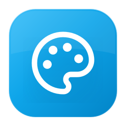
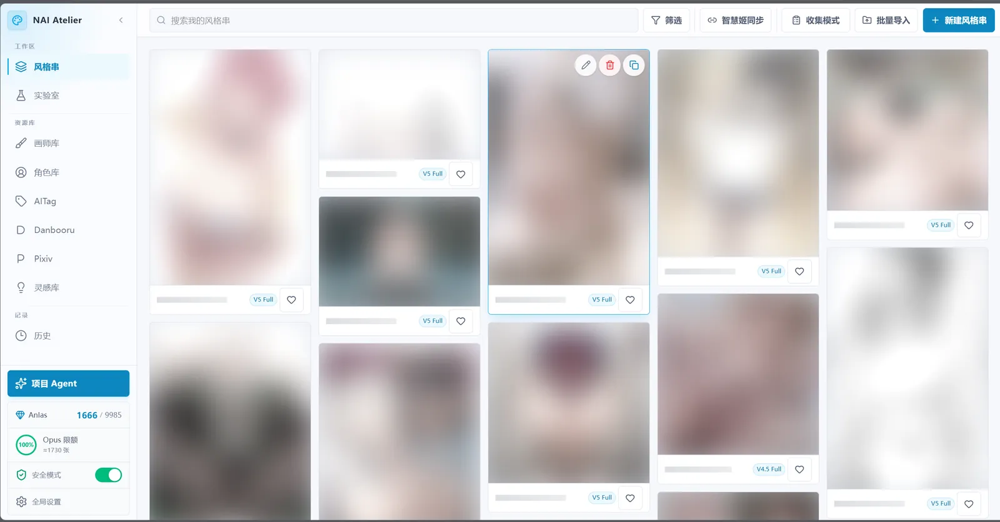
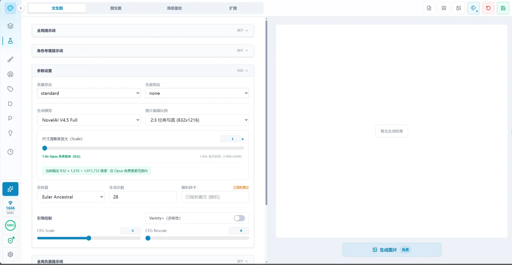
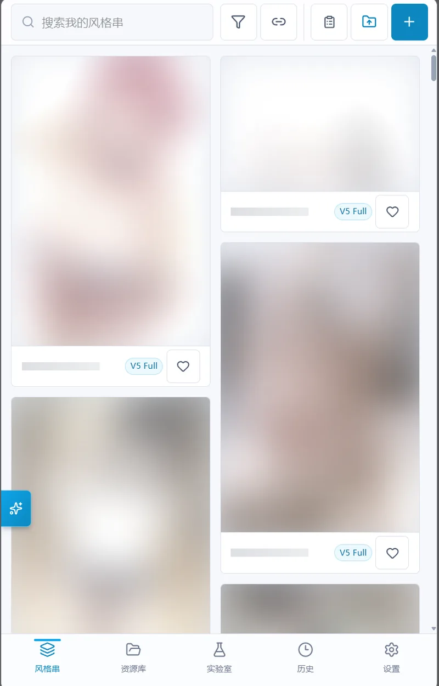

<div align="center">
  

  # NAI Atelier

  **A local personal creative workshop for NovelAI**

  **[简体中文](./README.md) · [繁體中文](./README.zh-TW.md) · [English](./README.en.md) · [日本語](./README.ja.md) · [한국어](./README.ko.md)**

  [Source version](./package.json) · [Releases](https://github.com/HelloQun54321/nai-atelier/releases) · [Changelog](./CHANGELOG.md) · [AGPL-3.0 License](./LICENSE)
</div>

---

## Overview

NAI Atelier is a local-first NovelAI creative workshop running on your Windows PC or Android phone, connecting the entire daily workflow: **discover references → compose prompts → generate with live preview → refine with inpaint/outpaint → save as reusable personal assets**.

Style chains, characters, prompt snippets, persistent Vibe encodings, collections, and lossless original history images stay on your own device. Everyday exploration defaults to **Opus** free-tier dimensions and step ranges, with clear up-front cost estimates and confirmation whenever **Anlas** would be spent. Built upon and independently maintained from [kirafishy/NaiPromptManager](https://github.com/kirafishy/NaiPromptManager).

## Screenshots

<div align="center">
  
  <p><em>Style chains and presets gallery (Safe Mode blur enabled for screenshots)</em></p>
  
  <p><em>Four-mode generation workbench</em></p>
  
  <p><em>Mobile touch interface over home Wi-Fi</em></p>
</div>

## Quick Start

| Edition | Requirements | How to start |
| --- | --- | --- |
| **Windows Installer** (Recommended) | Windows 10/11 x64 (no Node.js or Git needed) | Download `NAI-Atelier-Setup-*.exe` from [Releases](https://github.com/HelloQun54321/nai-atelier/releases) |
| **Source Deployment** | Node.js 22+ (24.x recommended), Git | Clone the repository and run the commands below |
| **Standalone Android APK** | Android 8.0+ (ARM64) | Install the APK; see the [Android guide (Chinese)](./docs/ANDROID_STANDALONE.md) |

### Windows Installer & Updates
1. Run the setup wizard and choose an installation folder (it checks for the Microsoft VC++ x64 runtime if missing).
2. Open **NAI Atelier**, add your NovelAI `pst-` key (or shared-gateway / pay-per-call key) under **Global Settings → NovelAI & Anlas**, and click **Update dictionary** under **Data & Maintenance → Tag completion dictionary**.
3. Closing the main window minimizes the app to the system tray so LAN access stays active; choose **Quit Atelier** from the tray menu to stop the backend completely. Check for and install updates anytime under **Data & Maintenance → App Updates**.

### Source Deployment
```bash
git clone https://github.com/HelloQun54321/nai-atelier.git
cd nai-atelier
npm ci
npm run dev:local
```
Once ready, open [http://localhost:3000](http://localhost:3000). To update a source checkout, stop the server and run `更新 NAI Atelier.bat` on Windows (or `sh scripts/update-local.sh` on macOS/Linux).

### Multi-Language & Mobile Access
- **Five UI Languages**: Switch instantly between Simplified Chinese, Traditional Chinese, English, Japanese, and Korean under **Appearance & Gallery → Language**. The built-in Creative Assistant replies in your chosen language while keeping English generation tags and asset names intact.
- **Phone over Home LAN**: Connect your phone to the same Wi-Fi, copy the LAN URL under **Data & Maintenance → LAN Access**, and enter the 4-digit PIN (requests route through the PC's network/proxy automatically; long-press cards to open the unified bottom action sheet).

## Key Features

- **Style Chains, `.naia` Bundles & Clipboard Collector**: Save complete style prompts, toggleable modules, multi-character setups, and sampling parameters. Organize with nested multi-folder trees, exchange `.naia` bundles (with visual preview picker and bundled Vibe/Precise References), find near-duplicate recipes locally via weighted artist/style similarity, and capture copied images, files, links, or prompt text automatically with the floating Windows Collector window.
- **Style Roll**: Draw random artist mixes from the full dictionary or selected local style chains with pinned tags, blocklists, favorite multipliers/guarantees, a 12-color weight proportion bar, and shared generation presets.
- **Four-Mode Generation Lab**: Unified workbench for **Text-to-Image, Image-to-Image, Inpainting (focused inpaint by default), and Outpainting (32px seam blending)**. Switch between full-text and categorized editing, clean/extract style prompts, proofread tags locally, position multiple characters on canvas, manage persistent Vibes & Precise References, and queue batches with live stage timers.
- **Prompt Library & Bilingual Tag Pills**: Customizable folder trees decoupled from 16 fixed semantic purpose tags, `@name` inline autocomplete, two-way projection with custom characters, AI snippet extraction/combination, bracket/numeric weight conversion, click-between insertion, double-click editing, and non-destructive tag muting/deletion.
- **Artist/Character Libraries, External Sources & Local WD Tagger**: Manage V4.5 and 7-part V5 artist sample packs (54,880 artists, per-card version toggle, in-place streaming sample generation) and folded character costume variants. Browse **AITag, Codex, Pixiv, Danbooru**, curate unified **Collections**, and run offline CPU **WD Tagger** inference (for private HTTPS reverse proxies, configure allowed origins in settings or via `PUT http://127.0.0.1:3000/api/lan/tagger-remote-access`).
- **Built-in Creative Assistant**: Connect 30+ LLM providers or custom endpoints to query/organize folders, edit prompts with per-session version history and red/green diff undo cards, silently fill missing Tag translations, manage queues, or run unattended Roll series under Read-Only / Standard / Full-Access permissions.
- **Multi-Key Vault, Key Pool & Liquid Glass Themes**: Manage official keys, `novelai-shared-gateway` member keys (streaming preview, personal quota ring, refill ETA), and pay-per-call relays; enable **Key Pool auto-rotation** (fill-ratio priority, zero-blocking start, background post-gen refresh, instant stop before spending Anlas). Includes Safe Mode blur, export metadata scrubbing, and **Cupertino Liquid Glass** themes with custom wallpapers.

## Local Data & Backups

| Edition | Data Directory | Backup Method |
| --- | --- | --- |
| **Windows Installer** | `%LOCALAPPDATA%\NAI Atelier\workspace\local-data` | One-click backup in **Data & Maintenance**, or quit from tray and copy `local-data` |
| **Source Deployment** | `<repo-root>/local-data/` | One-click backup in settings, or stop the server and copy `local-data/` |
| **Standalone Android** | Private app storage (separate from PC) | **Uninstalling deletes private app data** — export a password-encrypted `.naiatelier` backup first |

> ⚠️ Never modify `database_id`, `database_name`, or `bucket_name` in `wrangler.toml`; they locate your existing local SQLite/R2 storage.

## Ecosystem & Credits

- Includes a SillyTavern extension for two-way style chain, Vibe, and zero-copy history sync with [st-chatu8](https://github.com/damoshen123/st-chatu8), plus `st-chatu` shared public queue support.
- Built on [kirafishy/NaiPromptManager](https://github.com/kirafishy/NaiPromptManager) (MIT), with thanks to [@ffdkj](https://github.com/ffdkj), [@damoshen123/st-chatu8](https://github.com/damoshen123/st-chatu8), [@baibai-git/ST-BaiBai-Image](https://github.com/baibai-git/ST-BaiBai-Image), [@sdnwls/nai-style-lab](https://github.com/sdnwls/nai-style-lab), [@yexi-by/dsh-unrestricted](https://github.com/yexi-by/dsh-unrestricted), [@clanso](https://github.com/clanso), and [SmilingWolf WD Tagger](https://huggingface.co/SmilingWolf/wd-vit-tagger-v3).
