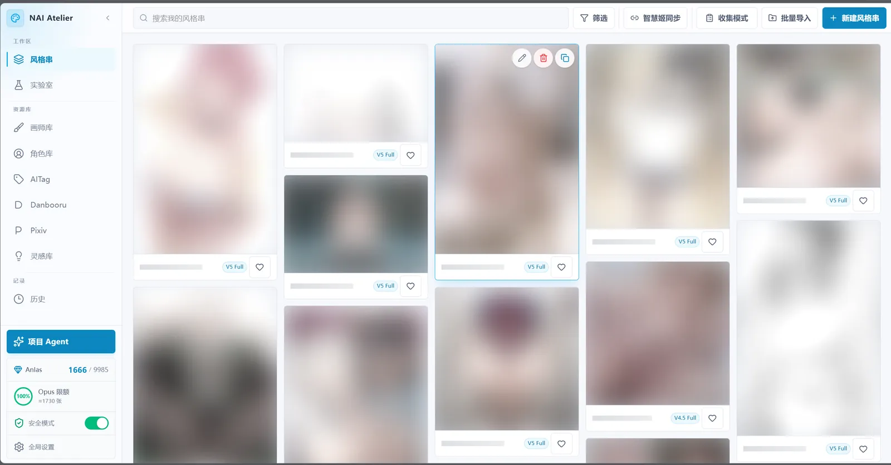
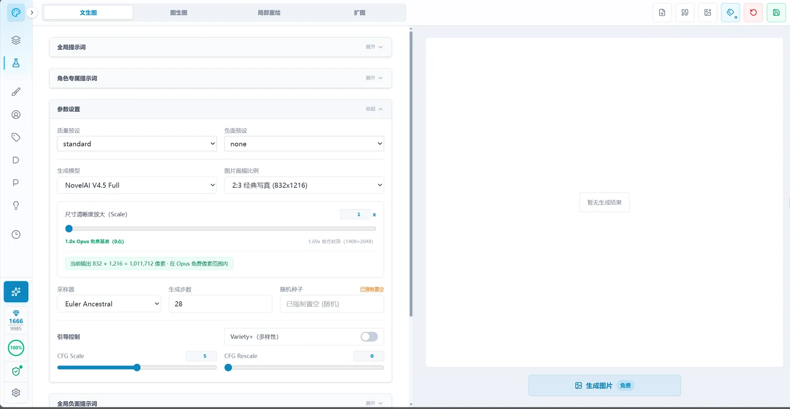
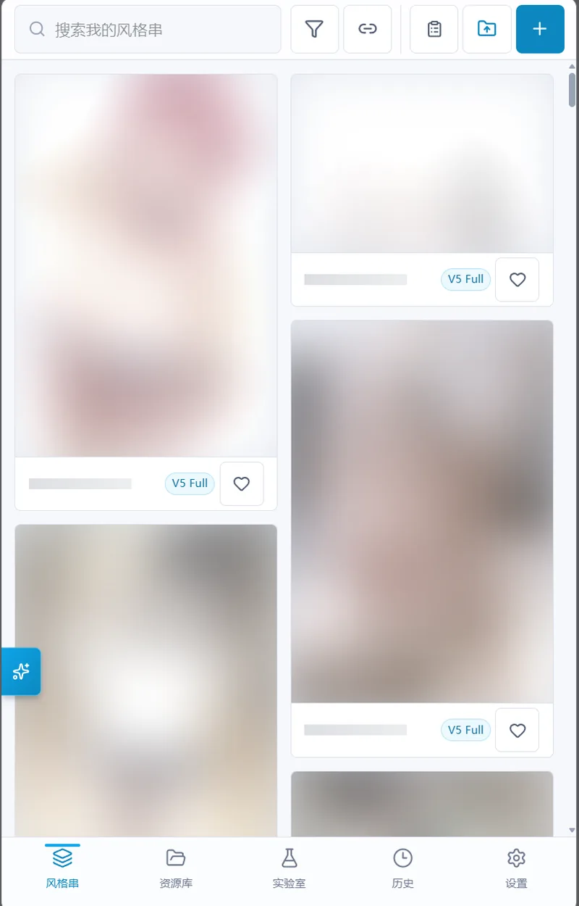

<div align="center">
  

  # NAI Atelier

  **NovelAI 向けローカル個人創作工房**

  **[简体中文](./README.md) · [繁體中文](./README.zh-TW.md) · [English](./README.en.md) · [日本語](./README.ja.md) · [한국어](./README.ko.md)**

  [ソースバージョン](./package.json) · [ダウンロード](https://github.com/HelloQun54321/nai-atelier/releases) · [更新履歴](./CHANGELOG.md) · [MIT ライセンス](./LICENSE)
</div>

---

## 概要

NAI Atelier は Windows パソコンまたは Android スマートフォンで動作する NovelAI 向けローカル創作工房です。「素材探し → プロンプト組み立て → ライブプレビュー付き生成 → 部分再描画・拡張で微調整 → 再利用可能な資産として保存」という日常の制作サイクルをひとつにつなぎます。

スタイルチェーン、キャラクター、プロンプト断片、永続 Vibe エンコード、コレクション、生成履歴の無劣化原画像はすべて手元の端末に保存されます。通常の探索は **Opus** の無料サイズ・ステップ範囲を基準とし、**Anlas** を消費する操作では事前に見積もりと確認を表示します。[kirafishy/NaiPromptManager](https://github.com/kirafishy/NaiPromptManager) をベースに独自開発・保守しています。

## スクリーンショット

<div align="center">
  
  <p><em>スタイルチェーンとプリセット管理（セーフモードのぼかし適用中）</em></p>
  
  <p><em>4モード生成ワークベンチ</em></p>
  
  <p><em>家庭内 Wi-Fi 経由のスマートフォン操作画面</em></p>
</div>

## クイックスタート

| 利用形態 | 動作要件 | 始め方 |
| --- | --- | --- |
| **Windows インストーラー版**（推奨） | Windows 10/11 x64（Node.js / Git 不要） | [Releases](https://github.com/HelloQun54321/nai-atelier/releases) から `NAI-Atelier-Setup-*.exe` をダウンロードして実行 |
| **ソースコード実行** | Node.js 22+（24.x 推奨）、Git | リポジトリをクローンして下記コマンドを実行 |
| **独立 Android APK** | Android 8.0+（ARM64） | ビルド済み APK をインストール（詳細は [Android ガイド](./docs/ANDROID_STANDALONE.md)） |

### Windows インストーラー版と更新
1. インストーラーを実行して保存先を選択します（Microsoft VC++ x64 ランタイムが未導入の場合は案内が表示されます）。
2. **NAI Atelier** を起動し、「**全体設定 → NovelAI と Anlas**」で公式 `pst-` Key（または共有ゲートウェイ／従量課金 Key）を追加し、「**データとメンテナンス → Tag 補完辞書**」で辞書を更新します。
3. ウィンドウを閉じるとシステムトレイに格納され LAN 接続が維持されます。完全に終了するにはトレイメニューの「**工房を終了**」を選択してください。「データとメンテナンス → アプリの更新」から新バージョンの確認・上書き更新が可能です。

### ソースコード実行
```bash
git clone https://github.com/HelloQun54321/nai-atelier.git
cd nai-atelier
npm ci
npm run dev:local
```
起動完了後、[http://localhost:3000](http://localhost:3000) を開きます。更新時はサーバーを停止し、`更新 NAI Atelier.bat`（macOS / Linux は `sh scripts/update-local.sh`）を実行してください。

### 多言語対応とスマートフォン連携
- **5言語切り替え**：「外観とギャラリー → 言語」から簡体字・繁体字・英語・日本語・韓国語へ即座に切り替え可能。内蔵「創作アシスタント」も選択言語で応答しつつ、英語の生成 Tag や資産名は原文を保ちます。
- **家庭内 LAN スマホ操作**：PC と同じ Wi-Fi に接続し、「データとメンテナンス → LAN アクセス」の URL と 4 桁 PIN を入力するだけで全機能をタッチ操作できます（PC 側の通信・プロキシをそのまま利用。カード長押しで下部アクションパネルを表示）。

## 主な機能

- **スタイルチェーン・共有パック・収集ウィンドウ**：画風プロンプト、モジュール、複数キャラクター、パラメータを一括保存。階層フォルダー整理、`.naia` 共有パック（画像プレビュー選択および Vibe・精密参照の同梱対応）、ローカル類似レシピ検出、コピーした画像・ファイル・URL・テキストを自動収録する Windows フローティング収集ウィンドウを搭載。
- **Style Roll（絵師ランダム抽選）**：全絵師辞書または選択したスタイルチェーンからランダムに組み合わせを抽選・生成。固定タグ、ブロック、お気に入り倍率・最低枠、12色ウェイト比率バー、画師ライブラリー共通プリセットに対応。
- **4モード生成ラボ**：**テキストから画像・画像から画像・部分再描画（フォーカス再描画既定オン）・拡張描画（32px 境界なじませ）**を統合。全文／カテゴリ別編集の切り替え、プロンプト整理・ローカル Tag 校正、複数キャラクター座標配置、永続 Vibe・精密参照管理、リアルタイム経過秒数とバッチ待機列を備えています。
- **プロンプトライブラリと二言語 Tag カプセル**：自由なフォルダー階層と 16 種の固定用途タグを分離管理。`@名前` 補完、カスタムキャラクターとの双方向連携、AI 抽出・組み合わせ生成に対応。括弧／数値ウェイト相互変換、隙間クリック挿入、ダブルクリック編集、非破壊の削除・ミュートモードを搭載。
- **絵師・キャラ辞書、外部ギャラリー、ローカル WD Tagger**：V4.5 および 7 分割 V5 絵師サンプルパック（54,880 名対応、カード別切替・その場でストリーミング補完生成）、衣装差分の折りたたみ表示に対応。**AITag・法典・Pixiv・Danbooru** と統合 **コレクション**、CPU で動作するオフライン **WD Tagger** 画像タグ推定を内蔵（私用 HTTPS リバースプロキシ利用時は設定画面または `/api/lan/tagger-remote-access` で許可オリジンを登録可能）。
- **内蔵「創作アシスタント」**：DeepSeek、OpenAI、Anthropic、Gemini など 30 社以上の API に接続。6 種のディレクトリ操作、会話ごとの履歴保護と赤緑差分カードによる安全なプロンプト編集、未登録 Tag の自動中国語訳補完、待機列制御や連続 Roll 実行に対応（読み取り専用／標準／フルアクセスの3段階権限）。
- **マルチ Key 保管庫・Key プール・Liquid Glass テーマ**：公式直結・共有ゲートウェイ（ストリーミング途中表示・個人枠リング・回復予測時間対応）・従量課金チャネルを管理し、満タン率優先で自動ローテーションする **Key プール**に対応。セーフモードぼかし、共有時メタデータ消去、**Cupertino Liquid Glass** テーマとカスタム壁紙を備えています。

## ローカルデータとバックアップ

| 利用形態 | データ保存先 | バックアップ方法 |
| --- | --- | --- |
| **Windows インストーラー版** | `%LOCALAPPDATA%\NAI Atelier\workspace\local-data` | 設定画面の「重要データのバックアップ」、またはトレイから終了後に `local-data` を丸ごとコピー |
| **ソースコード実行** | `<プロジェクトルート>/local-data/` | 設定画面の一括バックアップ、またはサーバー停止後に `local-data/` をコピー |
| **独立 Android** | アプリ専用領域（PC とは独立） | **アンインストールすると専用データが消去されます**。事前に設定画面からパスワード付き `.naiatelier` バックアップを書き出してください |

> ⚠️ `wrangler.toml` 内の `database_id`・`database_name`・`bucket_name` はローカル DB の識別キーです。変更すると空の新しい DB が読み込まれるため書き換えないでください。

## 連携と謝辞

- SillyTavern 拡張 [st-chatu8](https://github.com/damoshen123/st-chatu8) とのスタイルチェーン・Vibe・履歴ゼロコピー同期および `st-chatu` 共有待機列に対応（詳細は [ブリッジガイド](./docs/SILLYTAVERN_BRIDGE.md)）。
- [kirafishy/NaiPromptManager](https://github.com/kirafishy/NaiPromptManager)（MIT）、[@ffdkj](https://github.com/ffdkj)、[@damoshen123/st-chatu8](https://github.com/damoshen123/st-chatu8)、[@sdnwls/nai-style-lab](https://github.com/sdnwls/nai-style-lab)、[@yexi-by/dsh-unrestricted](https://github.com/yexi-by/dsh-unrestricted)、[@clanso](https://github.com/clanso)、[SmilingWolf WD Tagger](https://huggingface.co/SmilingWolf/wd-vit-tagger-v3) に感謝いたします。
