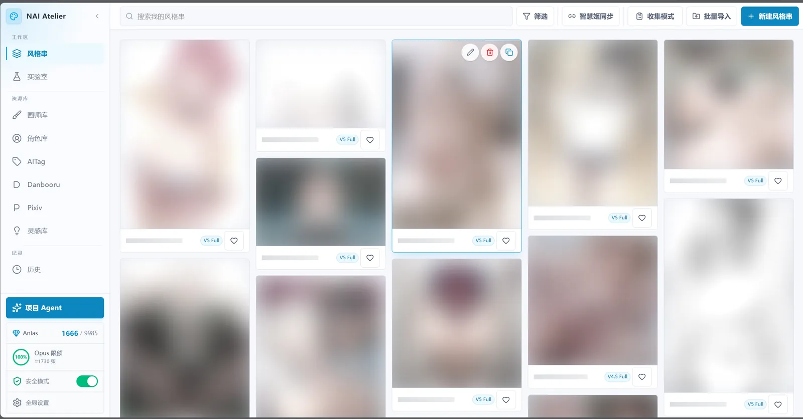
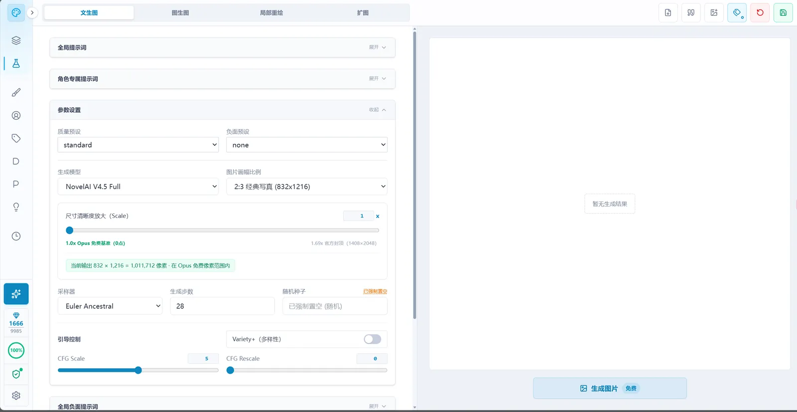
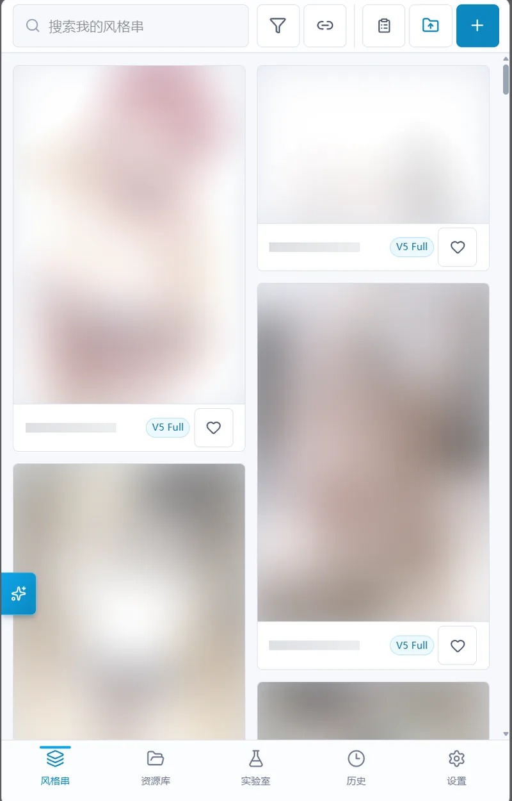

<div align="center">
  

  # NAI Atelier

  **NovelAI のための、個人用ローカル創作工房**

  **[简体中文](./README.md) · [繁體中文](./README.zh-TW.md) · [English](./README.en.md) · [日本語](./README.ja.md) · [한국어](./README.ko.md)**

  [ソースのバージョン](./package.json) · [ダウンロード](https://github.com/HelloQun54321/nai-atelier/releases) · [更新履歴](./CHANGELOG.md) · [MIT ライセンス](./LICENSE)
</div>

## プロジェクトについて

NAI Atelier は、Windows または Android で使う個人用の NovelAI 創作工房です。「参考を探す → プロンプトを組み立てる → 1 枚生成する → 観察して調整する → 再利用できる素材として保存する」という制作の流れをつなぎます。

スタイルチェーン、キャラクター、Vibe エンコード、コレクション、生成履歴の原画像は、自分の工房に保存されます。画像生成と AI アシスタントは、自分の認証情報でオンラインサービスに接続します。NovelAI の画像生成モデルを端末内で動かすアプリではありません。個人利用と、信頼できる家庭内 LAN を対象にしています。

本プロジェクトは [kirafishy/NaiPromptManager](https://github.com/kirafishy/NaiPromptManager) を基に独自開発・保守しています。

## 画面例

共通のスクリーンショットは簡体字中国語 UI で、画像の安全モードを有効にしています。レイアウトの参考として掲載しています。アプリは上記のほかの言語にも対応しています。

<div align="center">
  
  <p>スタイルチェーンと再利用できるプリセット</p>
  
  <p>4 つのモードを備えた画像生成ラボ</p>
  
  <p>スマートフォンのブラウザーから PC の工房に接続</p>
</div>

## はじめに

| 利用方法 | 必要な環境 | 開始方法 |
| --- | --- | --- |
| **Windows インストーラー版** — PC での日常利用に推奨 | Windows 10/11 x64。Node.js・Git は不要 | [Releases](https://github.com/HelloQun54321/nai-atelier/releases) から公開済みの `NAI-Atelier-Setup-*.exe` と `.sha256` を取得 |
| **ソースから起動** | Node.js 22+（24.x 推奨）、Git | リポジトリを clone して下記のコマンドを実行 |
| **独立 Android APK** | Android 8.0+、ARM64、更新された Android System WebView | 配布された APK または自分でビルドした APK をインストール。[Android ガイド](./docs/ANDROID_STANDALONE.md)を参照 |

ソースのバージョンと、公開ダウンロードのバージョンは異なる場合があります。ローカルでビルドしても、公開リリースやアプリ内更新は作成されません。ダウンロードできる版は Release の添付ファイルで確認してください。

### Windows

1. インストーラーを実行し、言語とプログラムの保存先を選びます。Microsoft Visual C++ x64 ランタイムの確認が行われます。不足している場合は案内に従ってランタイムをインストールし、工房のセットアップを再実行します。
2. デスクトップ、スタートメニュー、または保存先の `NAI Atelier.exe` から **NAI Atelier** を開きます。
3. 「**全体設定 → NovelAI と Anlas**」に自分の NovelAI `pst-` Key を追加し、その Key のローカル Anlas 予算を設定します。メンバーキーの場合は「キーを追加」で「画像生成ゲートウェイ」を選び、運営者のルート URL とメンバーキーを入力します。生成、メンバー残高、Vibe エンコードは同じ URL を使用します。Medium は変更せず送信するため、利用するゲートウェイ側の対応が必要です。ゲートウェイ生成にはライブプレビューがありません。公式キーに戻すと元の接続を使います。メンバー残高はローカル予算を上書きせず、公式料金の見積もりはゲートウェイの実際の課金額とは異なる場合があります。
4. 「**全体設定 → データとメンテナンス → Tag 補完辞書**」で「**辞書を更新**」を選びます。進捗、状態、タグ数と生成日時は、その設定行の下に表示されます。
5. 「**ラボ**」の「**テキストから画像**」でプロンプト、モデル、パラメータを設定し、表示される費用を確認して生成します。気に入った設定はスタイルチェーンとして保存できます。

Windows のウィンドウを閉じるとトレイに格納され、ローカルサービスは動作を続けます。停止するにはトレイまたはアプリのメニューで「**工房を終了**」を選びます。`Alt` でメニューを表示でき、データフォルダーや起動ログも開けます。詳しくは [Windows ガイド](./docs/WINDOWS_DESKTOP.md)を参照してください。

### ソースから起動

```bash
git clone https://github.com/HelloQun54321/nai-atelier.git
cd nai-atelier
npm ci
npm run dev:local
```

サービスの準備完了を待ってから [http://localhost:3000](http://localhost:3000) を開きます。依存関係のインストール時に Windows デスクトップのショートカットも作成されます。ソース版の完全起動は再ビルドし、このプロジェクトの既存サービスを再起動します。再実行前に進行中の作業を完了してください。

### UI とアシスタントの言語

「**全体設定 → 外観とギャラリー → 言語**」で簡体字中国語、繁体字中国語、英語、日本語、韓国語を選べます。UI はすぐに切り替わり、そのブラウザー／端末の選択が保存されます。Windows のタイトル、起動画面、メニュー、トレイ、収集ウィンドウも追従します。インストーラーも同じ 5 言語に対応します。

「**創作アシスタント**」は次のリクエストから、進捗や回答を含めて選択した言語を使用します。既存の会話、Prompt、Tag、独自の素材名、外部サイトの内容は原文を保ちます。制作物の言語を明示した場合は、その指定が会話の言語より優先されます。

UI の翻訳はアプリに含まれており、オンライン翻訳サービスは不要です。Tag 補完辞書は引き続き中国語・英語の対訳です。UI の言語変更で辞書は翻訳されません。

## スマートフォンで使う

### LAN 経由で PC に接続

スマートフォンと PC を同じ信頼できる Wi-Fi に接続し、「**全体設定 → データとメンテナンス → LAN アクセス**」に表示されるアドレスを開いて、4 桁の PIN を入力します。この方式のデータは PC の工房にあり、PC を動かしておく必要があります。通常のポートが使用中ならインストーラー版は別のポートを選びます。設定画面または今回の起動ログのアドレスを使ってください。

画像生成とゲートウェイ経由のリクエストは PC のネットワークを使用します。スマートフォンのブラウザーから直接開くサイトは、スマートフォン側の接続環境に依存します。家庭内 LAN 向けの機能であり、公開サーバーの構成ではありません。

タッチ操作では長押しで画像の操作を表示できます。大きな画像の閲覧、ピンチズーム、ダブルタップの拡大、パンに対応し、詳細画面を戻ると元の閲覧位置を保ちます。モバイルのラボは底画像・プロンプト・パラメータのタブに整理されています。

### 独立 Android

APK はスマートフォン上で独立した工房を動かします。4 モード、素材ライブラリー、アシスタント、任意のローカル Tag 推定を備え、スマートフォンのネットワーク、ストレージ、認証情報を使用します。PC の工房との自動統合・同期は行いません。

デスクトップ全体のクリップボード監視、PC のフォルダー、本機の SillyTavern ブリッジ、EXE 更新は PC 版の機能です。Android はシステムのファイル選択画面でエクスポートします。**Android のアンインストールはアプリ内の私有データを削除します。** 先に暗号化バックアップをエクスポートしてください。同じ署名でビルド番号が高い APK は上書き更新できます。[Android ガイド](./docs/ANDROID_STANDALONE.md)を参照してください。

## 創作ワークフロー

### スタイルチェーンと参照

- **スタイルチェーン**はプロンプトモジュール、ネガティブプロンプト、キャラクター、Seed、サンプリング設定、参照を保存します。キャラクターのプロンプトと構図位置は独立しており、位置指定はモデルの能力に従います。
- **今日の確認を記憶**：「今日は表示しない」を選んで明示的に確認すると、端末の当日中は同じ操作種別と範囲の選択を再利用します。削除・費用・移行は別々に記憶し、キャンセルでは保存しません。日付や Key・費用・保存先が変わると再確認します。「保存して移動」を記憶した場合も毎回実際に保存し、成功してから移動します。
- **移動前に保存**：スタイルチェーンやカスタムキャラクターに未保存の変更がある場合、「保存して移動」「破棄して移動」「編集を続ける」から選べます。保存に成功してから移動し、失敗時は編集中の内容を保持します。設定を完全にライブラリへ保存できない編集モードでは、編集を続けるか破棄する従来の二択を維持します。
- **カード操作**：スタイルチェーンとカスタムキャラクターのカード左上に赤い削除ボタン、右上に「お気に入り → 画像をダウンロード → 画像をコピー → 情報を編集」を縦に配置します。ハートは常時表示し、その他はマウス、キーボードフォーカス、スマートフォンの長押しで表示します。確認後に項目を削除し、参照が残っていないプレビューだけを整理します。既存の履歴とコレクションは保持します。表紙がない項目も削除・編集でき、キャラクター Tag 辞書の項目には削除ボタンを表示しません。
- **一括削除**：ツールバーの「複数選択」から現在の絞り込み結果を選択し、削除件数を確認します。操作は元のツールバー内で切り替わります。実際の一覧を更新した後、未削除の項目は選択を保持し、共用の表紙、履歴、コレクションの記録を残します。
- **スタイルチェーンのタグ管理**：絞り込みパネルの「カスタムタグ」見出し横にある「タグを管理」で検索、使用件数の確認、名前変更、統合、削除ができます。対象件数を確認した上で、現在の種類の全データの分類タグを更新し、プロンプト・パラメータ・画像・未検証状態を保持します。名前変更は選択中のタグ条件にも反映されます。新しい分類はカードの編集ボタンから追加します。
- **Windows の収集モード**はフローティングウィンドウを有効にした間、コピーした画像リンクを監視し、原画像を取得して埋め込み生成情報をプリセット化します。一時停止・再開・折りたたみ・進捗表示に対応し、作業中のアプリを中断しません。
- **Vibe Transfer**は対応モデルのスタイルエンコードをローカルに保存します。新規エンコードには Anlas が必要な場合があり、既存のものは再利用できます。対応モデルは最大 16 個の Vibe を使用でき、参照の追加費用は現在のルールから見積もります。
- **Precise Reference**は対応モデルでキャラクター／スタイル参照を提供します。V4／V4.5 の能力を V5 にそのまま適用せず、選択モデルと同期された能力に従って表示します。

### 画風ロール

PCの作業エリア、スマートフォンの「リソース」から開きます。「Rollを開始／もう一度Roll」で既存の絵師Tag辞書から組み合わせを抽選し、指定枚数を1枚ずつ生成します。記録名はツールバーに表示され、Roll ボタンは横スクロール領域の外に固定されて「枚数・人数・概算費用」を示します。隣のラウンド設定は「今回のみ」と「記録の既定」に分かれ、人数・枚数・重みの下限／上限・サンプル絞り込みを調整し、プロンプトと生成設定も開けます。重みの初期値は0.7～1.4で、0.1～3.0の範囲を0.1刻みで設定でき、上下限を同じにすると固定値になります。ラウンド開始または設定保存時に記録へ保存され、次回も使用します。固定した絵師は指定の重みを保ち、既存レシピは変わりません。別の絵師プールは不要です。料金確認・一時停止・キャンセルは既存の仕組みを使い、有料の自動再試行は行いません。

ラウンド設定では抽選方法も切り替えられます。全ランダム（既定）、絵師固定（先に固定画師を選び、以降は重みのみランダム）、重み固定（すべて同じ重み）です。固定画師の選択では、ランダム選択・選び直し・個別置換・個別に外す・もう1人追加・絵師ライブラリから追加・手入力ができます。カードには図包のサンプルが表示され、ない場合は明示されます。選んだ絵師は全体でブロックでき、直後に元へ戻せます。

サンプルのある絵師だけを抽選するスイッチもあり、明示的に固定・追加した絵師はそのまま残ります。設定は記録とラウンド条件に保存されます。各記録は最大240候補まで保持し、設定に残り容量を表示します。ゴミ箱のアーカイブ済み候補は確認後に完全削除でき、原画像と保存済みスタイルチェーンは残ります。

記録管理の「風格串から開始」（空の Roll ページからも可能）では、既存の風格串から新しい Roll 記録を作れます。共通プロンプトは元の画師部分を `{style}` に置き換え、ネガティブ・モデル・サイズ・パラメータ・構造化キャラクター・固定 Seed は保持します。画師は `artist:`／`Artists:` プレフィックスと詞庫内の裸の画師名の両方で認識し、古い串の不揃いな括弧・分组・残ったコロンは整理し、重みは 0.1 精度に丸め、32 ビットを超える Seed は下位 32 ビットを使い、モデル未記録時は既定モデルで続行します。解析できない画師 Tag はスキップして通知します。画師は固定グループとして元の重みをロックし、「元の重みを保持」をオフにするとすぐ再抽選できます。あとから「固定画師を選択」で個別置換でき、置換した位置の重みを引き継ぎ、他の画師の重みは変わりません。「画師の重みを再抽選」は固定グループのロックを外し、次のラウンドからランダムにします。元の風格串は変更せず、満足した結果は新しい風格串として保存できます。

工房共通のカード・画像レイアウト・外観設定を使い、自動配置は最大4列で大きく表示します。明示した列数設定は維持します。カードには番号・ラウンド・絵師の重みが表示されます。ホバー・キーボードフォーカス・長押しで保存、破棄、画像操作が現れ、ハートは共通のお気に入りです。カード詳細から完全なスタイルチェーンを保存したり実験室へ送れます。画像のない候補は生成後に保存してください。詳細には絵師サンプルのサムネイルがあり、絵師名から絵師ライブラリの検索を開けます。絵師ライブラリで複数選択した絵師は「Roll で固定」から新しい記録として固定できます。毎回のラウンドは絵師ライブラリから新しく抽選し、配合には絵師と重みだけを保存します。

絵師Tag・中国語名・`#番号` で検索し、フィルターで保存済み・生成待ち・ゴミ箱・ラウンドを選べます。「すべて」には生成待ちも含め、生成済みの数と混同しません。「残りを生成」は現在のラウンドの未生成の元配合だけを使います。過去の欠損画像は明示的に選択して生成できます。複数選択は元のツールバーを一括操作へ切り替え、途中失敗でも保存済みは残り、残りを再試行できます。連続生成がオフのときは、今回1枚だけ生成することを明示します。

記録選択の隣で名前変更、新規作成、風格串から開始、ゴミ箱への移動と復元ができます。破棄した配合・記録は復元でき、原画像と既存スタイルチェーンは保持します。ゴミ箱の候補は確認後に完全削除できます。詳細の「その他の操作」では画風のコピー、破棄、完全削除、「新しい記録 · 重みのみランダム」が使えます。画風比較、投票・ランキング、進化評価、自動重みテスト、Seed検証は提供しません。風格串からの再探索でもランキング・採点・一対比較は提供しません。旧比較記録はユーザーの指示で消去し、そのデータ構造の互換処理も削除しました。同時保存の競合は通知し、完全なバックアップには工房のバックアップを使います。[実装とデータの説明（中国語）](./docs/STYLE_ROLL.md)。


### ラボの 4 モード

- **このプロンプトを消去**：消しゴムは入力欄の外にある既存の操作エリアに配置します。全体プロンプトはコピーの隣、キャラクターの正プロンプトはカード上部、負プロンプトはその見出しの横です。その欄だけを消去し、同じ場所で「消去を元に戻す」を使えます。Tag 補助がオフでも Ctrl／Cmd+Z で取り消し、Ctrl+Y／Cmd+Shift+Z でやり直せます。4 モードとプリセットの全体／キャラクターの正負プロンプトで共通です。パラメータ、キャラクター項目、スタイルモジュールのスイッチは変更しません。
- **前回の生成設定を記憶**：生成設定とラボで切り替え、初期値はオンです。パラメータ、全体の正／負プロンプト、キャラクターの正／負プロンプトを個別に選択でき、初期状態では全選択です。再起動後は選択した部分だけを復元し、未選択部分は自由ラボの初期値または保存済みプリセットの元の設定を使います。現在の入力と同一セッションの下書きは保持し、主スイッチをオフにしても範囲選択は残ります。ブラウザー／アプリごと、各モードとプリセットごとに記憶し、復元した変更は手動保存が必要です。自由ラボの画像作業領域は再度開くと空になり、原画像と履歴は維持します。ブラウザーの下書きは D1／R2 バックアップに含まれません。
- **Key ごとの単一実行**：画面、ブラウザータブ、同じ工坊に接続するスマートフォンと Agent は一つの実行枠を共有します。使用中の通常要求は拒否され、「キューに追加」は固定設定を末尾へ、「次に実行」は現在の画像保存後に割り込み、完了後に元の残りへ戻ります。待機位置を確認でき、別端末からのキャンセルも正しく表示します。Key と独立工坊はそれぞれ分離します。
- **連続生成とキュー**：設定の「生成設定とラボ」で切り替えます。初期値はオンで、この端末に保存し、Key を変更しても変わりません。オフでは新しい生成と費用表示は1枚分になり、枚数・間隔・追加・割り込みの操作を隠し、この端末の Agent の複数枚／キュー要求も拒否します。送信済みタスクは継続し、一時停止・再開と待機タスクのキャンセルは可能です。再度オンにすると1枚から開始し、保存済み間隔や公共キュー／中継設定は維持します。未完了タスクがなければ主ボタンは「生成」のままです。
- **枚数指定とバックグラウンド生成**：4 モード共通の保存済み／総数の一時停止・再開と、生成／キュー追加ボタンを使い、矢印メニューで枚数と推定費用を確認します。承認後は実行端のバックエンドが生成・合成・履歴保存を担当し、LAN 接続のスマートフォン画面が停止しても PC は継続します。Android はタスク全体で前景サービスと CPU 保持を使います。前景へ戻ると実際の進捗を取得し、生成や保存を繰り返しません。準備中の一時停止も再開でき、費用増加は明示的な承認を待ち、手動停止を解除しません。生成・保存失敗では再試行せず、未保存画像はダウンロードでき、記帳・キュー解放の異常は別に通知します。終了・再読み込みは後続要求を停止して復元せず、電源断や強制終了の進行中画像は保証しません。Agent は要求数・保存数・履歴 ID を返します。
- **生成間隔**：生成ボタンの矢印メニューで直接入力、または加減ボタンで0.1秒ずつ変更できます（0.0～3600.0秒、初期値2.0秒）。各画像の保存後に待機して次の要求を送信し、最初の画像はすぐ開始します。一時停止中の経過時間も含みます。設定は Key ごとに保存し、待機・割り込みタスク、各画面、同じ工坊のスマートフォンと Agent がバックエンドの時計を共有します。0 秒は追加待機のみ無効にします。制限や失敗では停止し自動再試行しません。この初期値はプロジェクトの緩衝であり、公式の安全基準ではありません。

| モード | 主な動作 |
| --- | --- |
| **テキストから画像** | プロンプト、キャラクター、構図を試す。対応モデルでは透明背景を生成可能 |
| **画像から画像** | 底画像を変更しても現在のプロンプトとパラメータを維持。原画像の設定は必要に応じて明示的に読み込む |
| **部分再描画** | マスクを描く、または集中再描画で選択範囲を切り出して拡大生成し、原画像に合成する |
| **拡張描画** | 各方向にキャンバスを拡張し、境界の接合部分を再描画する |

「画像から画像」の出力は原寸、現在の無料ピクセル範囲までの縮小、カスタムサイズを選べます。送信用のコピーだけをリサイズし、原画像は保持します。集中再描画は切り出したリクエスト領域、拡張描画は完成後のキャンバスで費用を見積もります。無料のピクセル範囲内というだけで、ゼロ Anlas になるとは限りません。

推奨ステップと任意の無料ステップ制限を提供し、サイズ・ステップ・参照は利用者が選べます。対応モデルではストリーミングの途中画像を表示します。各モードの作業状態は別々に保持し、自由ラボを開き直すと文字・パラメータの下書きを復元します。画像の作業領域は空から始まります。

### 履歴・ライブラリー・共有

PC のサイドバーでは「素材を探す」に AITag、法典、Danbooru、Pixiv をまとめています。展開したサイドバー内でグループを開閉でき、状態はこのブラウザーに保存されます。グループを閉じても現在の参照先を表示します。アイコン表示時はクリックすると右側にメニューが開き、現在の参照先が強調されます。絵師・キャラクター・コレクションには引き続き直接アクセスでき、スマートフォンは従来の「リソース」パネルを使います。

- 生成履歴は原画像と実際の Prompt、Seed、パラメータをローカルに保存します。ラボに読み込んで再編集でき、大きな画像、お気に入り、ランダム順の閲覧も原画像を変えません。
- **創作の足跡**：PC はサイドバーの「記録 → 創作の足跡」、スマートフォンは履歴ツールバーから独立ページを開きます。期間は「週／月／年」で切り替え、初期表示は今年です。いずれもドロップダウンで具体的な期間を選びます。週は特定の週、月は年月、年は特定の年またはすべての年を選べ、未来の期間は表示しません。作品数、アクティブ日数、連続創作、お気に入り、よく使うスタイルチェーンと絵師、ヒートマップ、推移に連動します。キャラクターとよく使うタグ、Vibe アセット／エンコード、Roll の実験／候補／保存、お気に入りの出典とフォルダ、アシスタントのセッションとメッセージ、ローカル予算とコスト、失敗／キャンセル／ブロック（このバージョンから記録）、CSV 書き出しにも対応します。日付、スタイルチェーン、絵師、キャラクター、モデル、タグ、創作モードを選ぶと、その条件で履歴を開きます。ローカル集計のみを読み、チャット内容や完全な Prompt は読みません。アップロードも公式の枠消費の断定も行いません。
- **画師サンプルパッケージ**：設定 →「画師プレビューギャラリー」で V4.5（約 2.73 GB）と V5 Curated（約 1.03 GB）を管理します。各モデルのダウンロード／一時停止／再開と三点メニューを同じ行に配置します。ダウンロード中は実際の進捗を表示し、完了後は利用可能状態と件数を表示します。メニューには「ローカルファイルを使用」「索引を再作成」「関連付けを解除」があります。工房のネットワークとプロキシで取得し、検証後に自動で関連付けと索引作成を行います。既存ファイルは元の場所で読み取り専用のまま扱い、リソース保存先の変更にはパッケージ、途中ファイル、索引が含まれます。再起動後の再開は手動です。Windows で管理し、LAN 端末から閲覧できます。独立 Android のローカルパッケージは未対応です。画師ライブラリーは Tag 辞書、選択中の V4.5／V5 パッケージ、自作サンプルを使用します。旧保存 Artist レコードとブラウザーのお気に入り名簿は一覧やお気に入りフィルターに使わず、移行・削除せずそのまま保持します。履歴画像の参照保護は維持します。お気に入りは関連付け解除後も保持されます。画師サンプルのクリックは画師の選択だけを行い、拡大表示は開きません。画師ライブラリーとお気に入りの一覧／詳細プレビューには、確認できたパッケージの黒い余白だけを慎重に裁つ共通処理を使い、masonry は処理後の縦横比に従います。保存済みのお気に入りは自身の画像からプレビューを作るため、パッケージの関連付け解除後も利用できます。原画像の表示、ダウンロード／コピー、履歴、保存ファイルは変更しません。自作サンプルやパッケージ由来と確認できない画像には自動適用しません。
- **カード別のバージョンとサンプル追加**：カード左上のバージョンボタンで V4.5／V5 を直接切り替えます。上部ボタンは全カードを統一し、同じバージョンを再選択しても個別指定を解除します。検索と選択は維持します。画像なしのカードは表紙比率を保ち、固定の「サンプルを追加」ボタンを表示します。クリックすると現在の画師 Tag とバージョン用テンプレートで、カード内に1枚生成します。テンプレート未保存なら同じページで設定し、「保存してサンプルを生成」を選びます。上部の独立した画師ライブラリー設定ボタンは V4.5／V5 のテンプレートを保存するだけです。画像のあるカードにも小さなフローティング生成アイコンがあり、パッケージサンプルは「サンプルを生成」、自作サンプルは「サンプルを再生成」と表示します。ライブプレビューはモデル能力に応じて有効になり、ラボの全体プレビュー設定には左右されません。非対応モデルでは生成完了後に画像を表示します。バックエンドが先に履歴を保存し、その後冪等に自作サンプルへ追加します。新しいサンプルはカードに表示され、パッケージ画像や既存の自作サンプルは残ります。サンプルがあるカードで再生成すると今回のリクエストに新しいランダム Seed を使い、画像なしのカードの初回生成ではテンプレートの固定 Seed を使います。保存に失敗した場合は既存の履歴画像だけを再保存でき、生成をやり直して課金することはありません。既存の費用、Key、同一 Key の排他ルールを使い、原画像と履歴は変更しません。
- AITag は公開生成例とパラメータの索引、Pixiv はランキング・検索・作者作品、Danbooru は画像／Tag の参考を提供します。アーティストとキャラクターのライブラリーから素材を探して利用し、コレクションには自分で選んだ資料を保存します。
- AITag と Codex の詳細では、3 番目の紫色の「ベース画像として使用」ボタンから「画像から画像／部分再描画／拡張描画」を選べます。現在の画像を使用し、現在のプロンプトとパラメーターを保持して、自動生成は行いません。Codex の「その他の操作」は 4 番目に置き、ベース画像の選択肢を重複させません。狭い画面ではページ送りと操作ボタンのグループを別の行に配置できます。
- **コレクション**は保存した画像をフォルダーと再利用可能なタグで整理します。フォルダー・取得元・複数タグを組み合わせて絞り込めます。ツールバーの「複数選択」で一括選択に入り、「タグ管理」は絞り込みパネルのタグ見出しの横にあります。保存先は最近使用したフォルダーまたは「未整理」を選択できます。PC では単一・複数選択の画像をフォルダーへドラッグでき、タッチとキーボードでは移動操作を使えます。
- **以前のお気に入りとの互換性**：以前のスタイルチェーンとカスタムキャラクターのお気に入りは、現在の表紙を使ってコレクションに読み取り専用で表示します。表紙のハートと表紙がある項目の絞り込みは同じ画像状態を使います。表紙や対応項目がない古い印は保持し、同じ画像は重複させず、解除済みのお気に入りは復活させません。読み込み時に画像をコピーしたり元のプロンプトや履歴を変更したりせず、整理または解除したときだけ参照を保存します。未保存の互換参照は元のブラウザーにある古い印に依存します。
- **ローカル画像のインポート**：「コレクションに追加」で複数ファイルを選択するか、コレクション画面・PC のフォルダーへドロップします。候補を追加・除外し、共通のフォルダーとタグを指定できます。各画像のプロンプト・全パラメータ・キャラクターは個別に保持し、ない情報は補いません。プロンプトの入力は不要です。画像とファイル名から付けたタイトルを中心に表示し、「生成情報（任意）」は編集が必要なときだけ展開します。PNG／JPEG／WebP は各 12 MB まで。画像ごとに進捗と結果を表示し、再実行は未完了分だけを処理します。Web リンクやディレクトリには対応しません。
- 画像のダウンロード／コピーはホバー、キーボードフォーカス、タッチの長押しで表示します。「**全体設定 → プライバシーと共有 → 画像メタデータの削除**」で「**画像共有時に生成情報を除去**」を有効にすると、通常および隠しメタデータを処理します。既定は生成情報すべての削除です。「**プロンプトのみ**」では画像全体とキャラクターの正負プロンプトと隠しコピーを除去し、実際に記録された認識可能な生成パラメーターを保持します。欠けた値を既定値で補いません。原画像と履歴は保持され、失敗は通知します。「**カスタムテキスト**」は文字と絵文字に対応し、空欄なら選択した内容を除去、入力するとその後に共有 PNG の説明とプロンプト欄へ書き込みます。プロンプトのみの場合は実際のパラメーターも保持します。無効にしてもモードとテキストは保持されますが適用されません。セーフモードとは独立しています。ダウンロードしたファイルには出力メタデータが残りますが、画像のコピーやサイトでの再エンコードにより失われる場合があります。
- Tag 補完は中英検索と連続した重みグループに対応します。括弧／数値を選び、「重みを追加」で変換します。選択だけでは原文を変更しません。両方とも倍率を表示し、波括弧は1段ごとに ×1.05、角括弧は ÷1.05 で換算します。括弧は1段ずつ、数値は ±0.1、Shift で ±0.01 調整します。同じ倍率は同じ値、異なる倍率は「重みが異なる」と表示し、各グループを個別に増減します。表示の丸めで原文を自動変更しません。辞書・目録の規模はインストール済みのデータに依存します。AI 翻訳は設定した LLM とその課金ルールを使います。
- 既存の複数 Tag グループは、連続調整で重みなしを経由しても分割されません（`{a, b} → a, b → [a, b]`）。選択解除や原文編集で一時的なグループ範囲を解放します。
- 翻訳欄の末尾でも辞書補完を使え、候補は入力位置に表示されます。Enter またはフォーカスを移すと追加でき、Tag 領域の右下をドラッグして高さを調整できます。赤いごみ箱で削除モードに入り、重み表示と操作を隠してグループ内の Tag を個別に複数選択できます。赤くなった項目を確認して削除し、残りの重みは保ちます。回転矢印または Ctrl/Cmd+Z で元に戻し、Ctrl+Y または Ctrl/Cmd+Shift+Z でやり直せます。選択した Tag の原文をコピー／切り取り、貼り付けで追加でき、入力欄の標準ショートカットは維持します。
- WD ViT V3、WD SwinV2 V3、WD EVA02-Large V3 は明示的なモデルダウンロード後、ローカル CPU で Tag を推定します。「**全体設定 → 生成の設定とラボ**」で管理できます。Anlas を使わず、クラウド推論へのアップロードも不要ですが、処理速度とメモリー使用量はモデル・端末に依存します。

### 創作アシスタント

サイドバーまたはフローティングボタンから開きます。現在のページを把握し、ラボの下書き、素材、マスクや選択範囲を扱えます。PC 版は許可したローカル画像フォルダーを読み書き・エクスポートできます。Android のファイルツールはアプリ内の創作用ディレクトリに限定されます。

権限は「**読み取り専用**」「**標準**」「**フルアクセス**」の 3 段階です。生成・削除・消去は引き続き創作者の確認が必要です。既存の素材と後から行った手動編集を尊重します。モデル提供者と認証情報は NovelAI と別に設定し、利用料も提供者のルールに従います。

## 費用・Key・プライバシー

- **Anlas**、**Opus 枠**、**ローカル予算**、**公式残高**は異なる値です。予算と推定使用量は Key ごとに管理します。ローカル予算は公式残高でも、実際の請求額の保証でもありません。
- ゼロ Anlas の条件は有効なサブスクリプション、モデル、実際のサイズとステップ、残り Opus 枠、参照によって決まります。画像編集も条件を満たす場合があります。契約切れが Key の無効を意味するとは限らず、権限と使用可能残高は公式レスポンスで判断します。
- モデル能力、無料条件、費用係数は NovelAI の Web アプリから同期します。抽出に失敗すると最後の完全なルールを保持し、問題を示します。生成や新規エンコード前に費用を確認し、必要な場合は課金を承認してください。最終請求はサービス側で決まります。
- Opus の割合と推定残り枚数は同期した換算ルールを使います。推定値であり、固定枚数の保証ではありません。
- 複数の NovelAI Key に別名を付けられ、画面の Key はマスクされます。安全モードは画像をぼかします。外観は明暗、アクセント、密度、角丸、文字、ギャラリー配置を調整できます。
- **画像リストのレイアウト**では全体の既定値と各ギャラリーページを選べます。各ページは既定で全体設定に従い、オフにするとそのページのウォーターフォール／縦型／正方形とPC（1～7列）・スマートフォンの列数を個別に保存します。再びオンにすると全体設定に戻ります。閲覧履歴と絞り込み表示は元のギャラリー設定を使います。 ウォーターフォールの追加は既存列の実測高さを優先して短い列を埋め、画像の読み込みやサイドバーの幅変更で表示済みカードを移動しません。スタイルチェーン、画師ライブラリー、キャラクターライブラリー、コレクションで検索・絞り込み・並び順を変更すると先頭へ戻り、通常のデータ更新や詳細からの復帰では位置を保ちます。
- **st-chatu キュー**は Key の指紋で順番を調整し、生の Key、Prompt、画像を送信しません。**互換生成リレー**は生成を実行するため、現在の Key、プロンプト、必要な参照を受け取ります。第三者の課金には未対応で、公式費用の表示はリレーの料金ではありません。
- リレーの接続を取り消すとローカルの待機は止まりますが、遠隔の生成が止まるかはサービスによります。失敗時に有料リクエストを自動で再送したり、別の提供者へ切り替えたりしません。

## データとバックアップ

| 工房 | 永続的な創作データ |
| --- | --- |
| **Windows インストーラー版** | `%LOCALAPPDATA%\NAI Atelier\workspace\local-data` |
| **ソース版** | `<プロジェクトルート>/local-data/` |
| **独立 Android** | アプリ私有の SQLite と原画像ファイル。アプリの暗号化バックアップでエクスポート |

- **保存先の設定**：「全体設定 → データとメンテナンス → 保存先」で、工房データとキャッシュ／ダウンロード済みリソースの保存先を確認・変更できます。変更できるのは、その PC で実行中の Windows インストーラー版またはソース版だけです。LAN 接続のスマートフォンには PC のデータ保存先が表示されますが、変更はできません。Android の専用データ領域はシステムが管理します。移行ではデータをコピーして確認した後、新しい場所から再起動し、元のフォルダーを保持します。D1／R2 の保存識別子は変更しません。別の工房を開いてもデータは統合されません。キャッシュは独立した場所に設定するか、工房データに追従させることができ、切り替え時に既存のサムネイル、タグ推定モデル、辞書をコピーします。
- **エクスポート先**：同じ画面で「システム既定」（ブラウザー本来のダウンロード動作を維持）、「カスタムフォルダー」（選択した保存先を記憶）、「毎回確認」を選べます。画像とファイルのエクスポートは同じ保存先を使います。PC アシスタントで保存先を明示しない場合も、この設定を使用します。Android ではシステムが提供する共有エクスポート先を選択できます。ブラウザーの選択肢はダウンロード設定とフォルダー権限に応じます。
- **バックアップ先**：重要データのバックアップ先は引き続き手入力でき、この PC で保存先を管理できる場合は「フォルダーを参照」から選択することもできます。

Windows インストーラー版とソース版は別々の作業領域を使い、Android も独立しています。別の版で空の工房が開いても、元のデータが上書きされたという意味ではありません。Windows のプログラムとデータの保存先は別で、アンインストール時も個人データは既定で保持します。

PC では「**全体設定 → データとメンテナンス → 重要データのバックアップ → 完全バックアップを作成**」を使います。手動の場合は対象サービスを完全に停止し、`local-data/` 全体をコピーします。インストーラー版はウィンドウを閉じるだけでなく「**工房を終了**」で停止します。ブラウザーの未保存下書きは D1／R2 バックアップに含まれません。

`wrangler.toml` の D1 データベース名／ID、R2 bucket 名、binding を変更しないでください。既存ストレージの識別に使われるため、変えると新しい空のデータベースを読み込むことがあります。原画像と認証情報は `local-data`、サムネイルと Tag 推定モデルは再作成可能なキャッシュです。手動バックアップは保存領域全体をコピーしてください。

Android のアンインストール、リセット、端末変更前は、8 文字以上のパスワードを設定した暗号化 `.naiatelier` バックアップをエクスポートします。原画像、データベース、設定、Key、アシスタント／Pixiv の認証情報を含みます。キャッシュ・辞書・モデルは再ダウンロードでき、紛失したバックアップパスワードは復元できません。復元と空き容量の詳細は [Android ガイド](./docs/ANDROID_STANDALONE.md)を参照してください。

## 更新

- **Windows**：「**全体設定 → データとメンテナンス → アプリの更新**」で確認・ダウンロードし、「**再起動してインストール**」を選びます。対象は公開済みリリースだけです。起動時は静かに確認し、通常終了ではインストールしません。プレリリースの受信は既定で有効ですが、変更できます。生成、アシスタント、収集、バックアップ、辞書更新を終えてからインストールし、大きな変更前は完全バックアップを保管してください。
- **ソース**：作業を完了してサービスを止め、Windows ではリポジトリの `更新 NAI Atelier.bat`、macOS／Linux では `sh scripts/update-local.sh` を実行します。公開リリースに従い、独自ブランチ・fork・ローカル変更があると停止します。ZIP には Git の更新環境がありません。
- **Android**：同じ署名でビルド番号が高い互換 APK をインストールします。Android のビルド番号と PC／ソースの表示バージョンは別管理で、PC リリースだけで APK は再ビルド・公開されません。

## 連携と開発

SillyTavern コネクターは、選んだスタイルチェーン、Vibe エンコード、履歴の原画像を st-chatu8 と交換できます。[ブリッジガイド](./docs/SILLYTAVERN_BRIDGE.md)と[コネクター README](./sillytavern-extension/npm-bridge/README.md)を参照してください。

PC 版は React 19、TypeScript、Vite、Tailwind CSS、Node メディアゲートウェイ、ローカル Cloudflare Worker を使います。保存はローカル D1／SQLite と R2 互換オブジェクト、サムネイルは Sharp、Tag 推定は ONNX Runtime です。Android は共通モバイル UI とネイティブ SQLite、ファイル、ネットワーク、ONNX Runtime を使います。

| コマンド | 用途 |
| --- | --- |
| `npm run dev:local` | 完全なローカルソース工房を起動 |
| `npm run dev` | Vite フロントエンド開発サーバーを起動 |
| `npm run build` | フロントエンドと Worker をビルド |
| `npm run build:desktop` | 公開ソースから Windows インストーラーを作成 |
| `npm run build:android` | 署名付き ARM64 Android APK を作成 |
| `npm run update:tags` | 中英 Tag 辞書を更新・再構築 |
| `npm run test -- <パス>` | 対象を絞ったフロントエンドテスト |
| `npm run test:gateway` | ゲートウェイ、ブリッジ、ローカルバックエンドのテスト |
| `npm run test:live-sync` | 明示的に接続し、公式定数の抽出を検証 |

PC パッケージには Windows のビルド環境、Android には追加で JDK 21 と Android SDK が必要です。手順は [Windows](./docs/WINDOWS_DESKTOP.md) と [Android](./docs/ANDROID_STANDALONE.md) のガイドにあります。ビルドのみではアップロードしません。共同開発のルールは [AGENTS.md](./AGENTS.md)、製品の方針は [VIBER_INTENT.md](./VIBER_INTENT.md) にあります。

## 謝辞・関連文書

- 元プロジェクト：[kirafishy/NaiPromptManager](https://github.com/kirafishy/NaiPromptManager)、MIT。
- 中英 Tag データ：[ffdkj の Danbooru 翻訳表](https://github.com/ffdkj/ffdkj-Danbooru_Tag-Chinese-English-Translation-Table)。
- 連携と共有キューの参考：[damoshen123/st-chatu8](https://github.com/damoshen123/st-chatu8)。
- 画風ロールのフローとギャラリーの参考：[@sdnwls](https://github.com/sdnwls) / [nai-style-lab](https://github.com/sdnwls/nai-style-lab)。Atelier向けに独自実装し、コードや素材はコピーしていません。
- ローカル Tag 推定モデル：[SmilingWolf WD ViT Tagger V3](https://huggingface.co/SmilingWolf/wd-vit-tagger-v3)、Apache-2.0。

この README は日本語の利用ガイドです。[中国語の詳しい紹介](./README.md)、[製品の決定事項](./docs/PRODUCT_DECISIONS.md)、[技術文書](./docs/WINDOWS_DESKTOP.md)、[変更履歴](./CHANGELOG.md)、[作者の個人的な所感](./README.md#一点个人吐槽)は現在、簡体字中国語で保守しています。
