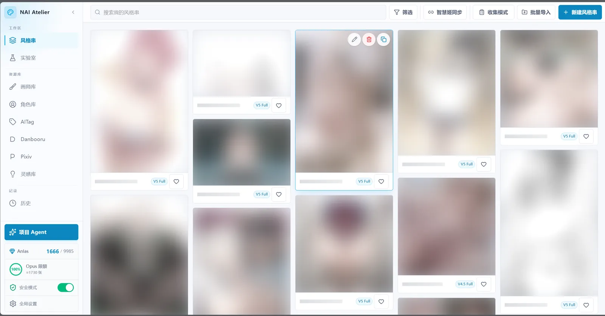
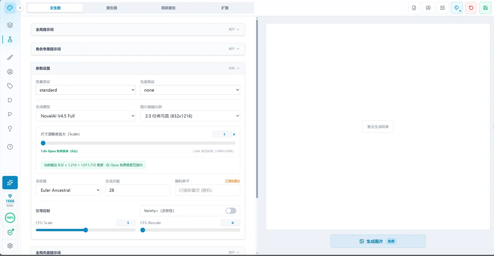
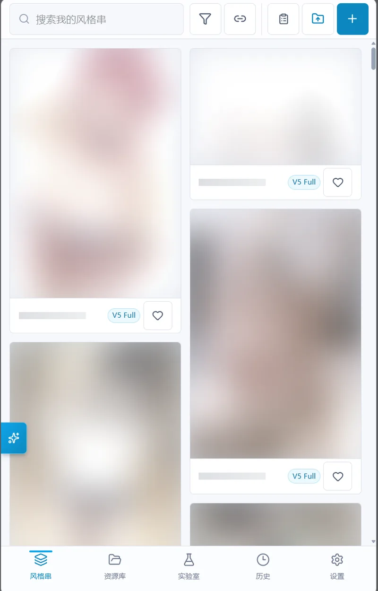

<div align="center">
  

  # NAI Atelier

  **NovelAI를 위한 로컬 개인 창작 공방**

  **[简体中文](./README.md) · [繁體中文](./README.zh-TW.md) · [English](./README.en.md) · [日本語](./README.ja.md) · [한국어](./README.ko.md)**

  [소스 버전](./package.json) · [설치판 다운로드](https://github.com/HelloQun54321/nai-atelier/releases) · [변경 기록](./CHANGELOG.md) · [MIT 라이선스](./LICENSE)
</div>

---

## 프로젝트 소개

NAI Atelier는 개인 PC(Windows) 또는 Android 스마트폰에서 실행되는 NovelAI 로컬 창작 공방으로, **레퍼런스 탐색 → 프롬프트 조합 → 실시간 미리보기 생성 → 인페인트/아웃페인트 다듬기 → 재사용 가능한 개인 자산으로 보관**하는 일상 작업 흐름을 하나로 연결합니다.

스타일 체인, 캐릭터, 프롬프트 조각, 영구 Vibe 인코딩, 컬렉션, 무손실 생성 이력 원본 이미지는 모두 사용자의 기기에 로컬로 저장됩니다. 기본 탐색은 **Opus** 무료 해상도·스텝 범위에 맞춰져 있으며, **Anlas**가 소모되는 작업은 사전에 예상 비용을 표시하고 확인을 받습니다. [kirafishy/NaiPromptManager](https://github.com/kirafishy/NaiPromptManager)를 기반으로 독립 개발·유지보수하고 있습니다.

## 화면 미리보기

<div align="center">
  
  <p><em>스타일 체인 및 프리셋 갤러리 (스크린샷 촬영을 위해 안전 모드 블러 켜짐)</em></p>
  
  <p><em>4모드 통합 생성 워크벤치</em></p>
  
  <p><em>가정용 Wi-Fi를 통한 스마트폰 터치 인터페이스</em></p>
</div>

## 빠른 시작

| 사용 방식 | 요구 사항 | 시작 방법 |
| --- | --- | --- |
| **Windows 설치판** (권장) | Windows 10/11 x64 (Node.js / Git 불필요) | [Releases](https://github.com/HelloQun54321/nai-atelier/releases)에서 `NAI-Atelier-Setup-*.exe` 다운로드 후 설치 |
| **소스 직접 실행** | Node.js 22+ (24.x 권장), Git | 저장소 클론 후 아래 명령 실행 |
| **독립 Android APK** | Android 8.0+ (ARM64) | 빌드된 APK 설치 ([Android 안내 문서](./docs/ANDROID_STANDALONE.md) 참고) |

### Windows 설치판 및 업데이트
1. 설치 마법사를 실행해 설치 폴더를 지정합니다(Microsoft VC++ x64 런타임이 없으면 안내에 따라 설치).
2. **NAI Atelier**를 열고 **전체 설정 → NovelAI 및 Anlas**에서 공식 `pst-` Key(또는 공유 게이트웨이 / 건당 과금 Key)를 등록한 뒤, **데이터 및 유지보수 → Tag 자동완성 사전**에서 사전을 업데이트합니다.
3. 창을 닫으면 트레이로 최소화되어 모바일 LAN 접속이 유지되며, 완전히 종료하려면 트레이 메뉴에서 **공방 종료**를 선택하세요. **데이터 및 유지보수 → 앱 업데이트**에서 새 버전을 확인하고 바로 덮어쓰기 업데이트할 수 있습니다.

### 소스 직접 실행
```bash
git clone https://github.com/HelloQun54321/nai-atelier.git
cd nai-atelier
npm ci
npm run dev:local
```
준비가 완료되면 브라우저에서 [http://localhost:3000](http://localhost:3000)을 엽니다. 업데이트할 때는 서버를 종료한 뒤 `更新 NAI Atelier.bat`(macOS / Linux는 `sh scripts/update-local.sh`)를 실행하세요.

### 다국어 및 모바일 LAN 연동
- **5개 국어 지원**: **외관 및 갤러리 → 언어**에서 간체·번체 중국어, 영어, 일본어, 한국어로 즉시 전환됩니다. 내장 창작 도우미도 선택한 언어로 대화하며 영어 생성 Tag와 자산 원본 이름은 그대로 보존합니다.
- **스마트폰 Wi-Fi 원격 조작**: PC와 같은 Wi-Fi에 연결한 뒤 **데이터 및 유지보수 → LAN 접속**의 주소와 4자리 PIN을 입력하면 스마트폰에서 모든 기능을 터치로 사용할 수 있습니다(PC 네트워크·프록시 자동 경유, 카드 길게 누르기로 하단 액션 시트 호출).

## 주요 기능

- **스타일 체인, `.naia` 공유 팩 및 클립보드 수집기**: 화풍 프롬프트, 모듈, 다중 캐릭터, 샘플링 매개변수를 한데 묶어 보관합니다. 다단계 폴더 트리 정리, `.naia` 공유 팩(커버 미리보기 선택 및 Vibe·정밀 참조 동봉 지원), 로컬 가중치 기반 유사 체인 찾기, 복사한 이미지·파일·링크·텍스트를 백그라운드에서 자동 수집하는 Windows 플로팅 수집 창을 지원합니다.
- **Style Roll (작가 조합 추첨)**: 전체 작가 사전 또는 선택한 로컬 스타일 체인 풀에서 무작위 작가 조합을 뽑아 생성합니다. 고정 태그, 차단 목록, 선호 배율·최소 보장 인원, 12색 가중치 비율 바 및 작가 라이브러리 공통 프리셋을 제공합니다.
- **4모드 통합 실험실**: **텍스트→이미지, 이미지→이미지, 부분 다시 그리기(포커스 인페인트 기본 활성), 확장 그리기(32px 경계 블렌딩)**를 한곳에서 다룹니다. 전문/분류 편집 전환, 프롬프트 정돈·로컬 Tag 교정, 다중 캐릭터 캔버스 배치, 영구 Vibe·정밀 참조 관리, 실시간 초시계와 대기열을 지원합니다.
- **프롬프트 라이브러리 및 이중 언어 Tag 캡슐**: 자유로운 폴더 트리와 16종 고정 용도 태그를 분리해 관리하며 `@이름` 자동 완성, 사용자 캐릭터 양방향 연동, AI 조각 추출·조합 생성을 지원합니다. 괄호/수치 가중치 변환, 빈틈 클릭 삽입, 더블클릭 편집 및 비파괴 삭제·음소거 모드를 제공합니다.
- **작가·캐릭터 사전, 외부 갤러리 및 로컬 WD Tagger**: V4.5 및 7분할 V5 작가 샘플 패키지(54,880명 지원, 카드별 버전 전환 및 제자리 스트리밍 샘플 생성)와 캐릭터 의상 변형 접기·연동 수집을 지원합니다. **AITag, 법전, Pixiv, Danbooru** 및 통합 **컬렉션**, 오프라인 CPU **WD Tagger** 역추론을 내장했습니다(개인용 HTTPS 리버스 프록시 사용 시 설정 화면 또는 `/api/lan/tagger-remote-access`로 허용 출처 등록 가능).
- **내장 창작 도우미**: DeepSeek, OpenAI, Anthropic, Gemini 등 30여 개 LLM API를 연결해 6대 디렉터리 관리, 세션별 버전 백업과 적녹 변경 비교 카드를 통한 안전한 프롬프트 수정, 미등록 Tag 자동 뜻풀이 보완, 대기열 제어 및 연속 Roll 자동 실행을 수행합니다(읽기 전용 / 표준 / 전체 접근 3단계 권한).
- **다중 Key 보관함, Key 풀 자동 순환 및 Liquid Glass 테마**: 공식 직결, 공유 게이트웨이(스트리밍 미리보기, 개인 할당량 링, 충전 예상 시간 지원), 건당 과금 채널을 지원하며 채움률 우선으로 무지연 순환하는 **Key 풀**을 제공합니다. 안전 모드 블러, 공유 이미지 메타데이터 세탁, **Cupertino Liquid Glass** 테마 및 사용자 배경화면을 지원합니다.

## 로컬 데이터 및 백업

| 실행 방식 | 데이터 경로 | 백업 방법 |
| --- | --- | --- |
| **Windows 설치판** | `%LOCALAPPDATA%\NAI Atelier\workspace\local-data` | 설정의 **중요 데이터 백업** 실행, 또는 트레이에서 공방 종료 후 `local-data` 전체 복사 |
| **소스 직접 실행** | `<프로젝트 루트>/local-data/` | 설정에서 원클릭 백업, 또는 서버 중지 후 `local-data/` 복사 |
| **독립 Android** | 앱 전용 비공개 저장소 (PC와 별도) | **앱 삭제 시 내부 데이터가 모두 지워집니다** — 삭제·기기 변경 전 비밀번호가 설정된 `.naiatelier` 암호화 백업을 내보내세요 |

> ⚠️ `wrangler.toml`의 `database_id`, `database_name`, `bucket_name`은 기존 로컬 데이터베이스를 찾는 식별자이므로 절대 수정하지 마세요.

## 생태계 연동 및 감사의 글

- SillyTavern 확장 [st-chatu8](https://github.com/damoshen123/st-chatu8)과의 스타일 체인·Vibe·이력 무복사 연동 및 `st-chatu` 공용 대기열을 지원합니다([브리지 안내](./docs/SILLYTAVERN_BRIDGE.md) 참고).
- [kirafishy/NaiPromptManager](https://github.com/kirafishy/NaiPromptManager)(MIT), [@ffdkj](https://github.com/ffdkj), [@damoshen123/st-chatu8](https://github.com/damoshen123/st-chatu8), [@sdnwls/nai-style-lab](https://github.com/sdnwls/nai-style-lab), [@yexi-by/dsh-unrestricted](https://github.com/yexi-by/dsh-unrestricted), [@clanso](https://github.com/clanso), [SmilingWolf WD Tagger](https://huggingface.co/SmilingWolf/wd-vit-tagger-v3) 프로젝트에 감사드립니다.
