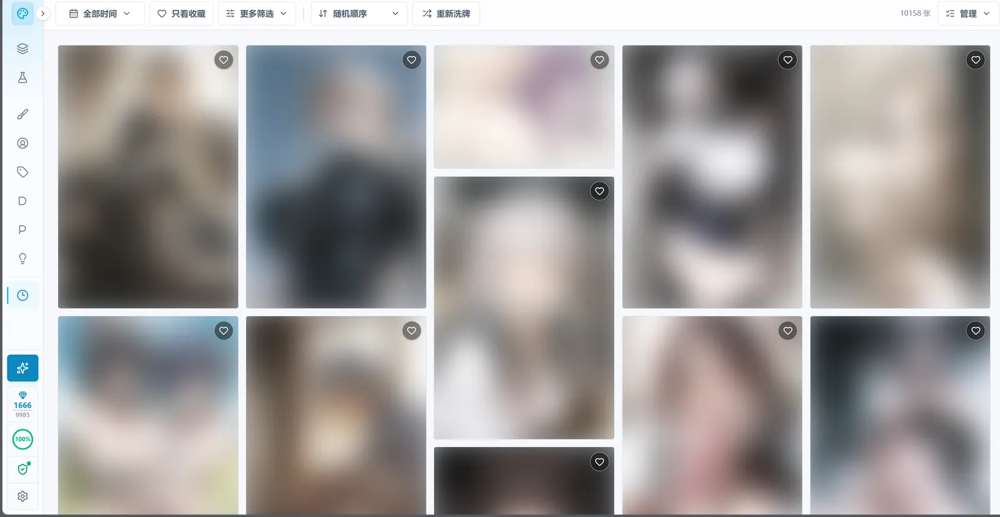
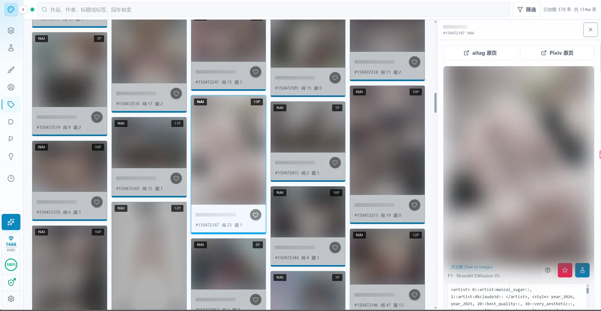
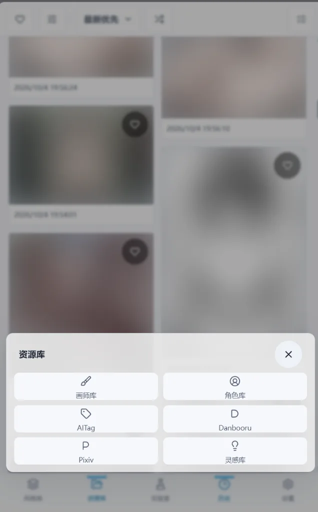
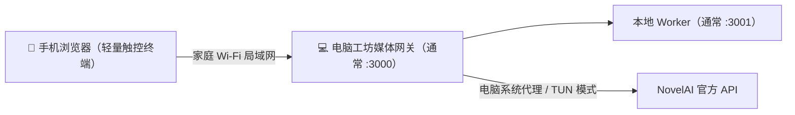
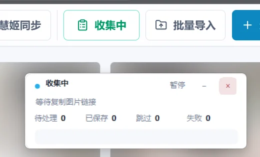
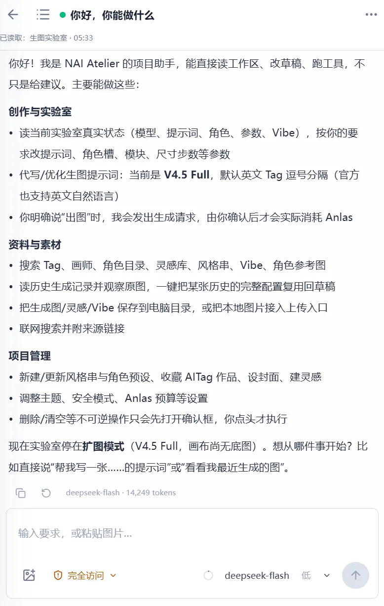
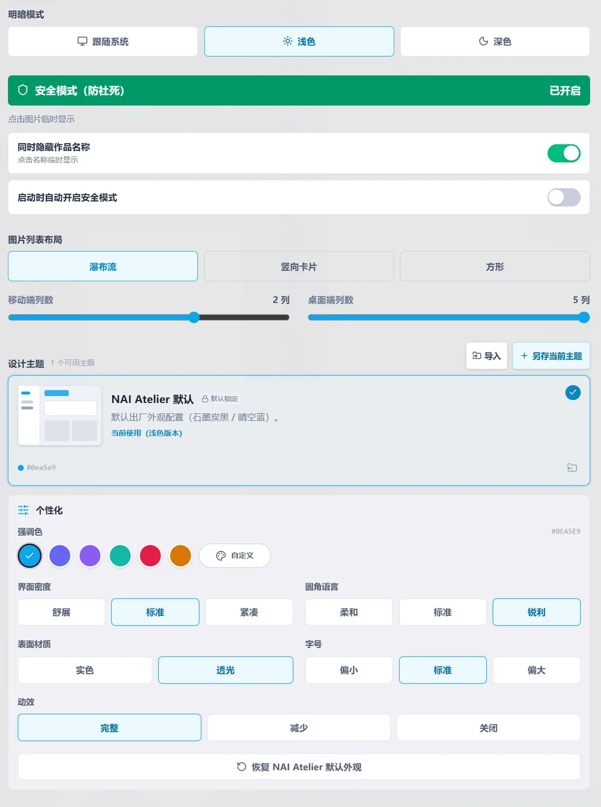
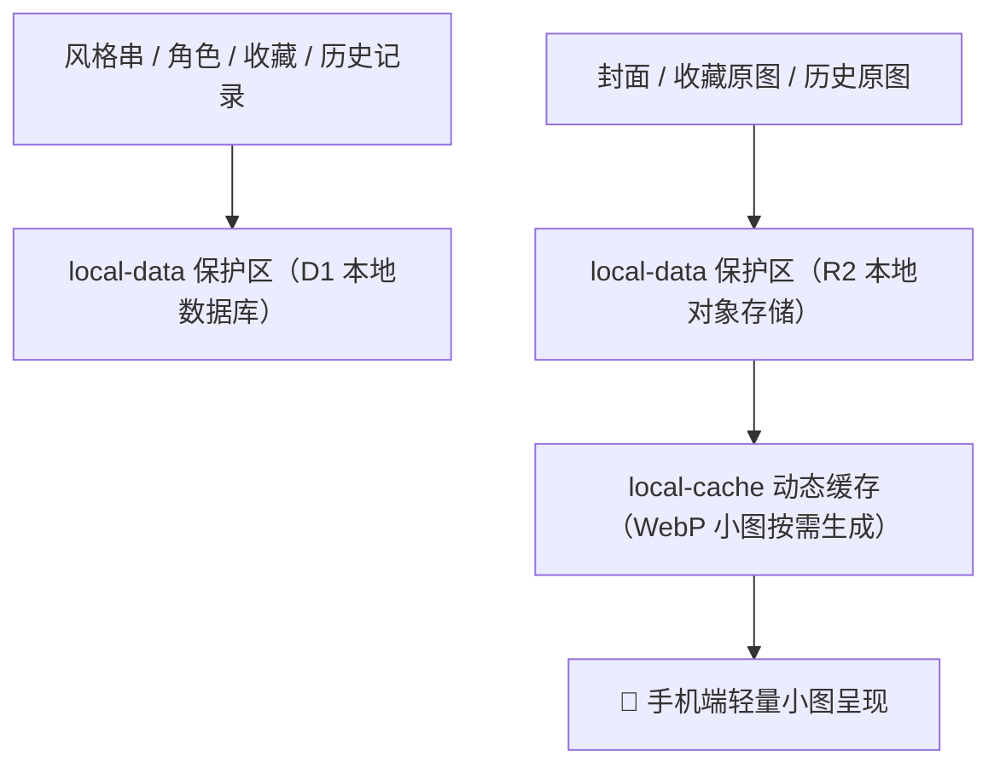

<div align="center">
  

  # NAI Atelier

  **面向 NovelAI 的个人本地创作工坊**

  **[简体中文](./README.md) · [繁體中文](./README.zh-TW.md) · [English](./README.en.md) · [日本語](./README.ja.md) · [한국어](./README.ko.md)**

  [](./CHANGELOG.md)
  [](https://novelai.net/)
  [](#-本地数据主权与备份)
  [](#-手机局域网创作体验)
  [](./LICENSE)

  [项目定位](#-项目定位) · [界面预览](#-界面预览) · [快速上手](#-快速上手) · [语言](#-界面与助手语言) · [手机创作](#-手机局域网创作体验) · [核心工作流](#-核心创作工作流) · [资源资料库](#-tag-与资源资料库) · [费用与隐私](#-费用密钥与安全守卫) · [数据主权](#-本地数据主权与备份) · [生态互通](#-生态互通与扩展st-chatu8-联动) · [技术架构](#-技术架构) · [更新日志](./CHANGELOG.md)

  > NAI Atelier 基于 [kirafishy/NaiPromptManager](https://github.com/kirafishy/NaiPromptManager) 二次开发并独立维护，面向本地单人创作；原项目见上方链接。
</div>

---

## 🧭 项目定位

NAI Atelier 是一套运行在个人电脑或 Android 手机上的 NovelAI 本地创作工坊。它围绕长期个人使用建立完整创作工作流：

> **寻找素材灵感 → 模块化组合 Prompt → 单张生成与流式反馈 → 局部加工与微调 → 沉淀为个人资产 → 随时在电脑与手机上继续创作。**

工坊以「生成一张 → 观察 → 微调 → 再生成」为默认心流节奏，帮助创作者保留判断与选择。常规探索优先使用官方免费面积与步数范围，复用已有 Vibe；需要消耗 Anlas 时先展示明确估算与二次确认。

| 核心创作体验 | 带来的便利 |
| :--- | :--- |
| 🎨 **完整创作闭环** | 从 Pixiv、Danbooru、AITag 找素材，组合提示词，生成或局部修补，将满意作品一键沉淀为个人资料库 |
| 📚 **个人资产持续复用** | 风格串、角色特征、Vibe 画风编码与历史原图保存在运行工坊的设备，创作配置持续积累 |
| 📱 **沙发/床上手机搓图** | 电脑充当本地工作站，手机连接家庭 Wi-Fi 即可全功能操控，触控优化、免配代理、4 位 PIN 轻量保护 |
| 🔋 **费用可见、过程可控** | 自动换算 Opus 电池剩余张数，自主设定本地点数预算，查看费用估算与付费确认，单张观察、拒绝盲目消耗 |

> [!IMPORTANT]
> **适用范围**：常规免费创作以 NovelAI 活跃 **Opus** 订阅为前提（非活跃 Opus 按付费档估算）。文档中的 **Anlas** 即官方代币（点数）；**Opus 限额** 即官方为 V5 模型引入的电池型免费生成配额。通用 NovelAI 兼容中转已接通普通／流式生图，第三方订阅、余额与额外计费规则尚未适配；界面沿用官方费用估算，不代表中转站实际收费。

---

## 🖼️ 界面预览

> 💡 **防窥保护提示**：为保护创作者隐私，预览截图均在开启全局安全模式（自动虚化作品与敏感占位符保护）状态下截取；点击预览图可查看高清原图。

### 🖥️ 桌面端：核心功能页面展示

<div align="center">
  <p><strong>🎨 风格串与创作预设资产库</strong></p>
  <a href="./docs/screenshots/desktop-presets-gallery.webp">
    
  </a>
  <p><em>自适应瀑布流、展开式侧栏、Opus 电池实时换算、智慧姬同步与收集模式</em></p>
</div>

<div align="center">
  <p><strong>🧪 生图实验室调参控制台</strong></p>
  <a href="./docs/screenshots/desktop-lab-workbench.webp">
    
  </a>
  <p><em>四大模式切换、官方免费尺寸与步数适配、引导控制与零点数安全指示</em></p>
</div>

<div align="center">
  <p><strong>🕘 本地原图生成历史画廊</strong></p>
  <a href="./docs/screenshots/desktop-history-gallery.webp">
    
  </a>
  <p><em>按可见范围加载本地作品、沉浸式大图浏览、收藏筛选与随机重新洗牌</em></p>
</div>

<div align="center">
  <p><strong>🗃️ 公网作品索引与参数参考（AITag）</strong></p>
  <a href="./docs/screenshots/desktop-aitag-browser.webp">
    
  </a>
  <p><em>精选生成案例检索、Prompt 与模型参数构成参考、一键载入工坊深入研究</em></p>
</div>

### 📱 手机端：家庭局域网移动端触控界面

<div align="center">
  <a href="./docs/screenshots/mobile-presets-gallery.webp">
    
  </a>
  &nbsp;&nbsp;&nbsp;&nbsp;
  <a href="./docs/screenshots/mobile-resources-modal.webp">
    
  </a>
  <p><em>44px 舒适触控、双列瀑布流、底部单手手势导航、全套资源库一触即达</em></p>
</div>

---

## 🚀 快速上手

工坊提供 **Windows EXE 安装版**、**源码本地部署** 与 **Android 独立 APK**：

| 使用方式 | 适合人群 | 运行准备 | 开启入口 |
| :--- | :--- | :--- | :--- |
| **EXE 安装版** | 普通使用者（推荐） | Windows 10/11 x64，无需配置 Node.js/Git | [下载已发布安装包](https://github.com/HelloQun54321/nai-atelier/releases)，双击安装向导 |
| **源码本地部署** | 开发者 / 自由定制者 | Node.js 22+ (推荐 24.x) 与 Git | 克隆仓库并执行本地启动命令 |
| **Android 独立 APK** | 希望手机独立创作的使用者 | Android 8.0+、64 位 ARM、手机自身网络 | 安装本地构建的 APK；使用和构建见 [Android 说明](./docs/ANDROID_STANDALONE.md) |

项目显示版本只随电脑端迭代，Android 适配通过独立安装构建号更新，同签名 APK 可直接覆盖安装并保留手机资料。手机图片长按显露下载／复制等原位操作，详情点按进入大图，支持双指缩放、双击放大／复原与放大后拖动。

### 方式一：Windows EXE 安装版（推荐）

1. 前往 **[GitHub Releases 下载页](https://github.com/HelloQun54321/nai-atelier/releases)**，选择最新正式发行的 `NAI-Atelier-Setup-*.exe` 安装包和对应 `.sha256` 文件；公开可下载版本以该页面附件为准，README 顶部版本徽章表示当前源码版本，本地构建不等于已经发布；
2. 双击运行安装程序，自主选择程序安装位置（首次运行会检查微软 VC++ x64 运行库）；
3. 安装完成后从桌面图标打开 **NAI Atelier**，按下方引导开启创作。

> 💡 个人数据保存在 `%LOCALAPPDATA%\NAI Atelier\workspace\local-data`，独立于程序安装目录，卸载时默认安全保留。详细说明见 [Windows 安装版文档](./docs/WINDOWS_DESKTOP.md)。

### 方式二：源码本地部署

```bash
git clone https://github.com/HelloQun54321/nai-atelier.git
cd nai-atelier
npm ci
npm run dev:local
```

安装依赖后，Windows 环境会自动在桌面生成晴空蓝调色盘图标的 `NAI Atelier` 快捷方式。等待终端显示服务就绪后，在浏览器打开 [http://localhost:3000](http://localhost:3000) 即可开始。

### 更新工坊

- **EXE 安装版**：在「全局设置 → 数据与维护 → 应用更新」检查并下载新版，再选择「重启并安装」。只检查 GitHub 已发布版本，尚未发布的本地构建不会出现在更新列表。启动时会安静检查，普通退出不会自动安装。安装前完成生成、助手、收集、备份与词库任务；个人数据保留，手机连接暂时中断。当前默认接收预发布，可关闭该选项。
- **源码本地部署**：完成任务并关闭源码服务窗口，双击项目根目录的 `更新 NAI Atelier.bat`。入口检查已发布版本、安装锁定依赖、构建并启动；本地修改、定制分支或分叉会停止更新。macOS／Linux 可运行 `sh scripts/update-local.sh`。ZIP 源码没有 Git 更新环境，需从下载页取得新版并按备份说明保留个人数据。
- **旧版首次升级**：没有更新入口的旧 EXE 需手动运行一次新版安装包；旧源码部署需先取得包含更新入口的新版代码。之后即可使用上述入口。主要版本或数据结构变化需要完整备份并按发行说明手动升级。

### 🎨 生成第一张图（5 步直达心流）

1. **添加 Key**：打开「全局设置 → NovelAI 与 Anlas」，添加自己的 `pst-` 密钥，设置该 Key 的 **Anlas 本地预算**；
2. **下载词库**：在「全局设置 → 数据与维护 → Tag 补全词库」点击「更新词库」，在该设置行下方查看下载、生成进度及词库数量／时间；电脑下载复用工坊检测到的出站代理，失败显示具体线路原因并保留现有词库；
3. **文生图测试**：进入「实验室 → 文生图」，输入提示词，选择模型、尺寸与步数，查看当前费用提示；免费资格取决于实际参数、订阅、Opus 额度和参考配置；
4. **生成与观察**：点击生成，实时观察渲染成图，确认无误后可一键将满意配置「保存为风格串」；
5. **开启局域网（可选）**：手机连接同一 Wi-Fi，在「全局设置 → 数据与维护 → 局域网访问」复制手机访问地址，输入 4 位密码继续创作；独立 Android 工坊直接使用手机网络。

### 🌐 界面与助手语言

在「全局设置 → 外观与画廊 → 语言」选择简体中文、繁體中文、English、日本語或 한국어，即时切换界面并记住选择。安装版的标题、启动页、菜单、托盘与收集悬浮窗也跟随；各浏览器／设备可独立选择。

创作助手从下一次请求起使用所选语言交流，已有聊天、创作 Prompt／Tag 和自定义资料名称保留原文，用户明确要求的创作产物语言优先。译文随应用提供，不依赖运行时在线翻译；Tag 补全词库仍为中英对照，界面语言切换不会改写词库或外站内容。README 顶部提供五种语言的使用说明，专项技术文档与变更日志目前以简中维护。

---

## 📱 手机局域网创作体验

随时随地窝在沙发或床上用手机搓图、挑图是最高频的心流体验。电脑负责充当本地工作站（运行服务、网关与存储核心），手机连上同一个家庭 Wi-Fi 即可全功能操控：



### 极简连接体验

- **生图请求复用电脑网络**：局域网模式的生成和网关代理请求由电脑发起，手机无需另配 NovelAI 代理；浏览器直接访问的外站仍取决于手机网络。安装版遇到端口冲突会另选端口，手机地址以设置页／本次启动日志为准；
- **轻量安全的 4 位 PIN 码**：局域网设备首次访问只需输入电脑终端/启动日志中打印的 4 位密码即可绑定（30 天内免重复输入），电脑本机免密访问；
- **单手触控心流适配**：
  - 核心操作区域满足至少 44×44px 舒适触控，避开全面屏防误触手势区；
  - 列表悬浮辅助按钮在触屏下采用**长按原位显露**，松手保留，不占用紧凑的看图视野；
  - AITag、Pixiv、Danbooru 的作品详情在手机上覆盖当前图库；页面返回与系统返回收起详情并继续原作品位置，多层窗口逐层返回，后台页面保留浏览状态；
  - 实验室四模式在电脑与手机端共用**三段式分区导航**：文生图为「全局／角色／参数」，图片编辑为「底图（画板／画布）／提示／参数」。电脑三分区紧贴主模式顶栏下沿，左右边缘分别对齐「文生图」与「扩图」按钮的选中块边界，三个按钮等宽，选中颜色与顶栏一致；右侧作品预览保留，各分区独立记住本次打开时的滚动位置。
  - 电脑开启 Agent 后，实验室与「试一试」优先保持编辑区、预览区并列，顶栏两排导航留在编辑列上方、操作区保留在右侧；中间可用宽度不足 560px 时，顶栏与预览同步切换为上下排列布局，窄栏内的参数与生成辅助操作自动收纳，各主题规则一致。
  - 所有主页面顶栏统一提供**可收起把手**：展开时把手位于顶栏上边中央、完全在顶栏内不跨界，描边胶囊内三角向上，悬停／键盘聚焦时显示「收起」，点击收起整条顶栏与状态行；收起后把手留在页面顶边并变为向下三角，提示「展开」。收起状态跨页面保留，刷新后沿用。

---

## 🧪 核心创作工作流

### 🎨 风格串：可复用的创作配方

风格串是工坊的核心预设载体：将一套经过实践验证的画风、角色特征、负面词与生成参数完整封存，随时一键调用或派生新作品。

- **模块化解耦分层**：全局提示词、可独立开关的风格模块与全局负面词清晰分层，避免反复手动拼词；
- **多角色独立图层**：每个角色拥有与全局等宽的独立正负面词输入框，「坐标」与「粘贴反推」以纯图标小按钮并入角色原有操作行；文生图与编辑模式均支持直观的 X/Y 构图定位（V4/V4.5 格点吸附，V5 自由定位）；
- **参数全套封存**：画面比例、尺寸、Steps、CFG、Variety+、采样器与 Seed 一并封存；
- **今日确认记忆**：确认框可勾选「今日内不再显示」，再明确确认后，当前设备当天复用该类型及范围的选择。各类删除、付费和迁移分别记住；取消不记，跨日或 Key／费用／目标等范围变化恢复提示。选择「保存并离开」后，之后仍会实际保存成功才离开。
- **离开前保存**：风格串或自定义角色有未保存修改时，可选择「保存并离开」「放弃并离开」或「继续编辑」。保存成功才跳转，失败保留草稿；目前无法完整入库的编辑模式仍只提供继续／放弃；
- **风格串批量删除**：从顶栏「多选」直接进入，在当前筛选结果中全选、反选或逐条勾选，再确认删除。操作栏在原顶栏切换，清空选择仍保留多选模式；处理结果按实际列表核对，未删除项保留选择。历史与收藏记录保留，仍被其他资料引用的封面不会清理。
- **风格串标签管理**：在「筛选 → 自定义标签」标题旁点击「管理标签」，搜索分类、查看使用条数、重命名、合并或移除。操作覆盖当前类型的全部资料，确认影响条数后只更新分类标签；提示词、参数、图片与待实测状态保留，重命名后同步已选标签筛选。新分类可从卡片铅笔中添加。
- **收集模式（Windows 置顶窗）**：从风格串顶栏开启后，小窗以等宽分段切换「风格串／收藏库／内容库」，切换模式保持卡片尺寸与控件位置。前两种模式接收「复制图片」和「复制图片链接」：「风格串」提取原图生成信息并保存完整配方，没有可识别信息时跳过；「收藏库」接收 PNG／JPEG／WebP，没有生成信息也可收藏，有信息则一并保留，默认进入未整理。相同原图重复收集不另存副本，已取消收藏的记录会恢复；切换只影响之后的复制，排队中的任务保持原去向。待处理、已保存、跳过、失败及结果详情按三种模式分别记录，切换时显示当前模式，排队与在途任务计入复制时的目标；重新开启收集时清零，不累计为历史总数。复制图片优先保留剪贴板 PNG，只有位图时转存 PNG；链接保留下载原图，每图最多 12 MB。在桌面或资源管理器中选中图片文件按 Ctrl+C 也可收集，支持一次复制多张 PNG／JPEG／WebP，并保留文件名和原文件内嵌信息；文件夹不会展开扫描，原文件不会被移动或修改。窗口可暂停、折叠，后台不抢焦点；NAI Atelier 默认明暗使用实色；半透明主题使用当前明暗版本的自选背景或配套壁纸，显示方式、背景强度、主题透明度、模糊、饱和度、边缘折射、圆角和高光均跟随现有设置。整窗共用一层玻璃，模式选中项为随主题参数变化的凸起玻璃滑块，其他按钮悬停时显露反光和亮边，不重复叠加模糊。图片适当压缩后只在内存中处理，不读取桌面；移除背景恢复画布色，文字对比不足时只给字串局部承托，不提高整面不透明度。采用单个 WPF 窗口，系统明暗切换原位生效，保持不抢焦点，重启后监听关闭。原生程序集按源码指纹缓存在资源缓存目录，工坊启动时仅后台准备，减少每次点击的重复编译；准备不打开窗口或监听剪贴板。
- **提示词随手收录**：先切换小窗到「内容库」，再在任意软件复制提示词，即自动按原文保存，不弹编辑／确认窗口。默认存入组合库，也可预先在「存入」中选择人物形象／服饰／姿势／表情状态／场景／镜头画面，后续复制直接进入对应条目库；名称取首行，空格、换行与权重逐字保留，命名和整理以后在内容库完成。连续复制依次保存，同次收集中相同原文与分类去重，失败可重新复制；切换分类不改变已入队文字的归属。图片模式不收文字，暂停不接收新复制但处理完已入队内容，继续只接收之后的新复制；不建立剪贴板历史。

<div align="center">
  <a href="./docs/screenshots/desktop-collection-float.webp">
    
  </a>
  <p><em>Windows 桌面置顶小窗：复制图片或图片直链，后台静默解析参数入库</em></p>
</div>

---

实验室开启「分类编辑」后，可从全局或某个角色点击「随机搭配」，逐类选择参与内容并预览后填入：全局入口写回人物、服饰、姿势、场景、镜头对应栏；角色入口只写打开时那个角色的形象、服饰、动作、表情栏。未选分类、空库、画师串与补充保持原样，不自动生图；填入可撤销。内容库的「Roll 组合」仍可自由选择范围和目标。

### 🎲 Roll 串：抽取组合

桌面从工作区打开「Roll 串」，手机从「资源库」进入。点击右上「开始 Roll／再 Roll 一轮」，直接从画师库的完整 Tag 词库抽组合并逐张出图；无需手填画师、先收藏或另建池子。记录名在顶栏直接可见，Roll 按钮固定在滚动区外并显示「张数 · 人数 · 预计费用」；按钮旁的「本轮设置」按「仅本轮」与「记录默认」分组调整张数、每串画师数、最低／最高权重和样张过滤，并进入提示词与生成设置。权重默认 0.7～1.4，可在 0.1～3.0 内按 0.1 调整，上下限相同即为固定权重；开始新一轮或保存配置后随记录保存，下次抽取继续使用，锁定画师仍使用指定权重，旧配方不变。每轮有限张数，付费时确认整轮总费用，可暂停或取消，不自动付费重试。

「本轮设置」还能切换抽取方式：全随机（默认）、固定画师（先选择固定画师，之后每轮只随机权重）、固定权重（所有权重取同一值）。选择固定画师时可随机选择、重新选择、逐位踢出与再加一位、从画师库添加或手动输入；卡片会显示图包样张，没有样张的画师会明确标注。选中的画师可加入全局屏蔽，被屏蔽的画师不会在任何记录里被抽到，也可在本轮设置或选择固定画师里随时取消；一键屏蔽后可立即撤销。

「本轮设置」里还有「只从有样张的画师中抽取」开关：开启后只从图包或自建样张存在的画师里抽，显式锁定／指定的画师仍会保留；开关随记录保存，也记在轮次条件里。每条记录最多保留 240 个候选，设置里显示剩余容量；回收站中的已归档候选可确认后永久清理，原图与已保存风格串仍保留。

记录管理的「从风格串开始」（空记录页也可直接进入）可以选择一条已有风格串新建 Roll 记录：公共提示词用 `{style}` 替换原画师段，负面、模型、尺寸、参数、结构化角色与固定 Seed 保留；画师默认作为固定画师组并锁定原权重，也可关闭「保留原权重」直接重 roll。画师识别同时接受 `artist:`／`Artists:` 前缀和词库中的裸画师名；旧串里不规范的括号、分组与残留冒号会清理，权重按 0.1 取整，超出 32 位的 Seed 取低 32 位，缺失模型按默认模型继续，无法解析的单个画师 Tag 跳过并提示。之后在「选择固定画师」里可逐位替换，替换会继承被替换位置的权重并同步更新记录，其他画师权重不变；「本轮设置」的「重 roll 画师权重」只解除固定画师锁定，下一轮起随机。源风格串不修改，满意结果仍保存为新的风格串。

图库沿用风格串等页面的卡片、图片布局和外观偏好，自动列数最多四列，图片随可用空间放大；明确设置列数时尊重全局偏好。候选卡片显示编号、所属轮次与画师权重；悬停、键盘聚焦或触屏长按卡片显露保存、丢弃和图片取用操作，爱心仍是全局图片收藏。点击图片看详情，可直接「存为风格串」或「送往实验室」；未出图的候选需先生成再保存。详情会显示画师样张缩略图，点画师名可带搜索跳到画师库；画师库多选后也可「在 Roll 中固定」，新建记录并预置固定画师。每轮按当前抽取方式重新抽取，候选只保留画师与权重，不记录来源、代数或对比结果。

搜索框按画师 Tag、中文名或 `#编号` 查找；「筛选」选择已保存、待生成、回收站及轮次，轮次下拉会显示当时的人数、权重与抽取方式，选中后可「沿用这轮条件」填回设置（不会自动提交）。全部视图如实包含待生成项，不再把配方总数当作成图数。中断一轮后，「补齐剩余」只提交本轮尚未生成的原配方；其他轮次缺图可选中后主动生成。进入多选，原工具栏切换为批量保存、丢弃／恢复、永久清理和选择操作；保存中断时已完成项保留，失败项仍可重试。关闭连续生成时，「补齐剩余／生成所选」会明确本次只生成 1 张。

记录下拉框旁的「管理记录」可重命名、新建、从风格串开始及移入／恢复回收站。丢弃结果或整条记录均可恢复，不删除原图或已经保存的风格串；回收站中的候选可确认后永久清理。详情「更多操作」提供复制画师串、丢弃、永久清理和「新建记录 · 只随机权重」。Roll 串只做抽取和出图，不提供画风对比、投票排名、进化评选、自动权重测试和换 Seed 验证；从风格串继续探索也不提供排名、评分或两两比较。

资料随本地工坊保存；并发保存冲突会提示重新加载，不覆盖新记录。旧对比记录已按用户决定清空，不再兼容其投票或验证结构。完整备份仍使用工坊备份。详见[实现与数据说明](./docs/STYLE_ROLL.md)。


### 🧪 生图实验室：四大创作模式

- **整段／分类编辑**：默认整段编辑，全局及每个结构化角色分别显示完整正负提示词，多角色与坐标照常可用。设置「生图偏好与实验室 → 提示词分类编辑」与实验室顶栏的「整段／分类」同步；窄栏和手机在「更多操作」中切换。分类编辑按「画师串、人物、服饰、姿势、场景、镜头、补充」全宽单列展示，角色另有形象、服饰、动作、表情，各框保留 Tag 辅助、复制、清空与撤销。仅切换不改内容，整段编辑后不会重复带回旧分类；分类文字跟随各自正负词记忆范围，独立于参数记忆。文生图、图生图、重绘与扩图共用。
- **导入后自动分类（可选）**：开启分类编辑后，可在同一设置中开启，默认关闭。之后导入 PNG／JSON、外部图库完整元数据或历史配置时，使用当前助手模型在后台整理未分类正词，完成后直接填栏并可撤销；已有分类直接恢复，只换底图不触发。仅发送提示词文本，不发送图片，不进入聊天记录，可能产生模型调用费用；原词、权重组、重复词、负面和生成参数保留，分类会按栏目重排正词。失败保留原文，不自动重试；等待期间的人工修改不会被迟到结果覆盖，结果可就地查看。
- **记住上次生图设置**：设置 →「生图偏好与实验室」，默认开启。可分别勾选参数设置、全局正向／负面、角色正向／负面提示词，默认全部保留，也可只记参数或某类提示词。跨重启仅记住所选部分；未选部分在自由实验室使用默认值，在已保存预设中使用原配置，当前输入与同次使用的完整草稿保留。关闭主开关不读取或更新跨重启记忆，并保留范围选择；各模式和各工作台独立，恢复的未保存修改仍需主动保存。记忆按当前浏览器／应用保存，自由实验室图片工作区复开留空，原图与历史不变；浏览器草稿不包含在 D1／R2 备份内。
- **强制置空种子**：随机种子标题右侧可直接切换「强制置空 ON/OFF」，与设置中的强制随机偏好同步保存。ON 时输入框置空并禁用，OFF 时显示原种子并可编辑；切换保留各模式草稿及预设里的原值，四模式与风格串／自定义角色工作台共用。
- **就地清空提示词**：橡皮擦位于框外已有操作区，全局提示词与复制并排，角色正向词放在卡片顶栏、负面词放在对应标题行；只清当前文本，清空后原位提供撤销。关闭 Tag 辅助也可用 Ctrl／Cmd+Z 撤销清空，Ctrl+Y／Cmd+Shift+Z 重做。四模式的全局及角色正负词共用，不改变参数、角色条目或风格模块开关。
- **同 Key 单并发**：所有页面、浏览器标签页、连接同一电脑工坊的手机及 Agent 共用后端限制。忙碌时普通请求明确拒绝；允许连续生成与排队时，仍有未完成任务才将主按钮变为「加入队列」，空闲保持普通「生成」，不把暂停标记、已完成进度或画布未就绪当作占用。箭头菜单可「排到下一位」、查看位置或取消等待项。插队等当前图片保存后执行，再继续原任务余量，普通追加排在队尾。跨端取消准确显示已取消，不同 Key 独立，独立工坊之间不协调。
- **连续生成与排队开关**：设置 →「生图偏好与实验室」可关闭，默认开启，按本端保存且不随 Key 切换。关闭后新生成固定单张，费用按单张显示，隐藏张数、间隔及追加／插队选项，普通单张生成保留主按钮及已勾选公共排队的状态入口，不显示暂停按钮或 `0/1` 等队列计数；主按钮恢复原来的图片图标与留白，桌面以 320px 宽、至少 44px 高为基准，空间不足时收缩，手机保持紧凑胶囊入口，两种模式和费用显隐不改变尺寸基准。执行时显示流动渐变与光点，暂停、排队等待及费用待确认停止；开启连续生成时，特效不影响加入队列与插队。本端 Agent 同样不能请求多张或排队。已提交任务不取消，只有旧队列还有后续图片或等待项才保留必要管理，已有暂停状态仍可继续；任务结束后恢复纯单张界面。重新开启从 1 张开始，保留已保存间隔，不影响公共队列／中转设置。
- **指定张数与后台生成**：四模式共用整队「已保存／总张数」暂停／继续按钮，以及当前批次张数和费用的生成按钮。确认后由运行设备后台持有固定配置并逐张生成、回贴和保存；手机局域网页面冻结不影响电脑执行，APK 使用任务全程前台服务与 CPU 保活。回前台补查进度和最新结果，页面不重复生图或入库。暂停先保存当前图片；准备阶段可正常继续，不再卡「暂停中」。费用上涨等待确认剩余消耗，完全访问的 Agent 任务沿用已有费用授权；均不自动解除用户暂停；换 Key、额度核实或生成／保存失败停止，不自动重试。已生成但未保存的图片仍可下载，记账与公共队列清理异常单独提示。关闭／刷新发起页停止后续，不恢复任务；断电或系统强杀不保证在途结果。Agent 回传请求数、实际保存数和历史 ID。
- **请求间隔**：生成箭头菜单的「生成间隔」默认 2.0 秒，可直接输入或用加减按钮每次调整 0.1 秒，范围 0.0～3600.0 秒；每张保存后等待再发送下一次请求，第一张不延迟，暂停期间经过的时间计入间隔。设置按 Key 保存，排队、插队、各页面、同一工坊的手机和 Agent 共用后端计时，0 秒只关闭额外等待。官方限流或失败仍停止，不自动重试；此默认缓冲不属于官方安全阈值。

实验室是实际调参生图的主控台，支持四大创作模式，通过 NovelAI 或自行配置的兼容中转获得生成结果：

#### 1. 文生图（Text to Image）：构图与参数探索
- **多角色独立控制**：各角色拥有专属提示词与画面占比，可直接从角色库导入；
- **透明通道生成**：在支持该能力的模型（如 V5）下一键开启透明背景生成，适配立绘、表情包与贴纸制作；
- **推荐参数与免费步数锁**：按模型提供推荐步数，可在生图偏好中启用或关闭免费步数锁；尺寸、步数与参考仍由创作者决定，最终费用按当前同步规则和实际请求估算，默认参数不保证每次都零 Anlas。
- **V5 Full 生成档位**：模型下方选择 High／Medium，默认 High。Medium 固定 14 步、Euler Ancestral 和 heavy 负面预设，相关控件及不支持的全局／角色负面词、CFG Rescale 灰白禁用；CFG、尺寸、种子和正向词可调整。四模式共用，切回 High 恢复原设置和负面词；历史记录实际生成参数，费用依官方动态规则估算。

- **生成过程预览**：开启后，四模式在电脑、局域网手机和独立 Android 逐步显示收到的实时预览与采样步数，相同图片也更新步数。生成、回贴与历史保存仍由后台负责；预览断线只重连观察，回前台补查最新进度与结果，不重新生图。成员网关及不支持流式的模型仍按其原有能力返回最终图。

#### 2. 图生图（Image to Image）：底图继承与变化
- **底图与提示词独立**：上传、拖入图片、点击「文生图最新」或通过 `Ctrl+V`／「粘贴」换底图，保留图生图当前的提示词、负面词、角色配置与参数；
- **输出尺寸自主选择**：在「参数设置 → 输出尺寸」选择保留底图尺寸、等比缩至当前官方免费像素范围或自定义宽高；手机在「参数」页签。默认保留原尺寸，选择随草稿恢复，宽高按接口要求为 64 的倍数。提交时只缩放副本，完整保留画面、比例不同处填白，角色定位同步转换，原图及当前草稿不变；费用提示与历史均使用实际输出尺寸。免费像素范围不代表必然零 Anlas，仍取决于步数、订阅／Opus 额度和参考配置；
- **主动复用原图配置**：需要原图提示词与参数时，使用顶栏「导入图片或 JSON 配置」，或在历史详情通过「导入到实验室」完整载入；
- **SSE 流式过程图即时预览**：接入流式生图端点，生图过程中实时查看画面演变走向，提前预判效果。

#### 3. 局部重绘：涂抹修补与聚焦放大
- **顺滑涂抹画板**：聚焦与普通重绘均可在画板下方通过滑条或数值调节画笔／橡皮擦大小，配备多级撤销/重做栈，涂抹待修改区域；
- **默认聚焦重绘**：先框选区域，再按需涂抹蒙版，局部裁切放大生成后羽化回贴，适合面部精修与手指细节修补；符合 Opus 条件时零 Anlas，V5 仍消耗 Opus 额度。可手动关闭以使用普通重绘，已有草稿／历史保留原选择；
- **空蒙版防跑拦截**：普通重绘未涂抹蒙版、聚焦重绘未框选区域时阻止生成；聚焦选区内没有笔迹时重绘整个有效选区。

#### 4. 扩图（Outpainting）：无缝延展画面边界
- **四向自由扩展**：自由设定上下左右扩展像素，基于原图自动重建画布；
- **32px 智能接缝过渡**：向原图边缘自动重绘 32 像素接缝，极大消除新增画面与原图之间的生硬分界。

---

### 🕘 生成历史与资产沉淀

- **无损原图与参数本地落盘**：每次生成的原图与全套 Prompt、Seed、采样参数即时保存入本地 D1 数据库与 R2 存储，清空浏览器缓存绝不丢失；
- **连续沉浸式翻阅**：支持大图上一张/下一张连续浏览、键盘方向键切换与 100% 原始尺寸像素级查验；
- **一键回填与微调**：大图详情直接提供「导入到实验室」，可指定送往文生图、图生图或局部重绘继续加工；
- **统一图片取用**：AITag、Pixiv、Danbooru、画师库、角色库、收藏库与风格串封面都可直接下载、复制图片；卡片、详情和大图统一在图片区右上按「收藏 → 下载 → 复制」竖排，收藏爱心常驻，其余操作桌面悬停／键盘聚焦或触屏长按显露。风格串与自定义角色卡片在同列最下方放透明铅笔编辑，风格串卡片铅笔上方另有烧瓶按钮，一键把整串提示词、模块、角色与生成参数送入实验室且原串不变，自定义角色列表不提供该入口；收藏统一使用共用爱心并汇入收藏库，无封面仍可编辑；移除白色按钮组和独立风格串内容复制弹窗，通过复制图片携带其中的创作信息。外站作品卡片取首图，详情按对应图片／当前页取用，目录翻图后取当前显示的图片；Tag 与角色提示词复制保持各自入口。
- **创作足迹与全域使用记录**：桌面从侧栏「记录 → 创作足迹」、手机从历史页工具栏进入独立统计页。时间导航分为周、月、年，默认打开当前年；三者都用下拉选择具体周期：周选具体周，月选年月，年选具体年份或全部年份，选项不包含未来；所选周期联动作品数、活跃天数、连续创作、历史收藏、最常用风格串与画师、热力图和趋势，并展示角色与常用标签、Vibe 资产/编码、Roll 实验/候选/保存、全部收藏来源与收藏夹、创作助手会话与消息，以及失败/取消/受阻事件和 CSV 导出。点击热力图日期、风格串、画师、角色、模型或创作模式会回到带筛选的历史。优先显示 Key 用量，历史参数合并聚合，Roll／Vibe／分组只读取轻量摘要；资产、助手与收藏各自就绪后显示，不互相等待，切换周期不重读资产，主动刷新读取最新本地记录。统计只使用本地记录，不读取聊天内容，不上传，也不冒充官方结算。
- **Key 使用量**：热力图下方展示当前保管箱各 Key 的已记录生成张数、V4.5／V5 分布、估算 Anlas 和计入 Opus 免费额度的图片张数；无法匹配当前保管箱的旧指纹默认折叠到「未关联的历史用量」，不代表多保存了可用 Key。「全部年份」直接展示已有累计 Anlas／Opus，其他周期使用新版明细；点开一行查看真实模型、新记录的生图／Vibe 编码费用及不受周期限制的原有累计，两份数据不相加。电脑按列比较，手机和窄工作区改为纵向条目；查看用量不会切换生图 Key。记录覆盖四模式、Agent、Roll 和样张补全，由电脑／独立 Android 的公共网关在成功后写入；不随删除历史减少，已有编码复用不重复计费。模型与周期明细自启用后积累，缺失显示「—」，不把旧 Opus 张数当作 V5 全部生成数，也不猜测回填旧图归属；缺计费快照显示未知，用量保存失败仍保留成品并提示。CSV 区分周期明细与原有累计，不包含密钥或指纹。预算与余额继续从原有入口查看。
- **图片分享与隐私保护**：各入口共用图片分享设置。在「全局设置 → 隐私与分享 → 图片元数据清洗」独立板块中开启「分享图片时移除生成信息」后，按「清洗内容」处理普通及隐藏元数据：默认「全部生成信息」；「仅提示词」清除整图与角色正负词及隐藏副本，保留实际记录且可识别的生成参数，不为缺失参数补默认值。原始资产和完整生成信息保留，清洗失败会明确提示。「自定义文本」支持文字与 emoji，留空时按所选内容清洗，填写后先清洗再写入分享 PNG 的描述与提示词字段；仅提示词模式仍保留真实参数。关闭清洗时保留模式与文本但不应用，清洗设置与安全模式互不影响。下载文件保留输出元数据，图片复制或网站重新编码后可能丢失。
- **创作预览操作**：小图与全屏大图的辅助按钮统一圆形图标，移除当前图片保留红底，设为封面保留主题色底，清空历史组与上传使用中性深色底；设封面排在下载／复制下方，上传位于右下。提示名称区分单图移除与整组清空，历史页原图均保留；触控命中区域至少 44px，封面处理中显示旋转图标并禁止重复操作。

---

### ✦ 创作助手：业务联动 AI 助手

点击界面侧栏或浮钮可一键唤醒基于轻量核心的创作助手。它不是简单的聊天框，而是真正连接工坊内部工具的创作助手：

- **本地素材目录读写**：可直接查看电脑指定目录中的素材图片（例如：`看看 D:\Pictures\参考图 里的图片`），或将满意作品一键导出到指定文件夹；
- **两步连接 API**：「连接 API」先选「第三方模型提供商」（DeepSeek、OpenAI、Anthropic、Kimi、MiniMax、Z.AI、Google Gemini、OpenRouter、Groq、Mistral、Hugging Face、OpenCode Zen 等 30 家），填入 Key 后自动获取模型并选用首个，可再编辑调整；或切到「自定义模型 API」填写地址、协议与模型。保存后自动设为默认；
- **三档权限安全掌控**：支持 **只读**、**标准**（首次写入目录时弹窗确认）、**完全访问** 三档权限模式；完全访问下，用户要求的四模式生图及其费用直接执行，无需再次询问或点击确认，预算不足和任务费用上涨也沿用授权；标准权限保留生图确认，Vibe 编码、删除与清空仍由创作者亲自确认；
- **破限模式（默认开启）**：「设置 → 创作助手」提供可选开关、规则预览和正文编辑，开启后向助手系统提示词注入创作向破限交付契约：直接给出可用成果，不以前置审查、说教或替代方案回避请求；覆盖创作、文学润色与敏感题材场景。参考 [dsh-unrestricted](https://github.com/yexi-by/dsh-unrestricted) 的契约设计与组装方式，按 pi-agent 的函数工具集成独立适配，不安装 DSH 依赖。规则正文可直接修改并保存到当前工坊，保存后从下一次助手任务生效，可一键恢复内置默认；关闭开关恢复原有规则。只约束输出内容与交付尺度，不改已有对话、工具权限或费用确认；模型服务端网络层审核过滤仍由服务本身决定。连接电脑的手机使用同一开关，独立 Android 在自身工坊保存；
- **实时页面感知与画布命令**：助手自动感知当前正在浏览的作品或实验室模式，能够直接调用像素级画布工具绘制蒙版、设置选区、调整参数草稿；
- **生成与资料管理**：可读取、暂停、继续或取消同一 Key 的生成队列，发起 Roll 轮次、补齐候选并保存为风格串，生成画师样张，创建内容库条目与收藏夹，对项目或本机图片反推 Tag，从本机图片创建 Vibe／角色参考，并打开创作足迹、Roll 组合库及对应设置分区。状态型操作复用页面同一队列、费用确认与结果核验，不另建后台任务；
- **上下文与执行安全**：支持思考过程与工具折叠，具备多步任务超时与防上下文膨胀保护。
- **可读错误提示**：模型余额不足、Key 失效、限流、服务端错误、网络不可达与上下文超限等统一显示可操作说明，原始错误收进「原始错误」详情，便于对照排查。
- **搜索 API（可选）**：设置 → 创作助手 → 「使用搜索 API」，独立填写服务地址与 Key，也可留空自动使用同地址的已配置连接（含自定义连接）；开启后优先调用兼容 DeepSeek Search/Fetch 协议的服务，按成功请求计费（每 1000 次 5 元，失败、无结果或超时不收费，2026-11-01 前免费），缺失、余额不足或限流时自动回退 DuckDuckGo／Bing 免费搜索。默认关闭，搜索词会发送给搜索服务。

<div align="center">
  <a href="./docs/screenshots/desktop-agent-chat.webp">
    
  </a>
  <p><em>感知实验室状态、代写/优化提示词、本地素材读写与三档权限安全掌控</em></p>
</div>

---

### 🌌 永久 Vibe 与 🧬 角色参考

- **Vibe Transfer 与本地编码复用**：在支持该能力的模型上，调用 NovelAI 接口提取画风编码并保存到当前工坊。新编码确认当前同步费用，已有编码可反复复用；参考数量附加费按动态规则估算，支持最多 16 个 Vibe 混合与调权。模型能力以实际界面为准，不把 V4／V4.5 的能力套用到 V5；
- **Precise Reference（角色参考）**：在支持该能力的模型上提供角色与风格参考，按官方要求适配参考画布，用于保持角色一致性。

---

## 📚 Tag 与资源资料库

桌面侧栏的「素材浏览」集中提供 AITag、法典、Danbooru、Pixiv。展开侧栏时可原位展开／收起该组，并记住本端选择；分组收起时仍显示当前来源。侧栏收成图标时，点击该入口在右侧打开来源菜单，选中项高亮。画师库、角色库、收藏库仍可直接进入；手机沿用底部「资源库」面板。

AITag 详情的「保存到风格串」优先复用已显示原图的浏览器缓存，再将原图与配置保存到本地；缓存未命中时才读取原图，成功后打开新风格串。蓝色「导入实验室」直接使用已有元数据恢复文生图配置，不等待图片下载或整个作品组刷新。

收藏库、AITag、Pixiv、Danbooru、画师库与角色库统一突出选中卡片，其余卡片适度变暗，并通过平滑滚动将最近点击的卡片在列表可视区域垂直居中，遵循项目与系统减少动画设置；图片加载或详情展开导致重排时保留定位，主动滚动立即打断居中动画、保持新位置，关闭详情或清空选择后恢复亮度。画师／角色目录保留多选，已选项都保持明亮，抽卡、返回目录或切换筛选释放旧定位。

收藏库、Pixiv 与 Danbooru 的浏览足迹在瀑布流模式下使用稳定分列，已显示卡片不会因异步加载重新换列；这三处按真实卡片高度排版，缩略图仍按可见范围加载。

收藏库「加入收藏库」可一次选择多张本地图片，也可直接把文件拖进页面；拖进桌面收藏夹会预选该夹，已有收藏卡片仍按原方式拖动整理。导入窗口支持追加、移除候选，整批选择收藏夹与公共标签，各图分别读取原有提示词、完整参数和角色，缺少元数据时不补造配置，也无需填写提示词。空窗口可点击整块区域选图；选图后主要显示图片预览和文件名标题，「生成信息（可选）」默认收起，仅在需要修改正负词时展开。桌面为候选与当前图片双栏，手机上下排列，候选独立滚动并保持选中项可见，进度和操作固定在底部。支持 PNG／JPEG／WebP，每图最多 12 MB；逐张显示保存结果，失败项保留供主动重试，成功项不重复提交，列表刷新失败单独提示。仅支持本地文件，不读取网页链接或整目录。

收藏库的已选标签直接显示在搜索框内，可逐个取消，并与后面的关键词一起筛选；多个标签要求同时满足，标签较多时横向滚动、保留输入空间。来源与收藏夹通过导航或手机筛选面板查看，不再另占一行当前筛选条件。普通浏览时卡片左上显示删除，取消收藏须确认并保留原图；筛选面板标签标题旁的「管理标签」可搜索、新建标签并查看使用页数；尚未使用的标签按 0 页保留，确认后可重命名、合并或移除，保留图片与收藏夹。给图片添加标签时可从输入框末尾的小箭头搜索点选已有标签，也可手动输入，详情、批量添加与手动收录共用候选。顶栏「多选」直接进入批量选择，空圆表示未选、勾表示全选、短横表示作品组部分选中；显示已选作品数与页数，全选／反选当前结果保留其他分类的选择，清空选择仍保持模式，主动退出恢复浏览。多选管理替换固定顶栏，批量移动、加标签与取消收藏不再临时插入一行挤动列表；窄屏操作可横向滚动，退出后恢复原搜索与筛选。作品可按最新／最早收藏、名称正／反序排序，桌面在顶栏选择，手机在筛选面板选择；记住排序，组内仍按页码显示。

### 🧩 内容库：条目、抽取与组合

顶栏「粘贴收录」可直接保存从项目内外复制的整段提示词。粘贴原文、可选命名并选择分类：不选时以「原文收录」存入组合库，选中六类之一则直接进入对应条目库。不拆词、不删改权重；原文记录可搜索、展开查看、改名、选择封面与删除，卡片上的「复制提示词」逐字复制，便于粘到需要的位置；它与已分栏的 Roll 组合分别取用，选入分类的原文也不会冒充已分栏条目。关闭窗口保留本次草稿，失败可继续保存，成功后停留原库；Windows 收集窗的文字收录也进入这里。

桌面资源库和手机资源面板都只保留一个「内容库」入口，顶栏按「条目库／组合库 → 筛选 → 搜索 → 粘贴收录 → Roll 组合」排列，两个库分别保留搜索、筛选与滚动位置。条目库按人物形象、服饰、动作、表情、场景、镜头六类管理可复用片段，分类在桌面为左侧二级侧栏（手机上为横向分类条），两库共用可收起顶栏，窄窗口和助手并列时自动换行，Roll 组合保持在右侧。条目默认以小封面配内容摘要浏览，可在筛选中切换封面视图、按最近更新或名称排序；各分类分别记住本次会话的搜索、筛选与滚动；支持手写、搜索、标签筛选、改名、编辑及从历史选择封面和参考图；全部视图用于汇总，选定分类后在分类内容区新建或 AI 生成。

AI 生成使用创作助手当前配置的模型，输出英文提示词与中英对照，不调用生图接口；模型服务可能收费。支持补全程度、保持留空、逐标签筛选及来源提示，来源为文本匹配推断。生成结果可编辑并选择保存，每个候选一次保存完整条目，失败和未选择的候选保留，重试不会重复已经成功的条目。设置 →「创作助手」可调整六类库的输出规范和附加指令，并预览当前输入，无需先保存。封面独立保存；参考图复用本地原件，删除历史后仍保留被库引用的图片。

右上角「Roll 组合」打开搭配面板（桌面宽弹窗、窄屏全屏），从已有六类库抽取内容：首次抽取前即可选择仅角色、全局场景／镜头或全部；支持固定、单栏重抽和最近组合恢复，有结果后主按钮重抽未固定项。保存与填入操作集中在当前组合区。关闭面板保留当前搭配并回到原库；满意的搭配可存入「组合库」，可搜索名称、标签与组合内的提示词，在卡片内展开逐栏预览、改名、复制快照、从历史选封面后再次载入。填入实验室前先核对逐栏变更，选择目标角色、新建角色或所有启用角色，确认后可撤销最近一次填入；所有启用角色使用同一组内容，已有多角色快照目前按首个角色载入。内容搭配保留分类负面与约束，不携带画师、风格负面和生图参数，抽取、保存和填入本身都不会生图。
每条条目另有「生成记录」：列出用这条提示词出过的图，按时间倒序分页加载、点开看大图；库卡片右下角显示「N 图」，历史页「来源」筛选也能直接按库条目筛图。关联在保存历史时按提示词文本匹配推断（长条目优先、正文不足 8 字符不参与，风格串、角色与外部来源不被覆盖），属于推断结果而非精确来源记录；首次使用会按请求分批补算已有历史；之后新增或修改条目正文也会补算该条目，详情优先补算当前条目，每次最多扫描 200 行，不重新扣费、不改动图片。条目没设封面时会自动取**最早关联到的那张生成图**当封面（复用持久原件，删除历史后仍保留；手动换过的不覆盖）；在条目里点「从历史选图」换封面时，面板只列这条目自己生成过的图，后续用同一提示词生成的图会自动出现。

分类操作区的「AI 一键六库」用一段话一次生成六类各一条：一次模型调用产出人物形象、服饰、姿势、表情、场景、镜头，逐条可改名、改词、取消勾选后一起入库；沿用六类库的输出规范、附加指令与详细补全，越界词按库分别过滤，缺库如实提示、不补空条目。同样使用当前助手模型、不消耗生图额度，模型服务可能收费。入口与单库 AI 生成一致：全部视图只汇总，选定分类后出现在分类操作区。勾选后的六条除了入提示词库，也能「写入风格串」：新建一条或写进已有串，人物四栏进角色 1、场景与镜头进各自全局栏。
同一组内容也可以「写入风格串」：新建一条，或写进已有风格串——人物形象／服饰穿搭／动作互动／表情状态进角色 1，场景与镜头进各自的全局栏，只有显式选「合并成一段」时才写补充栏。Roll 与 AI 六库写入时都保留未分栏的主体原文，将它放在补充栏；替换分类时同步替换或清除该栏负面，合并到补充时正负词一起追加，未选分类不变。写入后会同步该串的主体提示词与分栏来源（标记为 Roll），并清掉这条串的编辑器草稿，打开即可看到分栏。

### 🏷️ 智能 Tag 补全与连续权重胶囊

- **本地中英词库**：整合 Danbooru 中英对照与 NovelAI 专属 Tag，支持前缀联想与热度排序；条目数量以当前安装的词库为准；
- **一体式连续权重胶囊**：同一对花括号或方括号包裹的多个 Tag 自动合并为一个无缝胶囊视觉组件，整洁优雅；
- **内联调权**：「权重类型」在括号／数值间二选一，切换不改原文，点击「添加权重」才转换；中间统一显示倍率，括号按每层 ×1.05／÷1.05 换算，加减仍每次一层并经过无权重，数值按 `±0.1` 调节、Shift 为 `±0.01`；多选按倍率比较，等价写法显示同一数值，不同倍率显示「不同权重」，加减各自调整、不统一倍率；显示取舍不自动写回原文；
- **连续整组调权**：已有多词组经过无权重时保持本次整组选中，继续加减仍整段包裹，如 `{a, b} → a, b → [a, b]`；取消选择或改原文后释放临时组范围；
- **翻译区直接编辑**：末尾输入新提示词也支持词库补全，候选跟随输入位置；回车或离开输入位置后追加，Tag 区域可拖动右下角调整高度；红色垃圾桶开启删除模式，隐藏权重显示，逐词多选标红，点击「删除 n 个 Tag」确认，组内其他词的权重保留；
- **撤销与快捷键**：旋转箭头撤销输入、权重调整或删除，支持 Ctrl/Cmd+Z 撤销、Ctrl+Y 或 Ctrl/Cmd+Shift+Z 重做；选中 Tag 后可复制、剪切原文或粘贴追加，文字输入框保持原生快捷键；
- **AI 补译**：遇到未收录的 Tag，可调用已配置的 LLM 补齐中文含义并保存到本地翻译缓存；模型服务按自己的计费规则收费。
- **整页翻译与图片反推**：工作台和实验室顶栏可一次翻译当前模式各提示词框中未翻译的 Tag；通用图片反推面板支持直接 Ctrl+V 粘贴图片，角色提示词框也可直接粘贴反推。

### 🎨 画师库与 👤 角色库

- **画师库**：以当前 Tag 词库、V4.5／V5 图包及自建样张展示画师；旧保存 Artist 记录与旧浏览器收藏名册不再用于列表或收藏筛选，保留原数据、不迁移删除，历史图片引用保护继续有效。顶栏切换 **V4.5／V5**；搜索、热度／字母排序、抽卡、多选及复制 Tag 沿用现有操作。默认只看对应图包与词库匹配的有图画师，可在筛选关闭「只看有样张」查找缺图 Tag；画师页不再从 Danbooru 补图，角色库的公开封面保留。点按样张图片只选择画师，不打开大图；画师页与收藏库的图包列表／详情预览共用保守裁边，瀑布流按裁后实际比例排布。已保存的图包收藏不依赖原图包继续存在。原图查看、下载／复制、历史和收藏文件保持原样；自建样张及无法确认图包来源的图片不自动裁边。
- **样张图包**：在「设置 → 画师预览图库」管理 V4.5（约 2.73 GB）与 V5 Curated（约 1.03 GB）图包。每个版本的下载／暂停／继续与三点管理菜单同排；下载中显示真实进度，完成后显示可用状态及条目数。管理菜单提供「使用本地文件」「重新建立索引」「解除关联」。工坊通过自身网络与代理下载固定来源文件，保存到「缓存与下载资源」下的 `artist-samples/packs/`，支持中断续传；校验后自动关联并建立索引。已有文件只读、不复制或解包；切换资源目录时图包、续传副本与索引一同保留，重启后不自动继续未完成的下载。Windows 源码与安装版管理下载和文件，局域网手机共享浏览，独立 Android 暂不支持本地图包。解除关联保留原文件与缓存，已收藏的图片保存在工坊中。
- **单卡版本与补图**：点击画师卡左上的版本胶囊即可直接切换 V4.5／V5；顶部版本按钮统一整页并清除单卡覆盖，保留搜索与已选画师。缺图卡保持完整封面比例，点击固定「补充样张」按钮即可原地生成一张，不跳转实验室；未配置模板时先在当前页设置。顶栏独立的「画师库设置」文字按钮中可分别编辑 V4.5／V5 的公共正负词、`{artist}`、固定 Seed 与模型参数，配置不代表图包作者配方。画师补图在模型支持时直接请求并显示生成中间图，不依赖实验室的过程预览开关；模型不支持时等待成图；费用确认、当前 Key 和单并发规则沿用工坊现有流程。后台保存真实生成历史后自动归档为对应画师与版本的自建样张，并在封面显示。所有已有样张卡片都可通过图片右侧的小圆形图标继续生成：图包样张显示「生成样张」，自建样张显示「重新生成样张」。已有图的再次生成使用本次新随机 Seed，模板不改，旧样张仍保留；入库失败可仅重试保存，无需再次生图。原图、历史及图包不改写。
- **角色库**：结合角色 Tag 与自定义角色配方，可将特征 Prompt 送入实验室；目录数量随词库版本变化。风格串和自定义角色卡片的左上角提供红色删除按钮，桌面悬停／键盘聚焦或手机长按后显露，确认后删除条目及本地预览，无封面也可操作；角色 Tag 词库条目不提供删除。

### 🌐 外部素材发现：法典 · Pixiv · Danbooru · AITag

AITag 与法典详情的蓝色「导入实验室」会切到文生图，默认完整恢复当前图片的正负提示词、角色、模型、Seed 与已知参数，清除文生图旧主体、启用模块和旧参考配置；图生图、局部重绘与扩图的草稿、底图及蒙版保留，不自动生成。法典缺失字段保留文生图原设置；读取失败时阻止操作并提供重试。

- **AITag 索引**：本地图片缓存文件缺失时，按已有元数据只读回退到同一张远程原图，卡片、详情、下载与复制共用，不需重新收藏；原图仍不可用时保留失败反馈。聚合公网 NovelAI 生成案例与元数据索引，方便创作者横向对比不同画风的实际渲染表现，直观查阅作品的 Prompt 组织与参数结构，作为构图与角色设计的灵感参考；
- **法典**：资源库「法典」接入[所长法典](https://novelai.quicktagcloud.com/)的在线书目与共创广场。顶栏来源选择器显示当前书名／全部书目／共创广场，目录独立展开并支持层级搜索，结果数与筛选数量随操作更新；空结果可直接清除条件并保留来源。跨书目卡片标明书名，检索包含每张图片的独立正负词与角色内容。书目支持更新批次与内容分级筛选；广场支持分类、最新投稿及站内点赞排序。详情沿用 AITag 图片卡片，翻页与紧凑操作同排，显示当前原图模型、尺寸、步数、CFG 和完整正负词，长提示词限制高度，说明、中文词义及画师 V4.5／V5 样张按需展开；词义跟随当前提示词刷新，图片加载前预留空间。法典及其他分栏图库的桌面自动列数按列表实际宽度调整，固定列数与手机偏好保持。一键导入实验室或保存到风格串默认恢复当前原图的完整元数据，包括角色、模型、Seed 与全部已知参数，无需确认弹窗；完整恢复不会混入旧主体、启用模块或参考配置，其他模式草稿保留。第三个紫色「用作底图」按钮可选图生图／局部重绘／扩图，只装入当前图片，保留当前提示词与参数，不自动生成；同一入口也用于 AITag。法典详情只保留三个彩色操作，窄屏允许翻页与操作组分行；打开详情自动读取当前图片配置并完整导入，不提供字段取舍、追加／替换或手动切换提示词来源。保存后进入现有风格串编辑页，保留来源链接与当前图片封面。按当前图片的实际数据适配：完整元数据恢复原图配置；部分元数据取用全部已知内容，未提供的参数保留当前设置并明确标注；无原图或无可用 NAI 元数据时取用已知条目词、负面与角色。原图读取失败时显示错误并阻止主操作，可重试；不静默改用条目词覆盖读取失败。缺失参数不补成来源事实，SD／ComfyUI 图片不冒充 NAI 配置。常驻爱心支持整组／单图收藏，将图片原件和来源快照存入现有收藏库。书目按发布清单校验，失败提示旧缓存；外部实时图包遵循原站来源限制、不使用发布快照或离线回退。只读浏览不执行投稿、点赞或付费生成，不随安装包分发网站数据。
- **Pixiv 图库**：直连官方 App API，支持日/周/月榜、Tag 搜索与画师作品，详情图片一键反推 Tag 并收入收藏库；Windows 在默认浏览器登录并允许外部应用回调，安全保存成功后自动打开「Pixiv 已连接」完成页；
- **收藏库**：全局图片收藏页。各页面点爱心的图片自动汇集，来源由独立分类记录，来源与收藏夹名称不自动生成 Tag，作品组可一次收藏，也可逐张取舍，列表默认折叠为首图与页数；单张、多张统一在详情侧栏浏览和整理。卡片信息只显示名称与标签，图片不叠加来源标记；详情名称末尾的铅笔可改名，标签在前，其余模块跟随文生图自定义顺序；收藏库不提供备注功能。左侧按全局（全部／未整理）、来源、自定义收藏夹分组。自定义收藏夹可拖动行内把手上下排序，鼠标与触屏通用，键盘可用上下方向键；顺序自动保存。可将单张或已选多张图片拖入收藏夹，手机与键盘可用移动控件；取消收藏保留原图与原有分类。Pixiv 账号收藏使用右下角带 P 的心形，与本地收藏区分。
- **旧收藏兼容**：旧风格串与自定义角色收藏按当前封面只读显示在收藏库，卡片爱心和有封面条目的收藏筛选使用同一图片状态；无封面或未知条目的旧标记保留。已收藏的同图不重复，已取消的图片不自动恢复。不批量复制图片、不修改源提示词或历史，只有主动整理或取消时才保存引用；未保存的兼容引用依赖原浏览器中的旧标记。
- **Danbooru 素材库**：通用级构图与标签参考，具备本地智能调度与防限流保护。

### 🔍 本地图片反推 Tag（WD Tagger）

在运行工坊的设备上以 CPU 反推 Danbooru Tag，**无需上传第三方云端推理，零 Anlas 消耗**；局域网模式由电脑处理，独立 Android 由手机处理。支持 WD ViT V3、WD SwinV2 V3、WD EVA02-Large V3 模型，首次按需下载后可离线执行反推，获取外站图片仍需网络：
- **模型管理**：在「全局设置 → 生图偏好与实验室」底部下载、选择或删除模型；删除只清理对应模型缓存，再次使用时重新下载。
- **角色框粘贴反推（Paste-to-Tag）**：在目标角色中按 `Ctrl+V` 或点击「粘贴反推」，识别结果追加到该角色的提示词；处理耗时取决于模型和设备性能。

---

## 🛡️ 费用、密钥与安全守卫

### 🔋 Opus 电池限额自动换算（告别心算）

- **全自动静默轮询**：后台自动同步官方 `/user/subscription` 订阅状态与 Opus 电池限额；启动遇到首次、失效或过期的官方计费规则时立即后台核对，等待期间短间隔读取本地结果，完成后恢复常规轮询，避免规则已就绪但圆环仍等待下一分钟刷新；
- **动态换算剩余可搓张数**：按当前同步的官方系数显示百分比与估算可用张数，换算随规则更新，不将固定示例当成永久额度；
- **三色警报感知**：充裕时翡翠绿，低于 20% 琥珀黄预警，透支标红示警。

### 💰 Anlas 预算、费用估算与付费确认

- **本地预算**：创作者自主设定期望分配给工坊的本地安全预算（默认 1666 点）；
- **四模式统一计费依据**：文生图、图生图、普通／聚焦重绘与扩图按真实请求尺寸、步数、活跃 Opus、模型额度和参考配置判断免费资格。图像编辑也可能零 Anlas；聚焦看裁剪后的请求区域，扩图看最终画布，V5 等受限模型的免费档仍消耗共享 Opus 额度。
- **生成状态统一**：桌面和手机四模式统一「生成」与费用提示：免费、消耗 Opus 额度或预计 Anlas 数值；订阅尚未知时显示「费用确认中…／费用未知」，已有快照后台刷新时继续使用估算。缺底图、选区、蒙版及未应用扩图直接提示下一步；生成栏左侧小按钮使用图片图标显示「已保存／总张数」并暂停／继续；右侧小按钮使用人物图标显示「前方任务数／队列总数」，仅当前 Key 勾选「多人拼车公共队列」且有本次排队状态时出现，独立于连续生成开关。点开右侧可查看准备、加入、等待、即将生成、采样步数与使用者话语，并执行「取消排队／取消中…」；零与未知分别显示为数字与 `?`，中转不猜人数，正常完成收起。桌面编辑及手机共用，任务结束立即恢复操作。
- **规则自动同步**：启动后和每日从 NovelAI 官方 Web 应用同步免费门槛／资格／张数、成本系数、模型倍率、SMEA 倍率及编码／参考附加费；前端、内置助手与网关共用规则，保持打开的实验室也接收更新。可识别的数值调整自动生效，提取失效保留最近完整快照、短间隔重试并在侧栏示警。联网自检执行官方实际费用调用，避免把重试条件误当成价格条件；当前精确参考按每张、每个参考另收附加费，不因此取消基础免费资格。
- **生成前费用确认**：进入付费或启用付费参考时，生成前展示完整估算与确认，预算不足示警，由用户决定是否继续。Key 激活与启动不等待官方规则同步；普通生成复用已有订阅快照并后台刷新，不追加联网校验、费用上限拦截或同步异常确认。成功按生成前已有快照记本地用量，订阅未知时不猜测本地扣费；记账失败保留图片或编码并单独提示，避免重复消费。本地预算和「个人估算消耗 Anlas」不代表官方实际扣费；更新计费规则不自动修改历史预算和旧统计。

- **创作参数由你决定**：四模式和当前模型支持的参考能力直接可用，保留当前尺寸、步数、Strength 与参考配置；支持 Vibe 的模型最多使用 16 个参考。生图偏好中的免费步数锁可单独调整，局部重绘的「聚焦重绘」可随时切换。

### 🕶️ 沉浸式防窥（图片安全模式）与外观个性化

在公共场合、办公室或与人合屏时，随时一键隐匿敏感画面，并支持高度自由的外观治理：
- **三重遮罩防护**：所有作品与封面默认应用高强度模糊、深度压暗与色彩归零；
- **临时窥视机制**：点击单张图片仅临时解除遮罩预览，鼠标移开后立即恢复模糊；
- **失焦自锁保护**：切换标签页、应用失去焦点或轻按 `Esc`，遮罩全自动重置闭合；
- **布局列数自由掌控**：在「外观与画廊 → 图片列表布局」选择全局默认或具体页面；各页面默认跟随全局，也可单独设置瀑布流／竖向卡片／方形、电脑1～7列及手机列数，重新开启「跟随全局」即可恢复统一布局； 瀑布流追加优先依据现有列的实际高度补到短列，已显示卡片不因图片加载或侧栏变化搬列。风格串、画师库、角色库和收藏库主动改变搜索、筛选或排序时回到顶部，后台数据刷新与详情返回保留位置。
- **全站个性化主题**：内置明暗模式、自定义强调色与明暗两套完整配色；「控件、排版与玻璃细节」开放本机字体、字重、图标线宽、控件／面板／卡片圆角、间距、玻璃高光／背景折射与过渡参数。主题可另存、覆盖保存及版本 3 JSON 导入／导出，兼容旧文件；主题库由当前工坊共享，导入一次即可在其他浏览器及局域网手机选用，各设备独立记住当前主题；旧浏览器主题首次打开设置时保留并合入。主题卡片以完整工作区展示浅色／深色整体效果，包含侧栏、顶栏、提示词、结果区与生成操作，每个主题独占一行，宽屏并排、窄屏上下对照，当前修改独立标记；高频标签、选中与键盘焦点更清晰，支持增强对比度与系统强制颜色。恢复默认保留已收藏主题和生图偏好。参见[主题制作与分享](./docs/THEMES.md)，可直接导入[暖纸示例](./public/themes/warm-paper.json)，或使用[主题生成提示词](./docs/THEME_AI_PROMPT.md)交给其他 AI 制作；支持按明暗覆盖高级参数、侧栏／工具栏／弹窗分别设置透明度，以及填充式按钮和分段选择，项目自带 [Cupertino Liquid Glass](./public/themes/cupertino-liquid-glass.json)，新安装可直接选用，无需导入；三项画廊效果均开启，原件锁定且可另存副本，首次启动仍使用 NAI Atelier 默认主题。
- **工作区背景**：在「个性化 → 工作区背景」选择本地 PNG、JPEG 或 WebP 图片，支持铺满、完整显示、平铺图案、显示强度和图案大小；每个预设的浅色／深色背景在本端分别保存，重新应用预设或往返切换仍保留；「移除背景图片」只影响当前版本，「恢复默认背景」回到配套图片。第二套 Cupertino 主题自带白天雾蓝光场与夜间星空海面两张壁纸，背景不参与主题修改标记或覆盖保存，旧主题包背景仍可读取。图片在本机生成去除元数据的压缩副本，并在独立底层轻度柔化，真正的玻璃承托单次模糊其背后环境，文字、控件、作品和编辑画布保持清晰。玻璃实验室左侧各编辑模块分别使用独立半透明面板，模块之间留出透明间隙，侧栏保持独立，右侧预览与周围留白直接透出柔化背景。「个性化 → 控件、排版与玻璃细节」顶部提供“全局不透明度”和“实验室编辑面板不透明度”两条滑条；全局调整导航、弹窗和作品详情等界面表面，实验室编辑面单独计算，均可按 0～100% 实时调节，支持共用／明暗分别设置并随主题保存，Cupertino 预设按明暗分别配置阅读承托，普通控件与内层分组使用透明底，主题色主操作和选中项保持清晰。
- **图片卡片效果**：在「全局设置 → 外观与画廊 → 个性化」分别切换「全图磨砂卡片」和「卡片悬停浮动」，默认均开启。关闭磨砂会恢复图下信息栏；鼠标浮动遵循减少／关闭动效设置。两个开关在当前设备保存，也可随自定义外观预设导入、导出。

<div align="center">
  <a href="./docs/screenshots/desktop-appearance-settings.webp">
    
  </a>
  <p><em>全局安全模式配置、移动/桌面端瀑布流列数自定义与透光个性化主题</em></p>
</div>

### 🗄️ 多密钥保管箱（Key Vault）

- 支持录入多组 NovelAI Key 并标注别名（如「Opus 主号」、「拼车号」），在实验室顶栏一键秒切；
- **成员网关 Key**：在「设置 → NovelAI 与 Anlas → 添加密钥」选择「生图网关」，填写运营者提供的根地址（如 `https://gateway.example`，带 `/v1` 或其他部署前缀也可）与成员 Key（如 `STA1N-…`），添加后选中使用。也接受完整 `/ai/generate-image` 地址。网关地址随该 Key 保存，生成、成员余额和 Vibe 编码统一走网关；切回官方 `pst-…` Key 即恢复其原有官方／公共队列配置。旧官方条目无需修改。
- 网关兼容 NovelAI 原生 `/ai/generate-image` ZIP、`/user/subscription` JSON 与 `/ai/encode-vibe` 二进制接口，四种生图模式及 Medium 模型 ID／有效参数原样提交；Medium 是否可用取决于所部署网关的支持情况，Atelier 不替换模型档位。成员网关使用普通 ZIP，即使开启实时预览也只提交一次普通生图请求；不探测流式、不在失败后重试或回退官方。参考内容会随本次请求交给所选网关。
- 第三方网关的角色参考改发附原图的 `director_reference_images_cached`，官方直连保留原始字段；强度、保真等参数和估算费用继续按实际参考张数计算。仅当成员网关的额度接口明确返回 404／405／501 时，连续生成清除旧订阅快照，按无 Opus 免费权益的保守价估算；超过已确认费用时先等待确认。鉴权失败、限流、网络和其他服务错误仍停止，桌面、局域网与独立 Android 共用这一规则。
- 「网关余额／成员额度」显示成员分配值，不代表上游账号总钱包，不覆盖本地预算；张数和费用仍按官方规则估算，实际权限与扣费由网关决定。缺少订阅快照时保留成功生成张数，费用与 Opus 用量标为未知，不把保守估价冒充实际扣费。未绑定地址的成员 Key 会在本地拒绝，不发往官方。
- 界面上密钥默认掩码脱敏（`pst-…XXXX`），防止屏幕共享与录屏泄露；需要核对或迁移时可点条目旁的「显示」临时回显完整 Key（只回显当前这一条，不写入任何存储，关闭设置、切换或删除后复位），或点「复制」直接取到剪贴板。Key 本体不支持在界面编辑，改值请删除后重新添加。
- 新添加的 Key 会立即成为当前使用项，不必再手动点「使用」；切换后本地预算、账号额度与排队状态随之切换。

---

## 💾 本地数据主权与备份

### 运行设备持有自己的事实源

电脑安装版与源码部署以各自工作区的 `local-data` 为事实源；通过局域网访问的手机使用同一电脑工坊。独立 Android 工坊则以手机私有 SQLite 与原图文件为事实源，独立于电脑，不自动同步或合并资料。下面是电脑／局域网模式的存储关系：



> ⚠️ **高危提醒：`local-data` 是绝对保护区，禁止随意改动！**
> 
> `wrangler.toml` 中的 `database_id` 是本地存储哈希定位键。**擅自修改或删除 `database_id` 会导致 Worker 加载全新空库，界面表现为历史与预设“瞬间消失”**。备份或迁移时，请**完整打包复制整个 `local-data` 文件夹**！

### 数据备份与恢复

| 使用方式 | 持久化数据所在绝对路径 |
| :--- | :--- |
| **EXE 安装版** | `%LOCALAPPDATA%\NAI Atelier\workspace\local-data` |
| **源码本地部署** | `<项目根目录>/local-data/` |
| **独立 Android** | 手机应用私有 SQLite 与文件；通过应用内加密备份导出，不使用电脑的 `local-data` |

- **存储位置设置**：在「全局设置 → 数据与维护 → 存储位置」查看或更改工坊数据、缓存与下载资源目录。仅运行中的 Windows 安装版或源码工坊可更改；局域网手机只显示电脑数据位置，Android 私有数据位置由系统管理。迁移会复制并核验资料后重启到新位置，旧目录保留且不会改变 D1／R2 存储标识；打开另一工坊不会合并资料。缓存目录可独立设置，也可跟随工坊数据目录；切换时复制已有缩略图、反推模型和词库。
- **导出保存位置**：同页可选「系统默认」（保持浏览器原有下载行为）、「自定义文件夹」（记住已选位置）或「每次询问」；直接点击「当前导出目录」旁的「更改」即可选文件夹，确认后切换为自定义模式，取消保留原设置。图片与文件导出共用位置；电脑助手没有明确指定目录时沿用此设置。Android 可选择系统提供的公共导出目录；浏览器能力取决于当前浏览器下载设置与目录授权。
- **备份目录**：重要数据备份仍可手动填写目标路径；在本机允许管理存储位置时，也可通过「浏览文件夹」选择目录。

- **电脑应用内备份**：打开「全局设置 → 数据与维护 → 重要数据备份」，设定备份目录后点击「立即完整备份」；
- **电脑停服手动备份**：安装版通过托盘「退出工坊」，源码版关闭服务，再完整复制对应工坊的 `local-data/`；仅关闭安装版窗口不会停止后台；
- **Android 完整备份**：在「全局设置 → 数据与维护」的备份入口设置至少 8 位密码，导出加密 `.naiatelier` 文件。手机卸载会删除应用私有资料，卸载／换机前先导出；丢失密码无法恢复，详见 [独立 Android 说明](./docs/ANDROID_STANDALONE.md)；
- **不同入口的资料边界**：源码版、Windows 安装版与独立 Android 各有自己的工坊；第一次打开另一入口看到空库，不代表原资料被覆盖。浏览器尚未保存的草稿不属于 D1／R2 完整备份，跨工坊迁移另行处理。

---

## 🔗 生态互通与扩展（st-chatu8 联动）

- **智慧姬资产互通（SillyTavern 角色扮演无缝联动）**：
  - 深度参考并对接 SillyTavern 生图扩展 [st-chatu8](https://github.com/damoshen123/st-chatu8)；
  - 支持工坊精选风格串、永久 Vibe 画风编码与历史原图的双向无缝桥接，打通酒馆 RP 沉浸对话与工坊精细打磨之间的资产壁垒；
  - 详细同步规则、二进制去重与协议实现请参阅 [**SillyTavern 桥接技术指南**](./docs/SILLYTAVERN_BRIDGE.md)。
- **👥 多人拼车公共排队与通用生图中转**：
  - **st-chatu 协议排队**：在「NovelAI 与 Anlas → 多人拼车公共队列」填写兼容服务的基础地址，例如 `https://st-chatu-novelai-queue.hf.space/`；只用 Key 的 SHA-256 指纹协调顺序，取得许可后由工坊请求 NovelAI，不向队列上传原始 Key、提示词或图片。支持排队人数、自定义 15 字个性语及「显示当前使用者的个性语」，等待阶段可以取消；
  - **通用生图中转**：同一输入框也可填写任意兼容服务的完整 `/ai/generate-image` 地址，例如 `https://nai.ry.mk/ai/generate-image`，支持路径前缀及对应流式接口；启用后直接把生图请求交给中转服务排队，不调用 st-chatu 的握手接口。中转会接收当前 Key、提示词及本次参考内容，填写地址时明确提示；
  - **准确显示状态**：中转等待显示「中转排队／生成中…」，不猜测服务端人数，隐藏仅对 st-chatu 生效的个性语输入及显示开关。可「停止等待」中断本次连接，实际生成是否停止由服务端决定；失败不自动重发或回退官方，费用仍按已有官方规则估算。

---

## 🛠️ 技术架构

| 层级 | 技术方案 |
| :--- | :--- |
| **前端架构** | React 19、TypeScript、Tailwind CSS、Vite |
| **本地后端** | Cloudflare Workers / Wrangler 本地运行时、Node.js 媒体网关 |
| **持久存储** | 本地 D1 (SQLite) 数据库、本地 R2 兼容对象存储 |
| **图像处理** | Sharp (WebP 按需缩略图转码)、本地 ONNX Runtime (WD Tagger) |
| **局域网认证** | 4 位 PIN、HMAC 签名 Cookie 与登录失败限流；用于可信局域网 |

### 源码版常用维护命令

| 命令 | 用途 |
| :--- | :--- |
| `npm run dev:local` | 启动完整本地服务（前端 + Worker + 网关 + 词库） |
| `npm run update:tags` | 从 GitHub 更新并重新编译中英 Tag 分片 |
| `npm run test -- <路径>` | Vitest 快速定向测试 |
| `npm run test:gateway` | 网关、桥接与本地后端 Node 回归 + Worker 测试 |
| `npm run test:node -- <文件>` | 定向 Node 回归；省略文件运行全部（含桌面、Android 与工程工具） |
| `npm run test:live-sync` | 显式联网验证 NovelAI 官方常量提取 |
| `node scripts/bump-version.mjs patch` | 规范化版本号递增 |

---

## 📄 来源与致谢

- 基于 [kirafishy/NaiPromptManager](https://github.com/kirafishy/NaiPromptManager) 二次开发并独立维护，保留原有 [MIT 许可证](./LICENSE)；
- AI 辅助开发：[OpenAI Codex](https://github.com/codex) 参与功能实现、问题排查与代码审查，修改过程见 [AI 工作日志](./AI_WORKLOG.md)；
- 感谢 [@yexi-by](https://github.com/yexi-by) 的开源项目 [dsh-unrestricted](https://github.com/yexi-by/dsh-unrestricted)：工坊「破限模式」的交付契约、任务路由与开关设计参考该项目，按 pi-agent 的函数工具集成独立适配；
- 感谢 [@ffdkj](https://github.com/ffdkj) 维护的高质量 [Danbooru 中英对照翻译数据库](https://github.com/ffdkj/ffdkj-Danbooru_Tag-Chinese-English-Translation-Table)；
- 特别感谢 [@damoshen123](https://github.com/damoshen123) 的开源项目 [st-chatu8](https://github.com/damoshen123/st-chatu8)：工坊的「智慧姬互通联动」与「多人拼车云端排队协同」功能的设计与实现均深度参考了该项目；
- 感谢 [@sdnwls](https://github.com/sdnwls) 的项目 [nai-style-lab](https://github.com/sdnwls/nai-style-lab)：Roll 串的一轮出图和画风库体验参考了该项目，结合工坊既有功能独立实现，未复制其代码或素材；
- 本地反推模型：[SmilingWolf WD ViT Tagger V3](https://huggingface.co/SmilingWolf/wd-vit-tagger-v3) (Apache-2.0)。

### 一点个人吐槽

以下保留作者个人观点原文；当前免费资格和收费以应用同步结果及 NovelAI 实际结算为准。

novelai直到4.5系列的模型都还是opus档会员可以无限生小图（28步，1216*832这个像素尺寸内的）<br>
但8月下旬更新的5系列模型却一改之前的政策，搞了个及其傻逼的电池机制，限额<br>
novelai我给你老冯飞了<br>
去你discord讨论就禁言，去你推特下面反映就拉黑<br>
真是纯野狗公司吧<br>
一个破小说模型训练大半年搞炸炉端出来一坨屎<br>
生图模型也是一直装死不更新，一更新就加限额机制<br>
你和你的孝子贤孙全家飞天

---

<div align="center">
  <strong>详细修改过程请查看 <a href="./CHANGELOG.md">CHANGELOG.md</a></strong>
</div>
