<div align="center">
  

  # NAI Atelier

  **面向 NovelAI 的个人本地创作工坊**

  **[简体中文](./README.md) · [繁體中文](./README.zh-TW.md) · [English](./README.en.md) · [日本語](./README.ja.md) · [한국어](./README.ko.md)**

  [](./CHANGELOG.md)
  [](https://novelai.net/)
  [](#-本地数据主权与备份)
  [](#-手机局域网创作体验)
  [](./LICENSE)

  [项目定位](#-项目定位) · [界面预览](#-界面预览) · [快速上手](#-快速上手) · [语言](#-界面与助手语言) · [手机创作](#-手机局域网创作体验) · [核心工作流](#-核心创作工作流) · [资源资料库](#-tag-与资源资料库) · [费用与隐私](#-费用密钥与安全守卫) · [数据主权](#-本地数据主权与备份) · [生态互通](#-生态互通与扩展st-chatu8-联动) · [技术架构](#-技术架构) · [更新日志](./CHANGELOG.md)

  > 基于 [kirafishy/NaiPromptManager](https://github.com/kirafishy/NaiPromptManager) 二次开发并独立维护，专注本地单人创作体验。
</div>

---

## 🧭 项目定位

NAI Atelier 是运行在个人电脑或 Android 手机上的 NovelAI 本地创作工坊，把日常生图的各个环节串成顺手的一体化工作流：

> **寻找素材灵感 → 模块化组合 Prompt → 生成与实时预览 → 局部精修扩图 → 沉淀为个人资产 → 电脑与手机随时接力。**

工坊默认贴合 NovelAI **Opus** 订阅的免费面积与步数范围，优先复用本地已有的 Vibe 画风编码；遇到需要消耗 **Anlas** 点数的操作时，提前给出清晰估算并二次确认，让每一分点数都花在明处。

| 核心体验 | 实际便利 |
| :--- | :--- |
| 🎨 **一站式创作闭环** | 从 Pixiv、Danbooru、AITag、法典找参考，拼装提示词，生图或局部重绘，满意作品一键存为可复用配方 |
| 📚 **资产全本地沉淀** | 风格串、角色库、提示词片段、永久 Vibe 编码与全部历史无损原图均保存在你自己的设备上 |
| 📱 **家庭局域网手机搓图** | 电脑跑后台与网络代理，手机连同一 Wi-Fi 输入 4 位 PIN 即可全功能触控操作；亦提供独立 Android APK |
| 🔋 **额度透明、Key 池接力** | 自动换算 Opus 剩余可生图张数与预计回满时间，支持官方／拼车网关／按次渠道及多 Key 满圈率自动轮询 |

---

## 🖼️ 界面预览

> 💡 预览截图均在开启全局「安全模式」（自动模糊画面防窥）下截取，点击图片可查看大图。

### 🖥️ 桌面端：核心功能页面展示

<div align="center">
  <p><strong>🎨 风格串与创作预设资产库</strong></p>
  <a href="./docs/screenshots/desktop-presets-gallery.webp">
    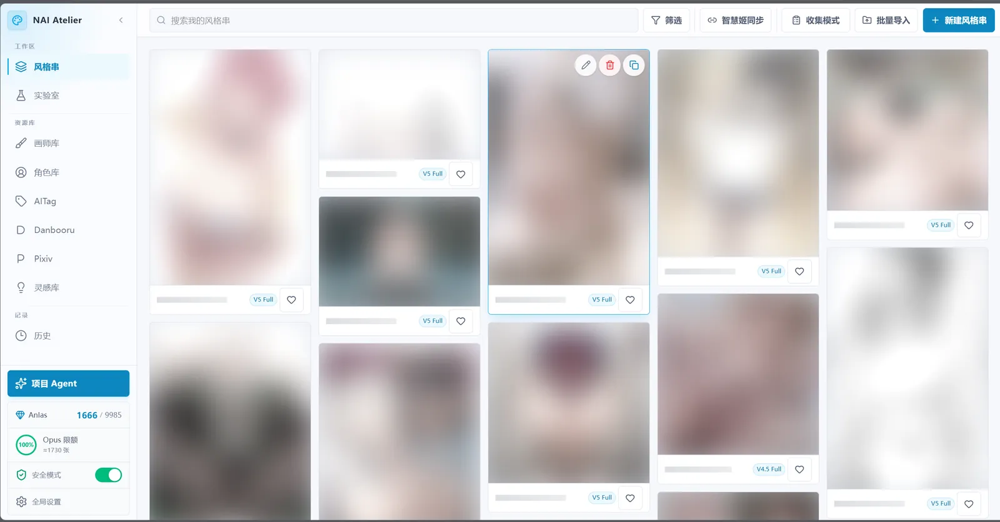
  </a>
  <p><em>自适应瀑布流、层级文件夹、Opus 额度实时换算、智慧姬同步与剪贴板收集小窗</em></p>
</div>

<div align="center">
  <p><strong>🧪 生图实验室调参控制台</strong></p>
  <a href="./docs/screenshots/desktop-lab-workbench.webp">
    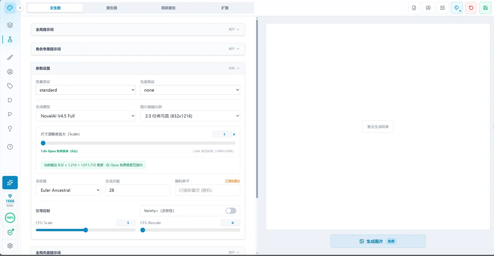
  </a>
  <p><em>四大模式切换、多角色构图定位、Tag 双语胶囊调权与居中生成状态栏</em></p>
</div>

<div align="center">
  <p><strong>🕘 本地原图生成历史画廊</strong></p>
  <a href="./docs/screenshots/desktop-history-gallery.webp">
    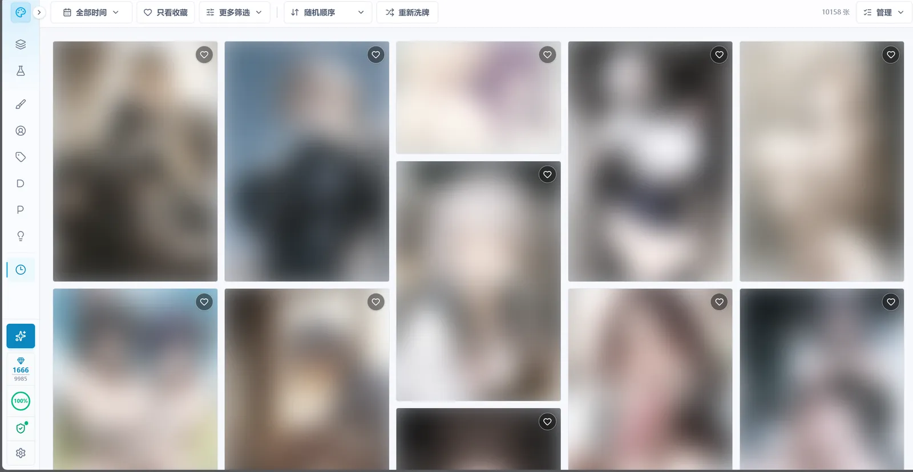
  </a>
  <p><em>无损原图与完整元数据落盘、回收站防误删保护、沉浸大图与一键回填实验室</em></p>
</div>

<div align="center">
  <p><strong>🗃️ 外部作品索引与参数参考（AITag）</strong></p>
  <a href="./docs/screenshots/desktop-aitag-browser.webp">
    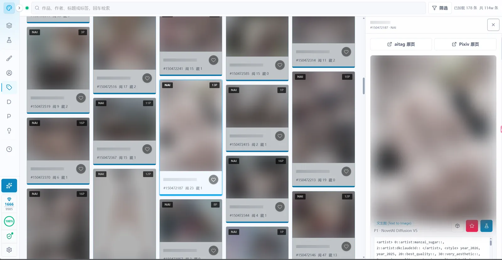
  </a>
  <p><em>公网案例检索、模型与参考筛选、一键保存风格串或完整载入实验室</em></p>
</div>

### 📱 手机端：家庭局域网移动端触控界面

<div align="center">
  <a href="./docs/screenshots/mobile-presets-gallery.webp">
    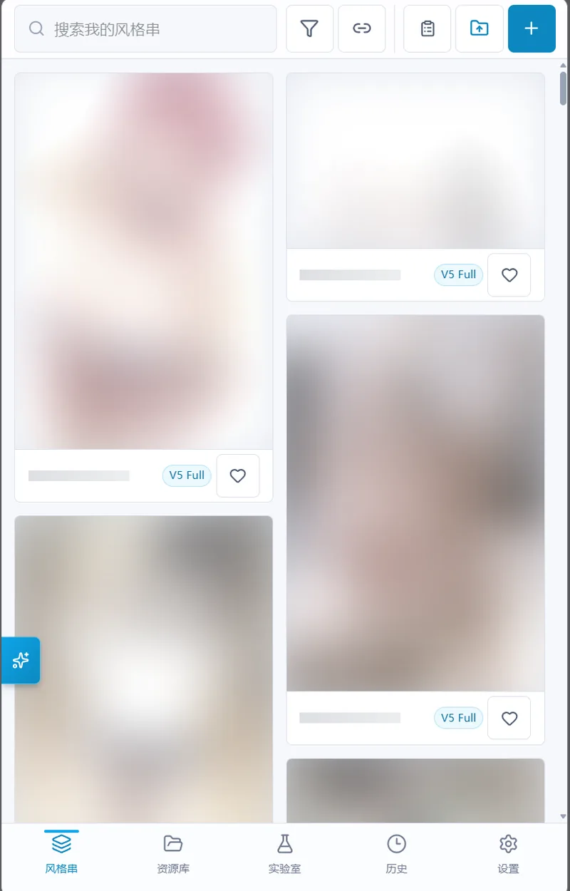
  </a>
  &nbsp;&nbsp;&nbsp;&nbsp;
  <a href="./docs/screenshots/mobile-resources-modal.webp">
    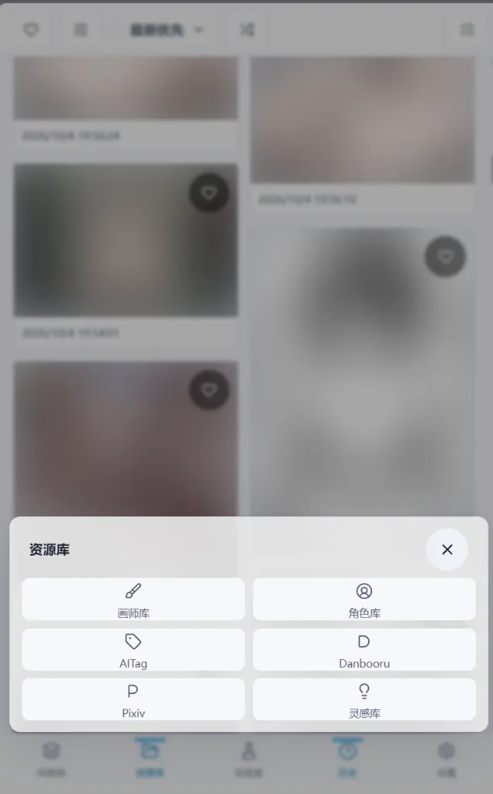
  </a>
  <p><em>44px 舒适触控尺寸、长按唤出统一底部操作面板、单手抽屉导航</em></p>
</div>

---

## 🚀 快速上手

| 使用方式 | 适用人群 | 环境要求 | 启动入口 |
| :--- | :--- | :--- | :--- |
| **EXE 安装版** | 日常桌面使用（推荐） | Windows 10/11 x64（免装 Node.js / Git） | 前往 [GitHub Releases](https://github.com/HelloQun54321/nai-atelier/releases) 下载 `NAI-Atelier-Setup-*.exe` 安装 |
| **源码本地部署** | 开发者 / 深度定制 | Node.js 22+（推荐 24.x）与 Git | 克隆仓库后执行下方启动命令 |
| **Android 独立 APK** | 手机离线独立管理资产 | Android 8.0+（ARM64） | 安装构建好的 APK，详见 [Android 独立版说明](./docs/ANDROID_STANDALONE.md) |

### 方式一：Windows EXE 安装版（推荐）

1. 在 **[GitHub Releases](https://github.com/HelloQun54321/nai-atelier/releases)** 下载最新发布的 `NAI-Atelier-Setup-*.exe`；
2. 双击运行安装向导并选择安装目录（若系统缺少微软 VC++ x64 运行库，向导会提示前往官网安装）；
3. 从桌面快捷方式打开 **NAI Atelier**。个人数据独立存放在 `%LOCALAPPDATA%\NAI Atelier\workspace\local-data`（可在设置中迁移到其他盘），卸载或重装程序均默认保留数据。详见 [Windows 安装版文档](./docs/WINDOWS_DESKTOP.md)。

### 方式二：源码本地部署

```bash
git clone https://github.com/HelloQun54321/nai-atelier.git
cd nai-atelier
npm ci
npm run dev:local
```

依赖安装完成后会自动在 Windows 桌面创建 `NAI Atelier` 启动快捷方式；终端提示就绪后，浏览器打开 [http://localhost:3000](http://localhost:3000) 即可使用。

### 更新工坊

- **EXE 安装版**：在「全局设置 → 数据与维护 → 应用更新」检查并下载 GitHub Release 新版，点击「重启并安装」即可原位覆盖升级。
- **源码本地部署**：关闭正在运行的服务窗口，Windows 双击根目录的 `更新 NAI Atelier.bat`（macOS / Linux 执行 `sh scripts/update-local.sh`），自动拉取已发布版本并重新构建启动。
- **Android 独立版**：使用同一签名且构建号更高的新版 APK 直接覆盖安装，手机内资料原样保留。

### 🎨 生成第一张图（5 步上手）

1. **配置密钥**：打开「全局设置 → NovelAI 与 Anlas」，添加官方 `pst-` Key（或拼车成员网关／按次渠道 Key）；
2. **下载词库**：在「全局设置 → 数据与维护 → Tag 补全词库」点击「更新词库」（若网络受限，也可手动下载 `tag.sqlite` 后点同行「导入词库」本地生成）；
3. **输入提示词**：进入「实验室 → 文生图」，编写提示词并选择模型、画幅与步数，按钮上会实时显示免费／消耗 Opus 额度或预计 Anlas；
4. **生成与沉淀**：点击「生成」查看流式渲染过程与成图，满意后可点击顶栏一键「保存为风格串」；
5. **连上手机（可选）**：手机连入同一家庭 Wi-Fi，在「数据与维护 → 局域网访问」复制地址并在手机浏览器输入 4 位 PIN 码即可接力操作。

### 🌐 界面与助手语言

在「全局设置 → 外观与画廊 → 语言」可随时切换 **简体中文、繁體中文、English、日本語、한국어** 五种界面语言，Windows 托盘、菜单与收集小窗同步生效。内置「创作助手」从下一轮对话起自动跟随所选交流语言，同时完整保留英文生图 Tag、Prompt 与资产原名不被误翻。

---

## 📱 手机局域网创作体验

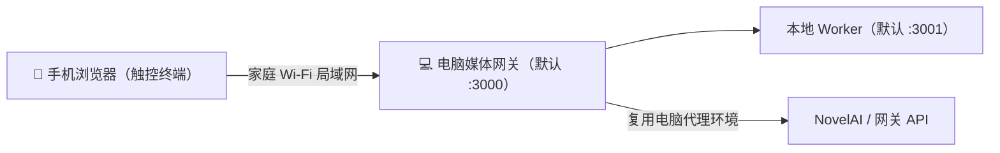

- **免配手机代理**：生图与图库代理请求均由电脑后台发出，手机连上家里 Wi-Fi 就能直接生图；首次输入 4 位 PIN 码后 30 天内免输。
- **原生级触控交互**：所有常用按钮满足 44px 触控高度，顶栏单行不溢出；长按图片卡片约 0.45 秒唤出统一的底部操作面板（收藏、下载、复制、编辑等），大图支持双指缩放、双击放大／复原与单指平移，系统返回键逐层收起弹窗并保留原浏览位置。

---

## 🧪 核心创作工作流

### 🎨 风格串：可复用的画风配方

将验证好的一整套画风正负面词、可开关的风格模块、多角色配置与采样参数完整封存，随时调用或微调：

- **层级文件夹与标签管理**：支持无限层级文件夹与多归属拖拽整理，筛选面板旁提供全库「管理标签」（重命名、合并去重、移除）。
- **`.naia` 批量分享包**：顶栏「分享包」支持将整库、筛选结果或勾选条目导出为 `.naia` 文件（封面可选不带、压缩或原图，自动随包携带关联的 Vibe 编码与精准参考，保留作者与出处声明）；导入时提供可视化图库预览，支持看图挑款与指定目标文件夹。
- **本地「查找相似」**：基于本地画师词库与 `::` 权重解析，离线比对全库风格串的画师组合与画风词重合度，多列并排高亮共同词与权重差异，方便清理近似配方。
- **Windows 置顶收集小窗**：开启后悬浮于桌面角落（支持液态玻璃主题同步、折叠与暂停，后台不抢焦点），提供三种收集模式：
  - **风格串／收藏库模式**：在浏览器、聊天软件或资源管理器中复制图片、多选图片文件或复制直链，后台自动提取内嵌 NAI 元数据入库（收藏库模式无元数据也收）；
  - **提示词库模式**：复制任意提示词文本即静默原样收录，自动取首行命名并去重，不打断浏览节奏。

<div align="center">
  <a href="./docs/screenshots/desktop-collection-float.webp">
    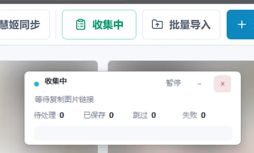
  </a>
  <p><em>Windows 置顶收集小窗：复制图片、文件、链接或文本，后台自动入库</em></p>
</div>

### 🎲 Roll 串：随机画师组合探索

不想手动凑画师串时，进入「Roll 串」即可按设定范围随机抽卡出图、挑出惊艳组合一键存为风格串：

- **灵活来源与偏好加权**：默认从完整画师词库抽取，也可从本地风格串中手选、随机抽选或汇总全部个人串建立画师池；支持锁定必出画师、全局屏蔽、只抽有样张／只抽收藏画师，以及设置收藏画师的抽中倍率（1～100 倍）与保底人数。
- **直观对比与记录管理**：每张候选卡底部以 12 色无切缝色带直观展示各画师权重占比，详情内点击画师即可查看样张或跳回画师库；左侧提供可收起的记录导航，Roll 与画师库共享整套公共提示词与参数预设。

### 🧪 生图实验室：四大创作模式

实验室将 **文生图、图生图、局部重绘、扩图** 整合在同一工作台，各模式独立保存草稿，自由实验室支持跨重启按需记忆文字与参数：

- **四大模式各司其职**：
  1. **文生图**：支持多角色独立提示词与画布构图定位（V4/V4.5 5×5 格点，V5 自由坐标）、V5 透明背景生成与 High／Medium 档位切换；
  2. **图生图**：上传、粘贴或一键取用「文生图最新」作底图（单纯换底图不覆盖当前提示词），输出尺寸可选原尺寸、等比缩至免费像素范围或自定义；
  3. **局部重绘**：默认开启「聚焦重绘」（框选局部裁切放大精修再羽化回贴，符合条件可享 Opus 零点数精修脸部与手部），配备丝滑画笔／橡皮擦与多级撤销；
  4. **扩图**：四向自由延展画布，自动向内重绘 32px 接缝消除拼接痕迹。
- **整段／分类双编辑与提示词工具**：默认整段编辑全局与角色正负词，也可切至「分类编辑」（画风整段锁定，角色与场景分栏拼装，支持按用途随机搭配）；全局正向框外内置魔杖 **「整理提示词」**（本地规则或 AI 按编号提纯画风串／只留画师／去重，可存 4 个快捷按钮）、本地词库 **「校对 Tag」** 与一键 **「样张」** 测试。
- **居中生成栏与后台队列**：蓝色主按钮实时展示当前阶段与 0.1s 跳动秒表（`准备中…` → `生成中…`／`采样 X/Y` → `正在保存…`）及上游出口耗时；右侧「生成选项」支持多张连出、按 Key 请求间隔（默认 2.0s，支持 ±10%～50% 随机浮动）、追加队尾与插到下一张，切页或锁屏不影响后台执行与落盘。
- **永久 Vibe 与精准参考**：在支持参考的模型上集中管理氛围参考（按模型保存编码长期免重算复用，支持 `.naiv4vibe`／`.naiv4vibeBundle` 导入导出，上限 16 张）与精准参考（五种官方类型，支持多层目录整理与引用保护）。

### 🕘 生成历史、回收站与创作足迹

- **无损落盘与强制回收站**：每张成图的原始 PNG 与完整参数即时存入本地 D1 + R2。单删、批量删与按时间／数量清理**一律先移入回收站**，已被收藏、提示词库或活动 Roll 候选引用的原图自动受保护跳过，杜绝手滑误删。
- **创作足迹与 Key 用量统计**：按周／月／年联动展示创作热力图、常驻画师与风格串排行（点击任意统计项可直达对应筛选的历史作品），并以通栏清晰列出保管箱各把 Key 的生图张数、模型分布、估算 Anlas 与 Opus 额度张数，支持导出聚合 CSV。

### ✦ 创作助手：直连工坊业务的 AI 搭档

侧栏或悬浮钮一键唤醒内置创作助手——它不仅能聊灵感、写词，还能直接调用工坊内部服务替你干活：

- **两步接入主流大模型**：内置 DeepSeek、OpenAI、Anthropic、Google Gemini、OpenRouter 等 30 家预设，填入 API Key 自动拉取模型，也支持自定义兼容端点；自带可选的免费／API 联网搜索。
- **直接读写工坊资产**：无需你手动翻页点按钮，助手可直接查询与管理六大目录树、读写提示词库与风格串、控制生图队列、在画布上画蒙版／设扩图、对本地图片跑反推或创建参考，还能按你指定的额度上限在后台自动跑完连续 Roll；输入框输入 `@` 即可直接引用角色库角色。
- **三档权限与安全可逆编辑**：提供「只读」「标准（生图前弹窗确认费用）」「完全访问（直接执行生图）」三档权限；每次改写提示词前自动按会话保存旧稿，在回复下方生成紧凑的**红绿差异卡片**供一键撤回／重做，并顺手在后台静默补齐未收录 Tag 的中文释义。长对话达 80% 容量自动摘要续聊（或手动输入 `/compact`），内置可自由编辑开关的创作向「破限模式」。

<div align="center">
  <a href="./docs/screenshots/desktop-agent-chat.webp">
    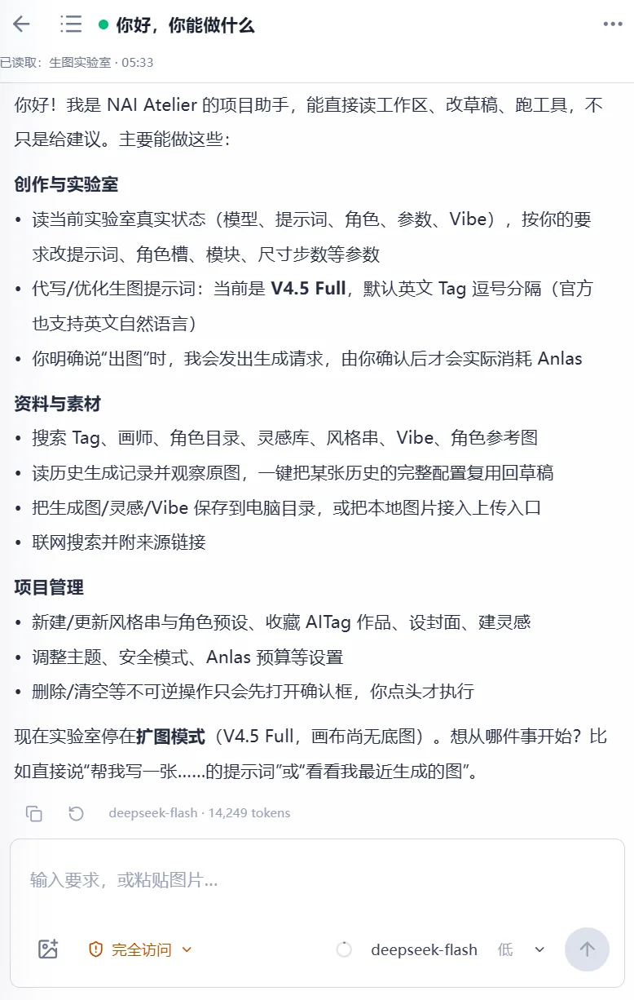
  </a>
  <p><em>感知工作区状态、红绿差异对照改词、直调工坊工具与三档权限掌控</em></p>
</div>

---

## 📚 Tag 与资源资料库

### 🧩 提示词库：自由目录与 16 类用途搭配

- **收纳目录与用途语义解耦**：提供「片段」与「组合」两大视图（粘贴收录同样支持保存完整原文）。片段预设 5 大根类、12 个二级目录，支持无限层级自由增删改与拖拽移动；同时采用系统固定的 **16 类用途 Tag** 驱动自动搭配与实验室分栏取用，角色库中的自定义角色也会自动双向投影到组合的「角色」夹中。
- **极速检索与 AI 辅助整库**：在任意提示词输入框键入 `@名称` 即可调出个人提示词库补全；支持就地生成条目封面、回查关联生成图，以及主动调用当前助手模型执行 **「AI 提取分类」**（拆分长咒语或看图提取片段）与 **「AI 生成搭配」**。

### 🏷️ 智能 Tag 补全与双语胶囊编辑

- **本地中英词库与资料卡**：整合 Danbooru 中英词表与 NovelAI 专属 Tag，画师与角色词右下角可直接点开样张／封面资料卡。
- **双模精确调权**：支持花括号／方括号（每层 ×/÷1.05）与 `数值::tag::`（±0.1，Shift ±0.01，支持 0 与负权重）一键互转及多词整组连续加减。
- **翻译区就地编辑**：点击胶囊间隙即可插入新词，双击英文或中文译文直接原位改词（上方原文同步高亮对应位置），并提供不拆坏权重组的批量 **「删除模式」** 与琥珀色虚线胶囊原位暂隐的 **「屏蔽模式」**。

### 🎨 画师库与 👤 角色库

- **画师库与 V4.5 / V5 样张图包**：完整合并词库与图包画师名单，支持中英文逗号多词搜索、个人分组、收录串数／生图数统计排序及无放回随机抽卡。可在「设置 → 画师预览图库」按需下载 V4.5（约 2.73 GB）与 V5 七分片图包（约 16.51 GB，覆盖 54,880 位画师，单包校验就绪即用，详见 [V5 图包说明](./docs/ARTIST_SAMPLES_V5_FULL.md)）；卡片上可直接切换 V4.5／V5F 样张、点亮偏好爱心、常驻红底一键屏蔽，或给缺图画师原地流式生成自建样张。
- **角色库与同族服装变体**：自动分列「danbooru」与「自定义」来源，同一角色的多种服装变体默认折叠为一张代表卡（点击展开子卡，支持全族联动收藏与一键入组），并可通过卡片铅笔弹窗直接为词库角色添加个人补充词与封面。

### 🌐 外部素材发现与全局收藏库

侧栏「素材浏览」聚合 **AITag、所长法典、Pixiv、Danbooru** 四大灵感来源：AITag 与法典详情提供统一的「保存到风格串 → 导入实验室 → 用作底图」三色直达按钮（AITag 另支持整组批量存串）；Pixiv 支持系统浏览器登录、榜单游标连拉与站内／本地双收藏区分；所有页面点亮右上角爱心的图片统一汇入 **「收藏库」**，支持按作品组折叠、拖拽排序收藏夹与交叉标签筛选。

### 🔍 本地图片反推 Tag（WD Tagger）

在本地通过 ONNX Runtime CPU 运行 WD ViT / SwinV2 / EVA02-Large V3 模型反推图片 Tag，**无需上传第三方云端、零点数消耗**。在实验室、角色槽、Pixiv／Danbooru 或收藏详情均可直接粘贴／选图反推，一键复制或追加到全局正向／角色栏。

<details>
<summary><strong>附：自用 HTTPS 反向代理下的反推来源配置（按需展开）</strong></summary>

若你通过自己的 HTTPS 域名反向代理访问工坊（反代需保留原始 `Host` 并自行做好访问认证与源站隔离），首次使用反推模型管理需将正式来源加入允许列表（二选一）：

**方式一：SSH 转发本机页面配置**
```sh
ssh -N -o ExitOnForwardFailure=yes -L 127.0.0.1:13000:127.0.0.1:3000 user@server
```
在本地浏览器打开 `http://127.0.0.1:13000`，进入「全局设置 → 数据与维护 → 反推 HTTPS 入口」开启并保存 `https://你的域名` 即可。

**方式二：在服务器本机用命令行配置**
```sh
# 1. 查看现有配置
curl --noproxy '*' -sS -i 'http://127.0.0.1:3000/api/lan/tagger-remote-access'

# 2. 写入完整允许列表（注意检查返回头为 HTTP 200）
curl --noproxy '*' -sS -i -X PUT 'http://127.0.0.1:3000/api/lan/tagger-remote-access' \
  -H 'Origin: http://127.0.0.1:3000' \
  -H 'Content-Type: application/json' \
  --data-raw '{"enabled":true,"origins":["https://atelier.example.com"]}'
```
</details>

---

## 🛡️ 费用、密钥与安全守卫

### 🔋 Opus 额度自动换算与计费同步

- **动态规则同步**：启动及每日自动从 NovelAI 官方前端同步最新免费门槛、模型倍率与参考附加费系数；侧栏实时换算剩余可生成张数与**预计回满时间**（充裕绿、低于 20% 琥珀黄、耗尽标红）。
- **本地预算与幂等记账**：支持按 Key 设定本地安全预算，付费操作生成前弹窗确认，每张成图通过独立凭据原子记账，绝不重复扣减。

### 🗄️ 多密钥保管箱与 Key 池自动轮询

- **三种接入渠道**：支持录入多把密钥并设别名掩码保存——**「NovelAI 官方」**直连、**「生图网关」**（兼容 `novelai-shared-gateway` 拼车成员网关，支持流式预览、个人配额圆环上限、独立钱包余额与精确回满时间）、以及 **「按次渠道」**（第三方按次计费中转，自动隐藏官方额度区）。
- **Key 池自动轮询**：拥有多把非按次密钥时可一键开启 Key 池——采用**单并发顺序出图＋满圈率优先**策略（优先消耗最接近满额的密钥以免回血溢出），发车前复用干净缓存**零阻塞秒起步**，每张成图后在后台静默刷新额度；全池免费额度耗尽或参数需扣付费点数时立即停下提示，绝不静默跨 Key 扣费。

### 🕶️ 沉浸式防窥、分享清洗与个性化主题

- **安全模式与元数据清洗**：一键开启全局图片高强模糊防窥（点击临时窥视，移开或切走窗口自动重锁）；独立提供「图片元数据清洗」与 PNG／生成信息 JSON 下载切换，可在分享导出副本时一键剥离全部生成信息或仅剥离提示词（支持写入自定义签名）。
- **液态玻璃主题与自定义壁纸**：出厂内置 **Cupertino Liquid Glass**（液态玻璃折射＋雾蓝／星空壁纸）与经典实色两套主题，开放明暗双版配色、本机字体、圆角密度、全局与实验室编辑面独立不透明度滑条、图库列数（桌面 1～7 列）及卡片磨砂／浮动开关，支持版本 3 JSON 导入导出与同工坊多设备共享。详见 [主题制作说明](./docs/THEMES.md) 与 [AI 主题提示词](./docs/THEME_AI_PROMPT.md)。

<div align="center">
  <a href="./docs/screenshots/desktop-appearance-settings.webp">
    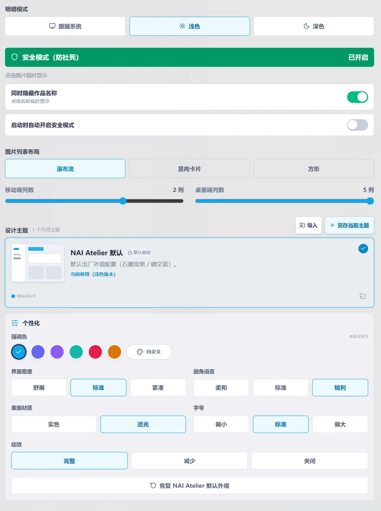
  </a>
  <p><em>液态玻璃主题细节、自定义明暗壁纸、图库列数与防窥隐私控制</em></p>
</div>

---

## 💾 本地数据主权与备份

### 运行设备持有自己的事实源

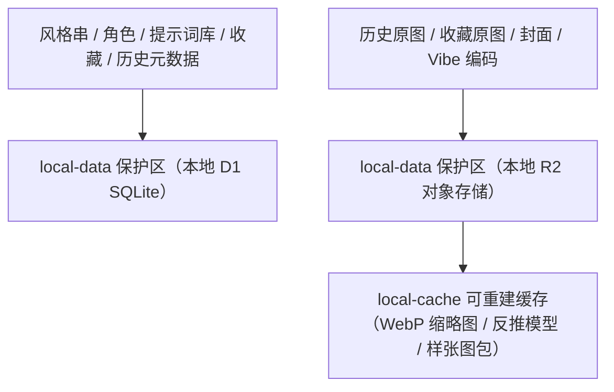

> ⚠️ **重要提醒：`local-data` 是核心数据保护区，请勿手工删改内部文件！**
> `wrangler.toml` 中的 `database_id`、`database_name` 与 `bucket_name` 是本地存储定位键，修改它们会导致程序加载全新空库（原数据仍在但界面显示为空）。

### 数据目录与备份方式

| 运行方式 | 数据存储路径 | 推荐备份方式 |
| :--- | :--- | :--- |
| **EXE 安装版** | `%LOCALAPPDATA%\NAI Atelier\workspace\local-data` | 在「全局设置 → 数据与维护 → 重要数据备份」一键完整备份；或托盘「退出工坊」后完整复制 `local-data` |
| **源码本地部署** | `<项目根目录>/local-data/` | 使用设置页一键完整备份；或停止服务后完整复制 `local-data/` |
| **独立 Android** | 手机应用私有目录（与电脑独立） | **卸载 APK 会清除私有数据**，换机或卸载前务必在「数据与维护」设密码导出 `.naiatelier` 加密备份 |

在 Windows 端的「存储位置」设置中，还可一键将工坊数据目录或缓存资源目录迁移至其他硬盘，并自定义图片与文件的默认导出文件夹。

---

## 🔗 生态互通与扩展（st-chatu8 联动）

- **酒馆双向资产互通（SillyTavern / TauriTavern 联动）**：内置共用酒馆扩展，支持原生 SillyTavern 与 TauriTavern，可将工坊精选的风格串、封面与永久 Vibe 同步至 [st-chatu8（智慧姬）](https://github.com/damoshen123/st-chatu8) 与 [ST-BaiBai-Image（柏宝绘）](https://github.com/baibai-git/ST-BaiBai-Image)，并零拷贝索引酒馆生成的历史原图。详见 [SillyTavern 桥接指南](./docs/SILLYTAVERN_BRIDGE.md)。
- **多人拼车公共队列与生图中转**：支持按 Key 配置 `st-chatu` 协议公共排队（仅用 Key 指纹协调顺序，支持查看前方人数与自定义 15 字个性语，不上传原 Key 与提示词），也支持填入兼容 NovelAI 接口的第三方生图中转地址。

---

## 🛠️ 技术架构

| 层级 | 技术方案 |
| :--- | :--- |
| **前端界面** | React 19、TypeScript、Tailwind CSS 4、Vite |
| **本地后端** | Cloudflare Workers（Wrangler 本地运行时）、Node.js 媒体与任务网关 |
| **持久存储** | 本地 D1（SQLite）数据库、本地 R2 对象存储（Android 为原生 SQLite + Keystore） |
| **图像与推理** | Sharp（WebP 动态缩略图）、ONNX Runtime（本地 WD Tagger 反推） |

### 源码版常用命令

| 命令 | 用途 |
| :--- | :--- |
| `npm run dev:local` | 启动完整本地工坊服务（前端 + Worker + 媒体网关） |
| `npm run update:tags` | 下载并重新编译本地中英 Tag 补全词库 |
| `npm run build:desktop` | 打包 Windows x64 安装程序 |
| `npm run build:android` | 打包 ARM64 签名 Android APK |
| `npm run test -- <路径>` | 运行前端／服务定向单元测试（Vitest） |
| `npm run test:gateway` | 运行后端网关、桥接与 Worker 回归测试 |
| `npm run test:live-sync` | 联网核验 NovelAI 官方模型与计价规则提取 |

---

## 📄 来源与致谢

- 源自 [kirafishy/NaiPromptManager](https://github.com/kirafishy/NaiPromptManager) 二次开发并独立维护，遵循 [MIT 许可证](./LICENSE)；
- 感谢 [@ffdkj](https://github.com/ffdkj) 维护的 [Danbooru 中英对照翻译数据库](https://github.com/ffdkj/ffdkj-Danbooru_Tag-Chinese-English-Translation-Table)；
- 感谢 [@damoshen123](https://github.com/damoshen123) 的 [st-chatu8](https://github.com/damoshen123/st-chatu8)：智慧姬资产互通与拼车公共排队协议深度参考了该项目；
- 感谢 [@baibai-git](https://github.com/baibai-git) 的 [ST-BaiBai-Image（柏宝绘）](https://github.com/baibai-git/ST-BaiBai-Image)：柏宝绘的画师串、Vibe 与生图历史零拷贝联动适配参考了该项目的存储与侧写元数据约定；
- 感谢 [@sdnwls](https://github.com/sdnwls) 的 [nai-style-lab](https://github.com/sdnwls/nai-style-lab)：Roll 串的随机抽卡与画风探索体验受该项目启发并结合工坊独立实现；
- 感谢 [@yexi-by](https://github.com/yexi-by) 的 [dsh-unrestricted](https://github.com/yexi-by/dsh-unrestricted)：创作助手「破限模式」的交付契约设计参考了该项目；
- 感谢 [@clanso](https://github.com/clanso) 在 [#21](https://github.com/HelloQun54321/nai-atelier/pull/21) 中贡献的画师统计解析与收藏状态修复；
- 本地反推模型基于 [SmilingWolf WD ViT Tagger V3](https://huggingface.co/SmilingWolf/wd-vit-tagger-v3)（Apache-2.0）。

---

<div align="center">
  <strong>完整迭代记录请查看 <a href="./CHANGELOG.md">CHANGELOG.md</a></strong>
</div>
