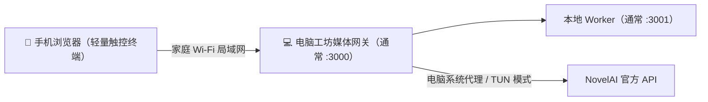
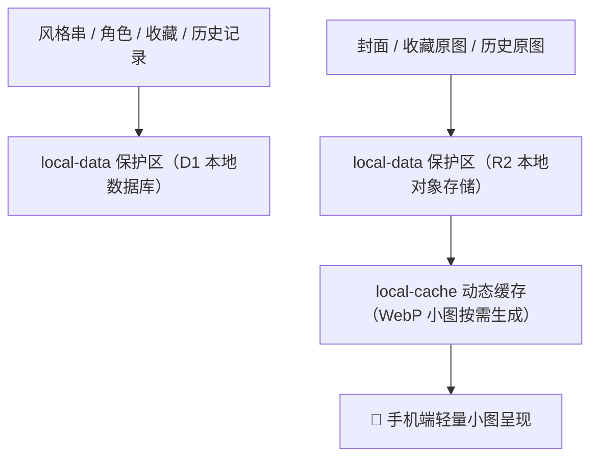

<div align="center">
  

  # NAI Atelier

  **面向 NovelAI 的个人本地创作工坊**

  **[简体中文](./README.md) · [繁體中文](./README.zh-TW.md) · [English](./README.en.md) · [日本語](./README.ja.md) · [한국어](./README.ko.md)**

  [](./CHANGELOG.md)
  [](https://novelai.net/)
  [](#-本地数据主权与备份)
  [](#-手机局域网创作体验)
  [](./LICENSE)

  [项目定位](#-项目定位) · [界面预览](#-界面预览) · [快速上手](#-快速上手) · [语言](#-界面与助手语言) · [手机创作](#-手机局域网创作体验) · [核心工作流](#-核心创作工作流) · [资源资料库](#-tag-与资源资料库) · [费用与隐私](#-费用密钥与安全守卫) · [数据主权](#-本地数据主权与备份) · [生态互通](#-生态互通与扩展st-chatu8-联动) · [技术架构](#-技术架构) · [更新日志](./CHANGELOG.md)

  > NAI Atelier 基于 [kirafishy/NaiPromptManager](https://github.com/kirafishy/NaiPromptManager) 二次开发并独立维护，面向本地单人创作；原项目见上方链接。
</div>

---

## 🧭 项目定位

NAI Atelier 是一套运行在个人电脑或 Android 手机上的 NovelAI 本地创作工坊。它围绕长期个人使用建立完整创作工作流：

> **寻找素材灵感 → 模块化组合 Prompt → 单张生成与流式反馈 → 局部加工与微调 → 沉淀为个人资产 → 随时在电脑与手机上继续创作。**

工坊以「生成一张 → 观察 → 微调 → 再生成」为默认心流节奏，帮助创作者保留判断与选择。常规探索优先使用官方免费面积与步数范围，复用已有 Vibe；需要消耗 Anlas 时先展示明确估算与二次确认。

| 核心创作体验 | 带来的便利 |
| :--- | :--- |
| 🎨 **完整创作闭环** | 从 Pixiv、Danbooru、AITag 找素材，组合提示词，生成或局部修补，将满意作品一键沉淀为个人资料库 |
| 📚 **个人资产持续复用** | 风格串、角色特征、Vibe 画风编码与历史原图保存在运行工坊的设备，创作配置持续积累 |
| 📱 **沙发/床上手机搓图** | 电脑充当本地工作站，手机连接家庭 Wi-Fi 即可全功能操控，触控优化、免配代理、4 位 PIN 轻量保护 |
| 🔋 **费用可见、过程可控** | 自动换算 Opus 电池剩余张数，自主设定本地点数预算，查看费用估算与付费确认，单张观察、拒绝盲目消耗 |

> [!IMPORTANT]
> **适用范围**：常规免费创作以 NovelAI 活跃 **Opus** 订阅为前提（非活跃 Opus 按付费档估算）。文档中的 **Anlas** 即官方代币（点数）；**Opus 限额** 即官方为 V5 模型引入的电池型免费生成配额。通用 NovelAI 兼容中转已接通普通／流式生图，第三方订阅、余额与额外计费规则尚未适配；界面沿用官方费用估算，不代表中转站实际收费。

---

## 🖼️ 界面预览

> 💡 **防窥保护提示**：为保护创作者隐私，预览截图均在开启全局安全模式（自动虚化作品与敏感占位符保护）状态下截取；点击预览图可查看高清原图。

### 🖥️ 桌面端：核心功能页面展示

<div align="center">
  <p><strong>🎨 风格串与创作预设资产库</strong></p>
  <a href="./docs/screenshots/desktop-presets-gallery.webp">
    
  </a>
  <p><em>自适应瀑布流、展开式侧栏、Opus 电池实时换算、智慧姬同步与收集模式</em></p>
</div>

<div align="center">
  <p><strong>🧪 生图实验室调参控制台</strong></p>
  <a href="./docs/screenshots/desktop-lab-workbench.webp">
    
  </a>
  <p><em>四大模式切换、官方免费尺寸与步数适配、引导控制与零点数安全指示</em></p>
</div>

<div align="center">
  <p><strong>🕘 本地原图生成历史画廊</strong></p>
  <a href="./docs/screenshots/desktop-history-gallery.webp">
    
  </a>
  <p><em>按可见范围加载本地作品、沉浸式大图浏览、收藏筛选与随机重新洗牌</em></p>
</div>

<div align="center">
  <p><strong>🗃️ 公网作品索引与参数参考（AITag）</strong></p>
  <a href="./docs/screenshots/desktop-aitag-browser.webp">
    
  </a>
  <p><em>精选生成案例检索、Prompt 与模型参数构成参考、一键载入工坊深入研究</em></p>
</div>

### 📱 手机端：家庭局域网移动端触控界面

<div align="center">
  <a href="./docs/screenshots/mobile-presets-gallery.webp">
    
  </a>
  &nbsp;&nbsp;&nbsp;&nbsp;
  <a href="./docs/screenshots/mobile-resources-modal.webp">
    
  </a>
  <p><em>44px 舒适触控、双列瀑布流、底部单手手势导航、全套资源库一触即达</em></p>
</div>

---

## 🚀 快速上手

工坊提供 **Windows EXE 安装版**、**源码本地部署** 与 **Android 独立 APK**：

| 使用方式 | 适合人群 | 运行准备 | 开启入口 |
| :--- | :--- | :--- | :--- |
| **EXE 安装版** | 普通使用者（推荐） | Windows 10/11 x64，无需配置 Node.js/Git | [下载已发布安装包](https://github.com/HelloQun54321/nai-atelier/releases)，双击安装向导 |
| **源码本地部署** | 开发者 / 自由定制者 | Node.js 22+ (推荐 24.x) 与 Git | 克隆仓库并执行本地启动命令 |
| **Android 独立 APK** | 希望手机独立创作的使用者 | Android 8.0+、64 位 ARM、手机自身网络 | 安装本地构建的 APK；使用和构建见 [Android 说明](./docs/ANDROID_STANDALONE.md) |

项目显示版本只随电脑端迭代，Android 适配通过独立安装构建号更新，同签名 APK 可直接覆盖安装并保留手机资料。手机图片长按显露下载／复制等原位操作，详情点按进入大图，支持双指缩放、双击放大／复原与放大后拖动。

### 方式一：Windows EXE 安装版（推荐）

1. 前往 **[GitHub Releases 下载页](https://github.com/HelloQun54321/nai-atelier/releases)**，选择最新正式发行的 `NAI-Atelier-Setup-*.exe` 安装包和对应 `.sha256` 文件；公开可下载版本以该页面附件为准，README 顶部版本徽章表示当前源码版本，本地构建不等于已经发布；
2. 双击运行安装程序，自主选择程序安装位置（首次运行会检查微软 VC++ x64 运行库）；
3. 安装完成后从桌面图标打开 **NAI Atelier**，按下方引导开启创作。

> 💡 个人数据保存在 `%LOCALAPPDATA%\NAI Atelier\workspace\local-data`，独立于程序安装目录，卸载时默认安全保留。详细说明见 [Windows 安装版文档](./docs/WINDOWS_DESKTOP.md)。

### 方式二：源码本地部署

```bash
git clone https://github.com/HelloQun54321/nai-atelier.git
cd nai-atelier
npm ci
npm run dev:local
```

安装依赖后，Windows 环境会自动在桌面生成晴空蓝调色盘图标的 `NAI Atelier` 快捷方式。等待终端显示服务就绪后，在浏览器打开 [http://localhost:3000](http://localhost:3000) 即可开始。

### 更新工坊

- **EXE 安装版**：在「全局设置 → 数据与维护 → 应用更新」检查并下载新版，再选择「重启并安装」。只检查 GitHub 已发布版本，尚未发布的本地构建不会出现在更新列表。启动时会安静检查，普通退出不会自动安装。安装前完成生成、助手、收集、备份与词库任务；个人数据保留，手机连接暂时中断。当前默认接收预发布，可关闭该选项。
- **源码本地部署**：完成任务并关闭源码服务窗口，双击项目根目录的 `更新 NAI Atelier.bat`。入口检查已发布版本、安装锁定依赖、构建并启动；本地修改、定制分支或分叉会停止更新。macOS／Linux 可运行 `sh scripts/update-local.sh`。ZIP 源码没有 Git 更新环境，需从下载页取得新版并按备份说明保留个人数据。
- **旧版首次升级**：没有更新入口的旧 EXE 需手动运行一次新版安装包；旧源码部署需先取得包含更新入口的新版代码。之后即可使用上述入口。主要版本或数据结构变化需要完整备份并按发行说明手动升级。

### 🎨 生成第一张图（5 步直达心流）

1. **添加 Key**：打开「全局设置 → NovelAI 与 Anlas」，添加自己的 `pst-` 密钥，设置该 Key 的 **Anlas 本地预算**；
2. **下载词库**：在「全局设置 → 数据与维护 → Tag 补全词库」点击「更新词库」，在该设置行下方查看下载、生成进度及词库数量／时间；电脑下载复用工坊检测到的出站代理，失败显示具体线路原因并保留现有词库；
3. **文生图测试**：进入「实验室 → 文生图」，输入提示词，选择模型、尺寸与步数，查看当前费用提示；免费资格取决于实际参数、订阅、Opus 额度和参考配置；
4. **生成与观察**：点击生成，实时观察渲染成图，确认无误后可一键将满意配置「保存为风格串」；
5. **开启局域网（可选）**：手机连接同一 Wi-Fi，在「全局设置 → 数据与维护 → 局域网访问」复制手机访问地址，输入 4 位密码继续创作；独立 Android 工坊直接使用手机网络。

### 🌐 界面与助手语言

在「全局设置 → 外观与画廊 → 语言」选择简体中文、繁體中文、English、日本語或 한국어，即时切换界面并记住选择。安装版的标题、启动页、菜单、托盘与收集悬浮窗也跟随；各浏览器／设备可独立选择。

创作助手从下一次请求起使用所选语言交流，已有聊天、创作 Prompt／Tag 和自定义资料名称保留原文，用户明确要求的创作产物语言优先。译文随应用提供，不依赖运行时在线翻译；Tag 补全词库仍为中英对照，界面语言切换不会改写词库或外站内容。README 顶部提供五种语言的使用说明，专项技术文档与变更日志目前以简中维护。

---

## 📱 手机局域网创作体验

随时随地窝在沙发或床上用手机搓图、挑图是最高频的心流体验。电脑负责充当本地工作站（运行服务、网关与存储核心），手机连上同一个家庭 Wi-Fi 即可全功能操控：



### 极简连接体验

- **生图请求复用电脑网络**：局域网模式的生成和网关代理请求由电脑发起，手机无需另配 NovelAI 代理；浏览器直接访问的外站仍取决于手机网络。安装版遇到端口冲突会另选端口，手机地址以设置页／本次启动日志为准；
- **轻量安全的 4 位 PIN 码**：局域网设备首次访问只需输入电脑终端/启动日志中打印的 4 位密码即可绑定（30 天内免重复输入），电脑本机免密访问；
- **单手触控心流适配**：
  - 核心操作区域满足至少 44×44px 舒适触控，避开全面屏防误触手势区；
  - 列表悬浮辅助按钮在触屏下采用**长按原位显露**，松手保留，不占用紧凑的看图视野；
  - AITag、Pixiv、Danbooru 的作品详情在手机上覆盖当前图库；页面返回与系统返回收起详情并继续原作品位置，多层窗口逐层返回，后台页面保留浏览状态；
  - 实验室四模式在电脑与手机端共用**三段式分区导航**：文生图为「全局／角色／参数」，图片编辑为「底图（画板／画布）／提示／参数」。电脑三分区紧贴主模式顶栏下沿，左右边缘分别对齐「文生图」与「扩图」按钮的选中块边界，三个按钮等宽，选中颜色与顶栏一致；右侧作品预览保留，各分区独立记住本次打开时的滚动位置。
  - 分区内模块采用固定顺序；设置中的「实验室模块默认展开」保留四模式独立的初始展开／收起偏好，电脑与手机均可调整，旧展开设置继续有效。默认全部展开（含 Vibe 与精准参考），设置里的四个实验室页面分组默认展开；已保存过旧偏好的话点「全部默认」即可套用新默认。
  - 电脑开启 Agent 后，实验室与「试一试」优先保持编辑区、预览区并列，顶栏两排导航留在编辑列上方、操作区保留在右侧；中间可用宽度不足 560px 时，顶栏与预览同步切换为上下排列布局，窄栏内的参数与生成辅助操作自动收纳，各主题规则一致。
  - 所有主页面顶栏统一提供**可收起把手**：电脑展开时把手仍位于顶栏上边中央；手机断点改到顶栏左侧独立位置，与其他控件同处一行且不遮挡按钮或缩小触控区。描边胶囊内三角向上，悬停／键盘聚焦时显示「收起」，点击收起整条顶栏与状态行；收起后把手留在页面顶边并变为向下三角，提示「展开」。收起状态跨页面保留，刷新后沿用。

---

## 🧪 核心创作工作流

### 🎨 风格串：可复用的创作配方

风格串是工坊的核心预设载体：将一套经过实践验证的画风、角色特征、负面词与生成参数完整封存，随时一键调用或派生新作品。

- **模块化解耦分层**：全局提示词、可独立开关的风格模块与全局负面词清晰分层，避免反复手动拼词；
- **可收起文件夹**：从顶栏文件夹图标展开层级目录，支持新建、改名、调整层级与单条／批量设置归属，同一串可加入多个文件夹；拖入具体夹追加归属，父目录包含子目录内容且每串只计一次；默认收起以保留大图空间，收起仍保留当前筛选。文件夹不改配方、标签和原图，删除目录也不删除风格串；目录随完整工坊备份保留，不随 `.naia` 分享包导出；
- **本地查找相似**：顶栏「查找相似」默认分析全部风格串，也可仅比较当前筛选结果；候选先按正向画师集合 75% 重合召回，无画师时至少两个正向具体画风词且集合重合度达 90%。最终归组还要求画师权重及全部已识别画风词权重分别达到 75%；无画师时全部已识别画风词权重达到 90%。权重正负分开，同名重复词逐项配对比较每对 min/max，不累计求和或归一；权重参与实际分组和排序，结果只表示提示词线索相似，不保证生成画面相同。每组标题显示组内任意两串的最低加权相似度（非平均值，也非全组词交集比例），百分比保留一位小数并按需省略尾零；所有组按未舍入分值降序排列，同分保持原顺序。删除成功后按剩余成员重算相似度并重新排序；切换扫描范围或重新扫描也按此规则排序，不保存扫描历史。已确认的媒介／渲染、线条、上色及具名画风词参与比较。组内多串同时对照：1024px 起，三串及以上最多三列；768px 起双列，手机单列。作品保留大图与原比例，可点击放大看原图；悬停、键盘聚焦或触屏长按后从左上操作删除，沿用单条确认和当日记忆。对比默认保留每条原串的完整全局正向词，最多显示四行，溢出后可展开全文；全组交集按各串同词出现次数的最小值标为共同词，非交集继续以普通正文显示。整项权重高亮只按全组内同词、同正负方向、同有效倍率的最少配对次数计算，先配共同权重项，再标同词异权项；原始权重写法保留。其余提示词与配置折叠。打开原串后返回保留本次扫描、展开状态和弹层滚动位置；资料变化会刷新结果。兼容 NovelAI `::` 权重重置、闭合及延续到正文末尾的权重写法；无法确定语义的相关特征归入线索不足并提示，独立 `::` 是合法重置。原图预览的 Escape 及返回按钮只退出原图；窄屏打开父层后放宽窗口，预览子层沿用返回栈，浏览器返回也只关闭顶层。功能本地分析，不调用 AI、不生图、不自动写回，不提供批量删除或合并。
- **多角色独立图层**：每个角色拥有与全局等宽的独立正负面词输入框，「坐标」与「粘贴反推」以纯图标小按钮并入角色原有操作行；文生图与编辑模式均支持直观的 X/Y 构图定位（V4/V4.5 格点吸附，V5 自由定位）；
- **参数全套封存**：画面比例、尺寸、Steps、CFG、Variety+、采样器与 Seed 一并封存；
- **今日确认记忆**：确认框可勾选「今日内不再显示」，再明确确认后，当前设备当天复用该类型及范围的选择。各类删除、付费和迁移分别记住；取消不记，跨日或 Key／费用／目标等范围变化恢复提示。选择「保存并离开」后，之后仍会实际保存成功才离开。
- **离开前保存**：风格串或自定义角色有未保存修改时，可选择「保存并离开」「放弃并离开」或「继续编辑」。保存成功才跳转，失败保留草稿；目前无法完整入库的编辑模式仍只提供继续／放弃；
- **风格串批量删除**：从顶栏「多选」直接进入，在当前筛选结果中全选、反选或逐条勾选，再确认删除。操作栏在原顶栏切换，清空选择仍保留多选模式；处理结果按实际列表核对，未删除项保留选择。历史与收藏记录保留，仍被其他资料引用的封面不会清理。
- **风格串批量分享**：顶栏「分享包」导入或导出 Atelier 专用 `.naia` 文件；多选时可直接「导出已选」。电脑本机可在导出按钮旁「打开文件夹」，优先打开本次文件的实际保存目录；尚未导出时使用已配置的固定目录或安装版系统目录。浏览器自行下载且无法提供路径时，会提示从下载记录「在文件夹中显示」。导出支持全部、完整筛选结果或已选条目，封面可选不带、压缩（默认，最长边 1024 像素）或原图；本地原件不变，图片仍遵守隐私清洗偏好。正负词、模块、主体、多角色与生成参数保持完整，配方必需的 Vibe 编码和精准参考随包迁移，即使不带封面也保留。可填写作者、来源链接（原帖或发布页面，可留空）及分享说明，导入预览和卡片信息窗可查看，后续再分享仍保留原声明。导出会比较本次打包条目与当时完整风格串库，自动标为「整库打包」或「部分打包」，没有关闭或手动修改选项；导入预览显示打包范围与包内条数，旧包没有范围字段时显示「未记录」。再次导出按当前实际范围重新判断，不继承旧标记；该信息仅说明范围，不证明原创、未倒卖或未被篡改。导入可新建文件夹（以包文件名预填，可改名）或选择一个及多个已有文件夹，再按全部、搜索筛选或已选条目保存为新串，不覆盖已有资料；同次导入预览中已成功项不重复提交，失败项可重试，收纳目标固定且复用同一个新夹。归类失败时配方仍已保存，可只重试归类而不重复建串，完成后可直接查看目标文件夹。当前不按内容去重或给同名条目自动改名，重新读取同一文件仍可新增副本，后续可用「查找相似」辅助整理。单包最多 10,000 条／2 GiB，较大资料库建议压缩封面或分批导出，沿用全局导出目录。专用封装增加普通工具直接读取的门槛，不保证阻止破解或转卖；来源为分享者声明，本阶段没有签名或在线授权。
- **分享包看图挑选**：导入预览沿用风格串页面的图片卡片与布局偏好，直接显示包内封面，独立勾选要导入的配方。操作集中在顶部一至两排，搜索及导入已选直接可用；文件夹、批量选择、其他导入范围与包信息按需展开，底部留给图片。点击图片可放大并左右翻看，退出大图仍保留原列表和勾选；完整配方及原始描述默认折叠，展开后可查看完整文字。预览只读取所选包，不提前保存图片或风格串；不带封面的条目仍可查看配方和导入，压缩封面按包内实际清晰度显示。已有新建／多选目标文件夹、全部／筛选／已选导入和失败重试继续保留。
- **风格串标签管理**：在「筛选 → 自定义标签」标题旁点击「管理标签」，搜索分类、查看使用条数、重命名、合并或移除。操作覆盖当前类型的全部资料，确认影响条数后只更新分类标签；提示词、参数、图片与待实测状态保留，重命名后同步已选标签筛选。新分类可从卡片铅笔中添加。
- **收集模式（Windows 置顶窗）**：从风格串顶栏开启后，小窗以等宽分段切换「风格串／收藏库／提示词库」，切换模式保持卡片尺寸与控件位置。前两种模式接收「复制图片」和「复制图片链接」：「风格串」提取原图生成信息并保存完整配方，没有可识别信息时跳过；「收藏库」接收 PNG／JPEG／WebP，没有生成信息也可收藏，有信息则一并保留，默认进入未整理。相同原图重复收集不另存副本，已取消收藏的记录会恢复；切换只影响之后的复制，排队中的任务保持原去向。待处理、已保存、跳过、失败及结果详情按三种模式分别记录，切换时显示当前模式，排队与在途任务计入复制时的目标；重新开启收集时清零，不累计为历史总数。复制图片优先保留剪贴板 PNG，只有位图时转存 PNG；链接保留下载原图，每图最多 12 MB。在桌面或资源管理器中选中图片文件按 Ctrl+C 也可收集，支持一次复制多张 PNG／JPEG／WebP，并保留文件名和原文件内嵌信息；文件夹不会展开扫描，原文件不会被移动或修改。窗口可暂停、折叠，后台不抢焦点；NAI Atelier 默认明暗使用实色；半透明主题使用当前明暗版本的自选背景或配套壁纸，显示方式、背景强度、主题透明度、模糊、饱和度、边缘折射、圆角和高光均跟随现有设置。整窗共用一层玻璃，模式选中项为随主题参数变化的凸起玻璃滑块，其他按钮悬停时显露反光和亮边，不重复叠加模糊。图片适当压缩后只在内存中处理，不读取桌面；移除背景恢复画布色，文字对比不足时只给字串局部承托，不提高整面不透明度。采用单个 WPF 窗口，系统明暗切换原位生效，保持不抢焦点，重启后监听关闭。原生程序集按源码指纹缓存在资源缓存目录，工坊启动时仅后台准备，减少每次点击的重复编译；准备不打开窗口或监听剪贴板。
- **提示词随手收录**：先切换小窗到「提示词库」，再在任意软件复制提示词，即自动按原文保存，不弹编辑／确认窗口。默认存入原文，也可预先在「存入」中选择外貌／服饰／动作／表情／场景／镜头／通用，后续复制直接进入对应条目库；名称取首行，空格、换行与权重逐字保留，命名和整理以后在提示词库完成。连续复制依次保存，同次收集中相同原文与分类去重，失败可重新复制；切换分类不改变已入队文字的归属。图片模式不收文字，暂停不接收新复制但处理完已入队内容，继续只接收之后的新复制；不建立剪贴板历史。

<div align="center">
  <a href="./docs/screenshots/desktop-collection-float.webp">
    
  </a>
  <p><em>Windows 桌面置顶小窗：复制图片或图片直链，后台静默解析参数入库</em></p>
</div>

---

实验室的整段与分类编辑均可从全局或某个角色点击「随机搭配」，从当前提示词目录选择参与项并预览后填入。全局入口固定写入当前全局，角色入口固定写入打开时的角色；未选目录、空库和无关正文保持原样，不自动生图，填入可撤销。提示词库的组合面板可自由选择范围和目标。

### 🎲 Roll 串：抽取组合

桌面从工作区打开「Roll 串」，手机从「资源库」进入。点击「开始 Roll／再 Roll 一轮」，默认从画师库随机补位并逐张出图，无需另建画师池；也可从所选已有风格串组成的来源集合随机补位。只有一个随机 Roll 流程：「本轮设置」将每串人数范围（如 4～6）与权重范围分别放在独立一行，人数上下限相同即固定人数。人数包含固定项，例如抽到 5 位、固定 2 位，就随机补齐另外 3 位；每条配方中全部画师的权重独立随机，固定 Tag 不固定权重。固定全部 Tag 时只随机权重，无需切换模式。点击「管理画师与偏好」进入样张弹窗：点封面锁定 Tag，左上屏蔽（卡片仍显示），右上爱心与收藏库同步偏好；没有样张保留空封面，由用户勾选只抽有样张的画师。偏好抽中倍率可用滑条拖动或数字输入，默认滑条范围为 1～100 倍、步进 0.1；输入更大倍率时扩展滑条范围，保留已有大值。每串至少偏好人数也可设置，默认 1 倍／0 位；已锁定偏好计入保底，不足时停止并提示。每轮有限张数，付费时确认整轮总费用，可暂停或取消，不自动付费重试。

画师管理弹窗内可筛选已锁定、偏好或已屏蔽的画师，也保留折叠的手动固定 Tag 入口。Roll 顶部工具栏靠近本轮设置的位置提供来源选择，桌面显示「从风格串提取」、手机显示「提取画师」；Roll 主页面与新建／编辑记录设置中的入口图标右侧保留名称，下一行显示当前来源状态（「已选 {0} 串 · {1} 位画师」或「画师库」）。选择器读取最新本地风格串（兼容无类型旧记录），沿用风格串大图偏好，并提供模型、收藏、待实测、标签 AND、搜索、创建时间／更新时间排序、重置及只看实际识别出画师 Tag 等筛选；筛选条件组合生效，保留已选来源。选择多条风格串作为当前记录的随机画师来源，固定 Tag 保留并仍按原规则计入每串人数；来源集合只用于随机补位，不受人数范围限制，补位只取所选来源集合，缺少足够画师时提示，不从全库补齐。不同来源串中重复出现的画师按出现串数提高相对抽取机会，同一串内重复书写不叠加，并与偏好倍率共同生效。手动选择来源并确认替换后保存所选串 ID 和每位画师实际出现的串数快照，重开编辑可恢复；之后修改来源串不会静默改变旧条件。需要恢复默认的完整目录来源时，使用「使用画师库」清除来源集合。取消不改变当前来源条件；来源筛选不会把 Tag 加入固定列表，也不带入提示词、权重或模型、Seed、参考，不修改原串或生图。屏蔽／排除、样张过滤与偏好保底继续生效。每串默认 4～4 位，权重默认 0.7～1.4，可在 0.1～3.0 内按 0.1 调整；权重上下限相同即统一权重。人数范围、固定 Tag、权重、偏好倍率／保底与样张过滤在开始新一轮或保存配置后随记录保存，旧配方不变。固定项不能超过人数上限；画师池不足会提示，不自动缩小范围。

来源选择器的数量框默认 3，点「随机选取」会从完整筛选结果中无放回抽取指定数量的可用风格串；没有可用画师的串不入选，手动取消的画师 Tag 状态保留。所选串置顶后可继续手动调整。数量无效或可用串不足时提示且不改当前选择；仍需确认后应用来源，并由用户手动开始 Roll，不会自动出图。「使用全部风格串」会从本次窗口已加载的全部个人风格串中汇总可用画师，不受当前搜索、筛选或分页位置影响，忽略手动取消状态；按画师跨来源串出现次数合并后直接应用并关闭窗口，无需逐串选择或再次确认。没有可用画师时提示并保留旧来源，仍过滤全局屏蔽。该操作不会自动出图；后来新增或修改风格串后，需要再次执行以更新来源快照。来源切换、手选确认与关闭集中在顶部；来源窗不再保留底栏，为大图卡片留出完整高度。点击顶部已选摘要按需打开画师 Tag 浮层，查看并勾选来源画师、出现次数与屏蔽状态。

画师管理弹窗里还有「只从有样张的画师中抽取」开关：开启后只从图包或自建样张存在的画师里抽，显式锁定／指定的画师仍会保留；开关随记录保存，也记在轮次条件里。每条记录最多保留 240 个候选，设置里显示剩余容量；回收站中的已归档候选可确认后永久清理，原图与已保存风格串仍保留。

普通新建记录使用推荐公共正负词与默认参数，不隐式继承当前记录；推荐公共栏包含质量、细节增强、皮肤材质、景深、光照、年份、背景与画师位置；独立角色栏只保留人物和姿态描述，可分别修改并按记录保存。所有原词保留，生成时仍合入全局正向。新版分栏仅用于新建或主动套用推荐，已有记录与自定义预设保持原样，打开旧记录不自动升级模板。Roll 与画师库使用同一个完整生成设置编辑器，共享可互选的命名预设；也可各自手动编辑或另存多套自定义配置。预设记录完整正负词、独立角色提示词与生成参数，不含抽取条件，推荐预设保持只读。画师位置统一为 `{style}`，角色栏可用 `{character}` 指定位置；各 Roll 记录与画师库 V4.5／V5 当前模板分别保存，互不覆盖。套用先写入当前草稿，保存 Roll 配置后才生效；预设的保存、更新和删除不改已存记录或作品，也不生图。不会自动指定自定义预设，也不提供导入／导出。有候选后配置冻结，现有记录、候选和图片保持原样；Roll 详情可保存喜欢的结果或送往实验室。

图库沿用风格串等页面的卡片、图片布局和外观偏好，自动列数最多四列，图片随可用空间放大；明确设置列数时尊重全局偏好。候选卡片显示编号、所属轮次与画师权重；悬停、键盘聚焦或触屏长按卡片显露保存、丢弃和图片取用操作，爱心仍是全局图片收藏。筛选可选「已出图但未保存」，只显示已有图片且尚未关联风格串的候选。点击图片看详情，可直接「存为风格串」或「送往实验室」；未出图的候选需先生成再保存。详情可按当前筛选、轮次与排序前后浏览，首尾禁用对应方向；保存后若候选离开当前筛选，详情接续显示下一项、没有下一项则显示前一项，结果为空时关闭。详情会显示画师样张缩略图，点画师名可带搜索跳到画师库；画师库多选后也可「在 Roll 中固定」，新建记录并预置固定画师。每轮按人数范围、固定 Tag、权重范围与偏好条件重新抽取，候选只保留画师与权重，不记录来源、代数或对比结果。

搜索框按画师 Tag、中文名或 `#编号` 查找；「筛选」选择全部、已出图但未保存、已保存、待生成、已收藏、未收藏、回收站及轮次，轮次下拉会显示当时的总人数、权重范围与固定画师数，选中后可「沿用这轮条件」填回设置（不会自动提交）。全部视图如实包含待生成项，不再把配方总数当作成图数。中断一轮后，「补齐剩余」只提交本轮尚未生成的原配方；其他轮次缺图可选中后主动生成。进入多选，原工具栏切换为批量保存、丢弃／恢复、永久清理和选择操作，可一键选择当前结果中的已收藏或未收藏图片，已收藏图片保留爱心标记；批量保存逐项继续，反馈成功数量、失败项编号与原因；重试只处理失败与未处理项，已成功项不会重复创建。遇到并发更新时先回读最新记录；无法确认保存关联状态会暂停后续项目并保留未处理项，可用「重试待保存项」继续处理。关闭连续生成时，「补齐剩余／生成所选」会明确本次只生成 1 张。

记录下拉框旁的「管理记录」可重命名、新建及移入／恢复回收站。丢弃结果或整条记录均可恢复，不删除原图或已经保存的风格串；回收站中的候选可确认后永久清理。详情「更多操作」提供复制画师串、丢弃、永久清理和「新建记录 · 固定这些画师」。Roll 串只做抽取和出图，不提供画风对比、投票排名、进化评选、自动权重测试和换 Seed 验证；从当前候选继续 Roll 时固定其画师 Tag，并沿用所属记录的公共配置与 Seed。

资料随本地工坊保存；并发保存冲突会提示重新加载，不覆盖新记录。旧对比记录已按用户决定清空，不再兼容其投票或验证结构。完整备份仍使用工坊备份。详见[实现与数据说明](./docs/STYLE_ROLL.md)。


### 🧪 生图实验室：四大创作模式

- **整段／分类编辑**：默认整段编辑，全局及每个结构化角色分别显示完整正负提示词，多角色与坐标照常可用。设置「生图偏好与实验室 → 提示词分类编辑」与实验室顶栏的「整段／分类」同步；窄栏和手机在「更多操作」中切换。分类界面保留画师串和已有旧栏，并按当前内容显示动态目录栏位；角色栏位可同时使用旧分类和目录分类。助手先读取真实目录，按目录 ID 使用 `directory:<目录ID>` 栏位读写，画师串仍写入 `basePrompt`。按栏修改保留未改栏位、负面与来源；修改角色带原 ID，只传要改字段，未传的角色内容与坐标保留。整段编辑不接受分类栏写入。栏位保留现有 Tag 辅助、复制、清空与撤销；分类文字跟随各自正负词记忆范围，独立于参数记忆。文生图、图生图、重绘与扩图共用。
- **导入后自动分类（可选）**：开启分类编辑后，可在同一设置中开启，默认关闭。之后导入 PNG／JSON、外部图库完整元数据或历史配置时，使用当前助手模型在后台整理未分类正词，完成后直接填栏并可撤销；已有分类直接恢复，只换底图不触发。仅发送提示词文本，不发送图片，不进入聊天记录，可能产生模型调用费用；原词、权重组、重复词、负面和生成参数保留，分类会按栏目重排正词。失败保留原文，不自动重试；等待期间的人工修改不会被迟到结果覆盖，结果可就地查看。
- **记住上次生图设置**：设置 →「生图偏好与实验室」，默认开启。可分别勾选参数设置、全局正向／负面、角色正向／负面提示词，默认全部保留，也可只记参数或某类提示词。跨重启仅记住所选部分；未选部分在自由实验室使用默认值，在已保存预设中使用原配置，当前输入与同次使用的完整草稿保留。关闭主开关不读取或更新跨重启记忆，并保留范围选择；各模式和各工作台独立，恢复的未保存修改仍需主动保存。记忆按当前浏览器／应用保存，自由实验室图片工作区复开留空，原图与历史不变；浏览器草稿不包含在 D1／R2 备份内。
- **强制置空种子**：种子标题右侧可直接切换「强制置空 ON/OFF」，与设置中的强制随机偏好同步保存。ON 时输入框置空并禁用，OFF 时显示原种子并可编辑；切换保留各模式草稿及预设里的原值，四模式与风格串／自定义角色工作台共用。
- **就地清空提示词**：橡皮擦位于框外已有操作区，全局提示词与复制并排，角色正向词放在卡片顶栏、负面词放在对应标题行；只清当前文本，清空后原位提供撤销。关闭 Tag 辅助也可用 Ctrl／Cmd+Z 撤销清空，Ctrl+Y／Cmd+Shift+Z 重做。四模式的全局及角色正负词共用，不改变参数、角色条目或风格模块开关。
- **同 Key 单并发**：所有页面、浏览器标签页、连接同一电脑工坊的手机及 Agent 共用后端限制。忙碌时普通请求明确拒绝；允许连续生成与排队时，仍有未完成任务才将主按钮变为「加入队列」，空闲保持普通「生成」，不把暂停标记、已完成进度或画布未就绪当作占用。箭头菜单可「排到下一位」、查看位置或取消等待项。插队等当前图片保存后执行，再继续原任务余量，普通追加排在队尾。跨端取消准确显示已取消，不同 Key 独立，独立工坊之间不协调。
- **连续生成与排队开关**：设置 →「生图偏好与实验室」可关闭，默认开启，按本端保存且不随 Key 切换。关闭后新生成固定单张，费用按单张显示，隐藏张数、间隔及追加／插队选项，普通单张生成保留主按钮及已勾选公共排队的状态入口，不显示暂停按钮或 `0/1` 等队列计数；主按钮恢复原来的图片图标与留白，桌面以 320px 宽、至少 44px 高为基准，空间不足时收缩，手机保持紧凑胶囊入口，两种模式和费用显隐不改变尺寸基准。执行时显示流动渐变与光点，暂停、排队等待及费用待确认停止；开启连续生成时，特效不影响加入队列与插队。本端 Agent 同样不能请求多张或排队。已提交任务不取消，只有旧队列还有后续图片或等待项才保留必要管理，已有暂停状态仍可继续；任务结束后恢复纯单张界面。重新开启从 1 张开始，保留已保存间隔，不影响公共队列／中转设置。
- **指定张数与后台生成**：四模式共用整队「已保存／总张数」暂停／继续按钮，以及当前批次张数和费用的生成按钮。确认后由运行设备后台持有固定配置并逐张生成、回贴和保存；手机局域网页面冻结不影响电脑执行，APK 使用任务全程前台服务与 CPU 保活。回前台补查进度和最新结果，页面不重复生图或入库。暂停先保存当前图片；准备阶段可正常继续，不再卡「暂停中」。费用上涨等待确认剩余消耗，完全访问的 Agent 任务沿用已有费用授权；均不自动解除用户暂停；换 Key、额度核实或生成／保存失败停止，不自动重试。已生成但未保存的图片仍可下载，记账与公共队列清理异常单独提示。关闭／刷新发起页停止后续，不恢复任务；断电或系统强杀不保证在途结果。Agent 回传请求数、实际保存数和历史 ID。
- **请求间隔**：生成箭头菜单的「生成间隔」默认 2.0 秒，可直接输入或用加减按钮每次调整 0.1 秒，范围 0.0～3600.0 秒；每张保存后等待再发送下一次请求，第一张不延迟，暂停期间经过的时间计入间隔。设置按 Key 保存，排队、插队、各页面、同一工坊的手机和 Agent 共用后端计时，0 秒只关闭额外等待。官方限流或失败仍停止，不自动重试；此默认缓冲不属于官方安全阈值。

实验室是实际调参生图的主控台，支持四大创作模式，通过 NovelAI 或自行配置的兼容中转获得生成结果：

#### 1. 文生图（Text to Image）：构图与参数探索
- **多角色独立控制**：各角色拥有专属提示词与画面占比，可直接从角色库导入；
- **透明通道生成**：在支持该能力的模型（如 V5）下一键开启透明背景生成，适配立绘、表情包与贴纸制作；
- **推荐参数与免费步数锁**：按模型提供推荐步数，可在生图偏好中启用或关闭免费步数锁；尺寸、步数与参考仍由创作者决定，最终费用按当前同步规则和实际请求估算，默认参数不保证每次都零 Anlas。
- **V5 Full 生成档位**：模型下方选择 High／Medium，默认 High。Medium 固定 14 步、Euler Ancestral 和 heavy 负面预设，相关控件及不支持的全局／角色负面词、CFG Rescale 灰白禁用；CFG、尺寸、种子和正向词可调整。四模式共用，切回 High 恢复原设置和负面词；历史记录实际生成参数，费用依官方动态规则估算。

- **生成过程预览**：开启后，四模式在电脑、局域网手机和独立 Android 优先显示最新实时预览、采样步数与最终成图，积压的旧预览可跳过，相同图片也更新步数。生成、回贴与历史保存仍由后台负责；关闭过程预览仍实时接收保存、排队和完成状态，预览断线只重连观察，回前台补查最新进度与结果，不重新生图。成员网关及不支持流式的模型仍按其原有能力返回最终图。

#### 2. 图生图（Image to Image）：底图继承与变化
- **底图与提示词独立**：上传、拖入图片、点击「文生图最新」或通过 `Ctrl+V`／「粘贴」换底图，保留图生图当前的提示词、负面词、角色配置与参数；
- **输出尺寸自主选择**：在「参数设置 → 输出尺寸」选择保留底图尺寸、等比缩至当前官方免费像素范围或自定义宽高；手机在「参数」页签。默认保留原尺寸，选择随草稿恢复，宽高按接口要求为 64 的倍数。提交时只缩放副本，完整保留画面、比例不同处填白，角色定位同步转换，原图及当前草稿不变；费用提示与历史均使用实际输出尺寸。免费像素范围不代表必然零 Anlas，仍取决于步数、订阅／Opus 额度和参考配置；
- **主动复用原图配置**：需要原图提示词与参数时，使用顶栏「导入图片或 JSON 配置」，或在历史详情通过「导入到实验室」完整载入；
- **SSE 流式过程图即时预览**：接入流式生图端点，生图过程中实时查看画面演变走向，提前预判效果。

#### 3. 局部重绘：涂抹修补与聚焦放大
- **顺滑涂抹画板**：聚焦与普通重绘均可在画板下方通过滑条或数值调节画笔／橡皮擦大小，配备多级撤销/重做栈，涂抹待修改区域；
- **默认聚焦重绘**：先框选区域，再按需涂抹蒙版，局部裁切放大生成后羽化回贴，适合面部精修与手指细节修补；符合 Opus 条件时零 Anlas，V5 仍消耗 Opus 额度。可手动关闭以使用普通重绘，已有草稿／历史保留原选择；
- **空蒙版防跑拦截**：普通重绘未涂抹蒙版、聚焦重绘未框选区域时阻止生成；聚焦选区内没有笔迹时重绘整个有效选区。

#### 4. 扩图（Outpainting）：无缝延展画面边界
- **四向自由扩展**：自由设定上下左右扩展像素，基于原图自动重建画布；
- **32px 智能接缝过渡**：向原图边缘自动重绘 32 像素接缝，极大消除新增画面与原图之间的生硬分界。

---

### 🕘 生成历史与资产沉淀

- **无损原图与参数本地落盘**：每次生成的原图与全套 Prompt、Seed、采样参数即时保存入本地 D1 数据库与 R2 存储，清空浏览器缓存绝不丢失；
- **连续沉浸式翻阅**：支持大图上一张/下一张连续浏览、键盘方向键切换与 100% 原始尺寸像素级查验；
- **一键回填与微调**：大图详情直接提供「导入到实验室」，可指定送往文生图、图生图或局部重绘继续加工；
- **统一图片取用**：AITag、Pixiv、Danbooru、角色库、收藏库与风格串封面都可直接下载、复制图片；卡片、详情和大图在图片区右上按「收藏 → 下载 → 复制」竖排，收藏爱心常驻，其余操作桌面悬停／键盘聚焦或触屏长按显露。风格串与自定义角色卡片在同列最下方放透明铅笔编辑，风格串卡片铅笔上方另有烧瓶按钮，一键把整串提示词、模块、角色与生成参数送入实验室且原串不变，自定义角色列表不提供该入口；收藏统一使用共用爱心并汇入收藏库，无封面仍可编辑；移除白色按钮组和独立风格串内容复制弹窗，通过复制图片携带其中的创作信息。外站作品卡片取首图，详情按对应图片／当前页取用，目录翻图后取当前显示的图片；Tag 与角色提示词复制保持各自入口。
- **创作足迹与全域使用记录**：桌面从侧栏「记录 → 创作足迹」、手机从历史页工具栏进入独立统计页。时间导航分为周、月、年，默认打开当前年；三者都用下拉选择具体周期：周选具体周，月选年月，年选具体年份或全部年份，选项不包含未来；所选周期联动作品数、活跃天数、连续创作、历史收藏、最常用风格串与画师、热力图和趋势，并展示角色与常用标签、Vibe 资产/编码、Roll 实验/候选/保存、全部收藏来源与收藏夹、创作助手会话与消息，以及失败/取消/受阻事件和 CSV 导出。点击热力图日期、风格串、画师、角色、模型或创作模式会回到带筛选的历史。优先显示 Key 用量，历史参数合并聚合，Roll／Vibe／分组只读取轻量摘要；资产、助手与收藏各自就绪后显示，不互相等待，切换周期不重读资产，主动刷新读取最新本地记录。统计只使用本地记录，不读取聊天内容，不上传，也不冒充官方结算。
- **Key 使用量**：热力图下方展示当前保管箱各 Key 的已记录生成张数、V4.5／V5 分布、估算 Anlas 和计入 Opus 免费额度的图片张数；无法匹配当前保管箱的旧指纹默认折叠到「未关联的历史用量」，不代表多保存了可用 Key。「全部年份」直接展示已有累计 Anlas／Opus，其他周期使用新版明细；点开一行查看真实模型、新记录的生图／Vibe 编码费用及不受周期限制的原有累计，两份数据不相加。电脑按列比较，手机和窄工作区改为纵向条目；查看用量不会切换生图 Key。记录覆盖四模式、Agent、Roll 和样张补全，由电脑／独立 Android 的公共网关在成功后写入；不随删除历史减少，已有编码复用不重复计费。模型与周期明细自启用后积累，缺失显示「—」，不把旧 Opus 张数当作 V5 全部生成数，也不猜测回填旧图归属；缺计费快照显示未知，用量保存失败仍保留成品并提示。CSV 区分周期明细与原有累计，不包含密钥或指纹。预算与余额继续从原有入口查看。
- **图片分享与隐私保护**：各入口共用图片分享设置。在「全局设置 → 隐私与分享 → 图片元数据清洗」独立板块中开启「分享图片时移除生成信息」后，按「清洗内容」处理普通及隐藏元数据：默认「全部生成信息」；「仅提示词」清除整图与角色正负词及隐藏副本，保留实际记录且可识别的生成参数，不为缺失参数补默认值。原始资产和完整生成信息保留，清洗失败会明确提示。「自定义文本」支持文字与 emoji，留空时按所选内容清洗，填写后先清洗再写入分享 PNG 的描述与提示词字段；仅提示词模式仍保留真实参数。关闭清洗时保留模式与文本但不应用，清洗设置与安全模式互不影响。下载文件保留输出元数据，图片复制或网站重新编码后可能丢失。
- **创作预览操作**：小图与全屏大图的辅助按钮统一圆形图标，移除当前图片保留红底，设为封面保留主题色底，清空历史组与上传使用中性深色底；设封面排在下载／复制下方，上传位于右下。提示名称区分单图移除与整组清空，历史页原图均保留；触控命中区域至少 44px，封面处理中显示旋转图标并禁止重复操作。

---

### ✦ 创作助手：业务联动 AI 助手

点击界面侧栏或浮钮可一键唤醒基于轻量核心的创作助手。它不是简单的聊天框，而是真正连接工坊内部工具的创作助手：

- **启动新对话**：每次启动工坊后首次打开助手，默认进入新对话；旧对话可从会话列表继续。同一次使用中收起重开或切换创作入口，保留本次选中的对话。
- **本地素材目录读写**：可直接查看电脑指定目录中的素材图片（例如：`看看 D:\Pictures\参考图 里的图片`），或将满意作品一键导出到指定文件夹；
- **两步连接 API**：「连接 API」先选「第三方模型提供商」（DeepSeek、OpenAI、Anthropic、Kimi、MiniMax、Z.AI、Google Gemini、OpenRouter、Groq、Mistral、Hugging Face、OpenCode Zen 等 30 家），填入 Key 后自动获取模型并选用首个，可再编辑调整；或切到「自定义模型 API」填写地址、协议与模型。保存后自动设为默认；
- **三档权限安全掌控**：支持 **只读**、**标准**（首次写入目录时弹窗确认）、**完全访问** 三档权限模式；完全访问下，用户要求的四模式生图及其费用直接执行，无需再次询问或点击确认，预算不足和任务费用上涨也沿用授权；标准权限保留生图确认，Vibe 编码、删除与清空仍由创作者亲自确认；
- **破限模式（默认开启）**：「设置 → 创作助手」提供可选开关、规则预览和正文编辑，开启后向助手系统提示词注入创作向破限交付契约：直接给出可用成果，不以前置审查、说教或替代方案回避请求；覆盖创作、文学润色与敏感题材场景。参考 [dsh-unrestricted](https://github.com/yexi-by/dsh-unrestricted) 的契约设计与组装方式，按 pi-agent 的函数工具集成独立适配，不安装 DSH 依赖。规则正文可直接修改并保存到当前工坊，保存后从下一次助手任务生效，可一键恢复内置默认；关闭开关恢复原有规则。只约束输出内容与交付尺度，不改已有对话、工具权限或费用确认；模型服务端网络层审核过滤仍由服务本身决定。连接电脑的手机使用同一开关，独立 Android 在自身工坊保存；
- **实时页面感知与画布命令**：助手自动感知当前正在浏览的作品或实验室模式，能够直接调用像素级画布工具绘制蒙版、设置选区、调整参数草稿；
- **生成与资料管理**：可读取、暂停、继续或取消同一 Key 的生成队列，发起 Roll 轮次、补齐候选并保存为风格串，生成画师样张，创建提示词库条目与收藏夹，对项目或本机图片反推 Tag，从本机图片创建 Vibe／精准参考，并打开创作足迹、提示词组合及对应设置分区。状态型操作复用页面同一队列、费用确认与结果核验，不另建后台任务；
- **上下文与执行安全**：支持思考过程与工具折叠；持续读取最新工作区状态，已发送的上下文保持原顺序以便模型服务复用缓存，状态未变时不重复追加快照。超出模型上下文预算时，较早的大型只读工具结果会在模型请求视图中折叠，原会话与完整回执保留；需要时可按资料 ID 重新读取。相同参数的成功查询可再次执行，只有连续失败的相同调用会被拦截，连续三轮工具全部失败则停止。模型请求遇到尚无输出或 Token 用量的瞬时错误时最多退避重试两次；不会重放工具或真实生图。可继续的停止状态提供「继续处理」，由用户主动以当前草稿接续。
- **可读错误提示**：模型余额不足、Key 失效、限流、服务端错误、网络不可达与上下文超限等统一显示可操作说明，原始错误收进「原始错误」详情，便于对照排查。
- **搜索 API（可选）**：设置 → 创作助手 → 「使用搜索 API」，独立填写服务地址与 Key，也可留空自动使用同地址的已配置连接（含自定义连接）；开启后优先调用兼容 DeepSeek Search/Fetch 协议的服务，按成功请求计费（每 1000 次 5 元，失败、无结果或超时不收费，2026-11-01 前免费），缺失、余额不足或限流时自动回退 DuckDuckGo／Bing 免费搜索。默认关闭，搜索词会发送给搜索服务。

<div align="center">
  <a href="./docs/screenshots/desktop-agent-chat.webp">
    
  </a>
  <p><em>感知实验室状态、代写/优化提示词、本地素材读写与三档权限安全掌控</em></p>
</div>

---

### 🌌 永久 Vibe 与 🧬 精准参考

- **Vibe Transfer 与本地编码复用**：每个模型分别保存编码，已付费编码长期复用，切模型或缺失时不会自动付费重做。支持官方 `.naiv4vibe`、`.naiv4vibeBundle` 与 PNG 内嵌编码的导入，已有编码不收编码费；组合可追加／替换导入、保存和导出，最多 16 项，可重复选同一参考、排序及分别调强度。保留负强度与超过 1 的数值，多参考按绝对值之和归一化；当前模型可用编码、未知提取量和每张附加费就地显示。新 V4.5 Full 编码默认提取量跟随已核对的官方设置，旧编码不改。模型能力以实际界面为准，不把 V4／V4.5 的能力套用到 V5；
- **Precise Reference（精准参考）**：在支持该能力的模型上，可选择「角色」「画风」或「角色与画风」，按官方要求适配参考画布。
- **实验室参考分区**：文生图使用「全局／角色／参考／参数」，图片编辑使用「底图（画板／画布）／提示／参考／参数」。Vibe 与精准参考集中在「参考」，角色提示词仍在原分区；当前 V5 系列不支持两种参考，因此隐藏参考分区，正在该页时自动回到有效分区。是否显示随模型与编辑模式能力判断，已有素材和参数保留，不自动付费编码。
- **Vibe 导出与整理**：资料详情的「导出全部编码」一次保留该资料的全部模型及编码变体，无需先选中某份编码；多份参考从组合管理导出。导出中防止重复点击，按实际结果显示已保存或已开始下载，取消不报错。归档可随时恢复；仅在归档详情中提供永久删除整份资料或单份编码，确认前后核对引用。风格串、历史、收藏、组合、助手可恢复草稿、已保存的本端实验室草稿仍在使用时会阻止删除，生成／编码及资料写入期间也暂不能删除；不自动解除引用或重新付费编码。其他设备或标签页尚未共享的临时草稿无法由当前页面核实，永久删除前请先结束相关编辑。
- **参考与过程预览**：官方直连及支持流式响应的兼容中转，可同时使用当前模型支持的 Vibe／精准参考与生成过程预览，复用已有资产，不重新编码；模型和编辑模式的能力限制继续生效。成员网关沿用普通生成，不提供实时预览。

---

## 📚 Tag 与资源资料库

桌面侧栏的「素材浏览」集中提供 AITag、法典、Danbooru、Pixiv。展开侧栏时可原位展开／收起该组，并记住本端选择；分组收起时仍显示当前来源。侧栏收成图标时，点击该入口在右侧打开来源菜单，选中项高亮。画师库、角色库、收藏库仍可直接进入；手机沿用底部「资源库」面板。

风格串、画师库、角色库、提示词片段与组合、收藏库共用一套目录树导航、上级选择、多归属选择和单目录编辑窗口，资料仍按业务分别保存；Roll 选画师沿用画师库同一份分组，浏览状态独立。可在任何层级新增子目录、改名、换上级和删除，深层目录按完整路径区分；电脑按需展开侧栏，拖动目录名到另一个目录即可移入整棵子树，拖动时导航顶部出现「移到根目录」目标；手机和键盘也可通过编辑上级完成移动。手机使用紧凑路径选择，顶栏把手保持原样。父目录包含下级内容并按条目去重计数，归属勾选只改变直接选中的目录；删除保留作品和其它归属，直接子目录提升一级。收藏夹保留颜色和同级排序，分享包导入的新文件夹也可指定上级，现有目录不会自动搬动或改写。

实验室及预设工作台的全局与角色正负提示词共用 Tag 补全。在词库识别出的画师或角色 Tag 右下角点击圆形资料按钮，可查看名称、中文名、有效作品数与图片；权重组里的每个匹配 Tag 也可分别查看。普通 Tag 不显示资料按钮。资料弹窗复用画师样张与角色封面及已有的偏好、屏蔽、收藏、样张维护和费用确认操作，不会自动生成图片；分类由词库标记决定，不要求 Tag 有中文翻译。

AITag 详情标题栏关闭钮左侧有两个仅图标按钮：叠层文件加保存标记表示批量保存风格串，保存标记加右箭头表示「保存后跳转」开关。两个按钮均无填充背景或边框，仅图标着色；批量保存为绿色，跳转开启为主题色、关闭为灰色。开关默认开启并按本端记住，保存期间禁用；单项保存仍恢复当前图片的完整元数据，开启时打开对应风格串的实验室编辑器，关闭时留在 AITag。批量保存须等组内图片全部加载后才开始，再逐张把各自提示词、完整参数（含角色）、封面、来源和 P 页码名保存为独立风格串；鼠标停在保存图标上可查看进度，按钮旁不显示文字或数字。全部成功后，开关开启则前往风格串列表，关闭则留在详情；只要有失败项就留在详情供重试。部分失败后重试跳过该批已确认成功项，单项失败不阻塞后续图片并汇总结果；不做全库查重，也不合并同名或相似串。原图优先复用已显示的浏览器缓存，未命中才读取；蓝色「导入实验室」使用已有元数据恢复文生图配置，不等待图片下载或整个作品组刷新。

收藏库、AITag、Pixiv、Danbooru、画师库与角色库统一突出选中卡片，其余卡片适度变暗，并通过平滑滚动将最近点击的卡片在列表可视区域垂直居中，遵循项目与系统减少动画设置；图片加载或详情展开导致重排时保留定位，主动滚动立即打断居中动画、保持新位置，关闭详情或清空选择后恢复亮度。画师／角色目录保留多选，已选项都保持明亮，抽卡、返回目录或切换筛选释放旧定位。

共用瀑布流保留当前可见与已浏览卡片的所属列；图片实际比例返回后，只整理视口下方尚未浏览的尾部，减少短列留白。收藏库、Pixiv 与 Danbooru 的浏览足迹继续使用稳定分列；这三处按真实卡片高度排版，缩略图仍按可见范围加载。收藏库保持一次完整展示，开关与切换详情复用未变化的卡片；折叠的生成参数第一次展开时才创建，之后收起再展开保留内容。

收藏库通过「加入收藏库」按钮打开导入窗口，可一次选择多张本地图片，或在导入窗口内拖入文件；画廊内拖动仅用于把已有作品追加到具体收藏夹，保留其他归属；全部／未整理只作浏览，不显示整页导入遮罩。导入窗口支持追加、移除候选，整批多选收藏夹与公共标签，各图分别读取原有提示词、完整参数和角色，缺少元数据时不补造配置，也无需填写提示词。空窗口可点击整块区域选图；选图后主要显示图片预览和文件名标题，「生成信息（可选）」默认收起，仅在需要修改正负词时展开。桌面为候选与当前图片双栏，手机上下排列，候选独立滚动并保持选中项可见，进度和操作固定在底部。支持 PNG／JPEG／WebP，每图最多 12 MB；逐张显示保存结果，失败项保留供主动重试，成功项不重复提交，列表刷新失败单独提示。仅支持本地文件，不读取网页链接或整目录。

收藏库的已选标签直接显示在搜索框内，可逐个取消，并与后面的关键词一起筛选；多个标签要求同时满足，标签较多时横向滚动、保留输入空间。来源与收藏夹通过导航或手机筛选面板查看，不再另占一行当前筛选条件。普通浏览时卡片左上显示删除，取消收藏须确认并保留原图；筛选面板标签标题旁的「管理标签」可搜索、新建标签并查看使用页数；尚未使用的标签按 0 页保留，确认后可重命名、合并或移除，保留图片与收藏夹。给图片添加标签时可从输入框末尾的小箭头搜索点选已有标签，也可手动输入，详情、批量添加与手动收录共用候选。顶栏「多选」直接进入批量选择，空圆表示未选、勾表示全选、短横表示作品组部分选中；显示已选作品数与页数，全选／反选当前结果保留其他分类的选择，清空选择仍保持模式，主动退出恢复浏览。多选管理替换固定顶栏，批量设置收藏夹、加标签与取消收藏不再临时插入一行挤动列表；窄屏操作可横向滚动，退出后恢复原搜索与筛选。作品可按最新／最早收藏、名称正／反序排序，桌面在顶栏选择，手机在筛选面板选择；记住排序，组内仍按页码显示。

### 🧩 提示词库：片段、组合与原文

顶栏「AI 提取分类」可以粘贴提示词或选择一张本地图片，按当前目录整理候选；检查名称、正文及目录归属后勾选保存。未知目录会要求人工核对，也可明确保存为未归类片段。PNG 优先读取原文件内嵌提示词，也可主动用支持图片的当前助手模型看图推断。英文 Tag 按来源片段保留，中文描述转英文及看图结果需要人工核对；负面与参数单独展示，提取片段不替代完整配方保存。分析和缺词补译由你主动触发，会发送对应文字、当前目录或图片副本，可能产生模型费用，不会自动生图或切换模型。

原文区默认只显示输入与清空／撤销，Tag 和权重可从「编辑工具」展开。「按文字分类」优先使用输入框文字，输入为空时使用图片内嵌提示词；「AI 看图提取」发送图片副本并推断内容，图片旁明确显示两者区别。产生候选后，主按钮变为「保存所选片段」，重新分析成为次要操作。

关闭提取窗口保留本端草稿，刷新后保留文字、元数据和候选，但再次看图须重选原图；重新分析成功会替换未保存候选。批量保存继续处理其他条目，只保留失败项及原因；同一候选刷新、重试沿用创建身份，回执丢失时也不会重复创建，若身份已用于不同内容则明确报错且不覆盖原条目。普通「粘贴收录」继续直接原样保存，不调用模型。

提示词库顶部仅保留「片段／组合」，默认进入片段；电脑和手机不再提供「全部／原文」范围入口。既有原文记录保留，可从低频管理查看，原文收录后的「查看」仍可打开详情并取用。统一搜索覆盖名称、正文、负面、标签、已有中文对照及组合全部角色，切范围保留关键词，名称命中优先，摘要高亮命中内容；多标签筛选取交集。片段与组合共用顶栏独立文件夹按钮：片段显示目录树，组合显示独立的用户自定义分类树，含全部、未归类和预建空分类，父分类包含后代且数量按组合去重统计；组合可同时归入多个分类；片段与组合的分类、归属、目录选择和展开偏好分别独立，标签筛选也各自保留在本次会话。电脑按需展开左侧导航，手机显示紧凑选择器，分类管理支持新增子分类、改名、合并、更改上级和删除，组合分类名称继续沿用原有唯一性；片段树中，点击箭头只收展分支，点击目录按包含子目录的范围浏览，数量按片段去重汇总。收起保留选择与列表位置。手机将资源范围和 AI 提取收进原筛选，为搜索、收录和搭配保留空间，不多加一行或移动把手。范围、目录、排序和各范围滚动记在本端，关键词与标签仅保留本次会话；旧「全部／原文」浏览偏好只读回落到片段，不改写已有资料。

片段目录从八个根目录及其第二层起步：人物整体、其他主体与物品、场景环境、互动与关系、构图与镜头、光照与色彩、画风与表现、质量与补充修饰。从顶栏文件夹按钮展开导航，片段和组合都可先选中目录，再点击标题旁的「＋」，默认在该目录下新建子目录；选「全部／未归类」时默认建在根层。选中目录后，同排铅笔编辑名称和上级，垃圾桶确认删除。日常新建／编辑与风格串、画师／角色和收藏夹共用紧凑窗口，名称获得焦点，保存一次即生效；片段的目标范围默认折叠，未修改时保留原值。片段和组合都只保留这套文件夹操作，不另设目录管理窗口或重复保存；组合编辑窗口内可展开「合并分类」，选择目标并确认影响范围。片段可同时归入多个目录，也可留空。删除目录保留条目，子目录提升到上级；旧六类资料只读映射到对应目录，不批量迁移原记录。多窗口同时修改会提示重新读取，已保存的空目录树也会保留。

顶栏「粘贴收录」只需正文，名称、分类和标签均可留空，默认作为原文保存，保留空白、换行和权重。「保存并继续」方便接着收录，保留所选分类和标签，失败时保留输入；保存后仍在库页，可点击短暂出现的「查看」定位新条目。片段、组合、原文统一使用图库式封面卡片，跟随现有图片布局与磨砂信息栏偏好；无封面时显示类型图标和正文摘要。点击卡片查看详情，「使用」直接可达，编辑、复制与删除通过鼠标悬停、键盘聚焦或手机长按显露；有封面时提供图片收藏、下载和复制。删除先确认，取消或失败保留记录。原文整理另存片段时保留源原文；导入导出、AI 生成、封面等低频操作仍可从筛选中的「管理提示词」进入。

「搭配」的参与项随当前目录变化，可以全选或只选几个，也可选父目录作为一个候选池、从其所有后代片段中抽一条；父子同时选中时只按父目录抽取。默认全选使用当前第二层目录及没有子目录的根节点，每个选中单元抽一条，不会从所有叶节点各抽一条。可以直接选片段、手写、编辑分类负面、固定或单项重抽。当前轮次不会自动加入后来新增的目录；改名、删除目录或源片段不覆盖当前文字。

组合可以只含部分内容，保存目录路径、正负词、用途及来源快照；修改源片段不会改变旧组合或历史。「编辑组合」可保存修改或另存，「复制组合数据」复制结构化数据。旧六类和多人组合继续读取，多人组合需选择角色后另存，保留原组合。自定义目录内容进入实验室后可逐项编辑，整段转换、草稿记忆、历史和风格串分享继续保留；同一目录同时存在于全局和所选角色时会提示先调整归属，避免保存组合时覆盖其中一份。助手先读取实际目录及候选再处理所选范围，不以固定槽位猜测意图。

组合通过自定义标签分类，没有预设类别，可以留空或填写多个。从组合文件夹导航可预先建立空分类、编辑或删除；合并放在选中分类的编辑窗口内，导航显示各分类的组合条数；改名与合并会先确认影响范围，只调整组合标签，不改变片段或原文里的同名标签。预建分类即使没有组合也会保留，并可从组合筛选、保存和详情编辑里选用。保存组合、实验室收录组合及 AI 搭配候选保存时，均可手填或选择已有分类；组合详情可就地编辑、清空，编辑内容或另存时带入旧标签。标签用于搜索和现有筛选，多个标签取交集；内部外貌、服饰、场景等分栏继续决定实际取用位置，改标签不会改提示词、负面、封面或生图参数。

从库页或搭配面板「使用」，先选择目标及追加／替换／仅填空白，查看变化后确认，成功才进入实验室文生图，不再重复选择。此流程复用实验室当前草稿和撤销；正在执行任务时不会强行写入。

实验室四模式的提示词输入区提供取用与收录，支持追加、替换、仅填空白。从角色栏打开固定该角色，从全局栏打开固定当前模式；组合先展示逐栏对照，整段编辑也可使用，角色和全局内容分别保留。取用不触发生图，负面词不会混进正词。风格串可选择目标角色，Roll 配置也可取用已有组合；历史、收藏与外部提示词详情可直接收录。

输入保存的名称即可搜索个人提示词：一个候选列表中，上组是「我的提示词」，下组是 Tag；输入 `@名称` 只查个人库。上下键选择、Enter 或点击取用，未选择时 Enter 保留换行，Tab 仍切换焦点，中文输入法选字不触发补全。分栏组合先选择目标并预览，确认后才展开；同名记录分别显示。`@_@` 和 `artist:` 继续使用 Tag 补全；分栏组合从权重组外取用，普通片段补全保留权重。

AI 单类生成与「AI 生成搭配」使用当前创作助手模型，可能产生模型服务费用，不调用生图接口。候选可以选择保存为片段或组合，保存不再次调用模型。封面和参考图复用已有本地资产；生成记录依据提示词文本匹配推断，不能视为精确来源证明，手动封面不会被自动替换。

### 🏷️ 智能 Tag 补全与连续权重胶囊

- **本地中英词库**：整合 Danbooru 中英对照与 NovelAI 专属 Tag，支持前缀联想与热度排序；条目数量以当前安装的词库为准；
- **一体式连续权重胶囊**：同一对花括号或方括号包裹的多个 Tag 自动合并为一个无缝胶囊视觉组件，整洁优雅；
- **内联调权**：「权重类型」在括号／数值间二选一，切换不改原文，点击「添加权重」才转换；中间统一显示倍率，括号按每层 ×1.05／÷1.05 换算，加减仍每次一层并经过无权重，数值按 `±0.1` 调节、Shift 为 `±0.01`；多选按倍率比较，等价写法显示同一数值，不同倍率显示「不同权重」，加减各自调整、不统一倍率；显示取舍不自动写回原文；
- **连续整组调权**：已有多词组经过无权重时保持本次整组选中，继续加减仍整段包裹，如 `{a, b} → a, b → [a, b]`；取消选择或改原文后释放临时组范围；
- **翻译区直接编辑**：末尾输入新提示词也支持词库补全，候选跟随输入位置；回车或离开输入位置后追加，Tag 区域可拖动右下角调整高度；红色垃圾桶开启删除模式，隐藏权重显示，逐词多选标红，点击「删除 n 个 Tag」确认，组内其他词的权重保留；
- **撤销与快捷键**：旋转箭头撤销输入、权重调整或删除，支持 Ctrl/Cmd+Z 撤销、Ctrl+Y 或 Ctrl/Cmd+Shift+Z 重做；选中 Tag 后可复制、剪切原文或粘贴追加，文字输入框保持原生快捷键；
- **AI 补译**：遇到未收录的 Tag，可调用已配置的 LLM 补齐中文含义并保存到本地翻译缓存；模型服务按自己的计费规则收费。
- **整页翻译与图片反推**：工作台和实验室顶栏可一次翻译当前模式各提示词框中未翻译的 Tag；通用图片反推面板支持直接 Ctrl+V 粘贴图片，角色提示词框也可直接粘贴反推。

### 🎨 画师库与 👤 角色库

- **个人分组**：搜索前的文件夹图标展开分组导航，默认收起并记住本端选择；一位画师或一个角色可以加入多个组。电脑也可直接拖动卡片到自定义组，追加该组并保留原归属；拖动已选卡片时一起处理全部已选项，未选卡片只处理自身，重复加入不重复保存。选中卡片后点“设置分组”可按需勾选或移除归属，支持批量整理，也适用于手机和键盘；侧栏标题右侧的加号直接新建分组，选中自定义组后，同一行用铅笔改名、垃圾桶删除；删除分组保留条目和图片。角色 Tag 与自定义角色分别归类。导航名称旁显示完整目录的成员数量，搜索和分页不缩小该数，多张样张属于同一画师时只计一位；多归属在各组分别计数。读取中或失败显示“—”，真实空组显示0。分组与现有搜索、收藏和其他筛选组合，库页随机选取只在当前组内进行；Roll 画师管理也能按组查找和整理，但不会把浏览分组自动当成本轮抽取来源。分组不改 Prompt、原图或偏好，随完整工坊备份保存。

- 样张生成时，右下角旋转加载圈在卡片内容之外显示，点按可查看状态与取消等操作，不插入底部状态行或增加卡片高度；暂停、待费用确认与失败均有明确提示，保存失败可仅重试保存。

- **画师使用统计**：画师库与 Roll 选画师列表均显示当前「收录串数／生成图片数」，可分别从高到低或从低到高排序，也可组合「已收录／未收录」「已生成／未生成」筛选，并保留搜索、收藏或锁定等原有范围。统计按完整目录筛选排序后分页，不局限于当前已加载卡片；首次统计全部现存资料，之后增量维护，同串／同图重复画师只计一次，删图即扣减，风格串编辑／删除同步更新。生成数不包含外部导入和画师补图样张；两处排序只辅助选材，不自动改变偏好或随机抽取概率。
- **画师库**：完整画师目录取当前 Tag 词库与所有已接入 V4.5／V5 Full 图包名单的并集，画师库与 Roll 共用。画师库与 Roll 选画师列表均支持用英文或中文逗号分隔多个搜索词，任意一项模糊命中英文 Tag 或中文名即可显示，按画师原名去重并保留现有筛选和排序；空项和重复搜索词自动忽略。词库已有条目保留中文名和热度，图包独有 Tag 保留原名，未知热度不显示为作品 0，未有样张的词库画师仍可选择。对应模型的自建样张继续参与浏览；旧保存 Artist 记录与旧浏览器收藏名册不再用于列表或收藏筛选，保留原数据、不迁移删除，历史图片引用保护继续有效。顶栏切换 **V4.5／V5 Full**；搜索、热度／字母排序、抽卡、多选及复制 Tag 沿用现有操作。文件夹导航内可选择「全部画师／偏好画师／已屏蔽」，与当前文件夹、搜索、样张和统计筛选同时生效；收起仍保留范围，文件夹归属计数保持完整目录口径。「画师库设置」可分别勾选「抽取时排除已偏好画师」「抽取时排除已屏蔽画师」，默认关闭并在本端记住；开启后下一批不会抽到对应画师，人数不足按实际显示，全部排除则提示调整设置并保留当前批，不改变 Roll 串的抽取规则。默认只看当前版本图包与自建样张中的有图画师，包含图包独有 Tag；可在筛选关闭「只看有样张」浏览完整并集或查找缺图 Tag，切换样张版本不会删掉完整目录中的画师；画师页不再从 Danbooru 补图，角色库的公开封面保留。点按样张图片只选择画师，不打开大图；画师页与收藏库的图包列表／详情预览共用保守裁边，瀑布流按裁后实际比例排布。已保存的图包收藏不依赖原图包继续存在。原图查看、下载／复制、历史和收藏文件保持原样；自建样张及无法确认图包来源的图片不自动裁边。
- **样张图包**：在「设置 → 画师预览图库」管理 V4.5（约 2.73 GB）与 V5 七个图包（六个 `NAID5F` 加 `STYLISH-8000`，合计约 16.51 GB）。V4.5 保持原入口；V5 可展开明细，逐包下载、暂停、继续及查看进度，也可全部下载。每片校验 SHA-256、建立索引成功后立即并入当前可用集合，缺片或下载失败不影响已有样张；已下载文件复用，未完成副本支持续传，重启后需主动继续。管理菜单提供「使用本地文件」「重新建立索引」「解除关联」，选择本地文件只核验并接入该注册分片，不要求全部齐备。工坊通过自身网络与代理下载固定来源，保存在「缓存与下载资源」下的 `artist-samples/packs/`。七包实测覆盖 54,880 位画师，其中 53,384 位匹配当前词库；原始 99,264 页按同画师完全相同图片数据去重为 54,880 张，STYLISH 补齐原六包的 7,742 位缺口。同名画师合并浏览，不同图片按固定顺序翻页。作者文件名 `Curated` 表示精选集合，不能直接证明生成模型版本。旧文件、历史图片地址和收藏保留，已有文件只读、不合并或解包；启动只恢复已启用的子集，不擅自下载或接入其他文件。来源、校验值及覆盖见 [V5 图包核查](docs/ARTIST_SAMPLES_V5_FULL.md)。资源目录切换包含图包、续传副本与索引；Windows 管理本地文件，局域网手机共享浏览，独立 Android 暂不支持本地图包。解除关联保留原文件与缓存，已收藏图片不依赖图包继续存在。
- **画师偏好与样张生成**：封面左上屏蔽，下方按悬停、键盘聚焦或触屏长按显露单张删除按钮（图片图标右下叠删除小标）；删除仅移除当前版本、当前页样张，成功后接续相邻图片，失败保留原页，历史、收藏及原图包不受影响。右侧依次为偏好爱心、生成、版本切换；爱心常驻，生成与版本按钮在悬停、键盘聚焦或触屏长按时显露。版本按钮内版本号在上、小双箭头在下，可直接切换当前卡片的 V4.5／V5 Full 样张；Roll 选画师弹窗复用整套样张封面、真实比例瀑布流及画师库图片显示偏好，生成、单页删除、左右翻图和版本切换一致；点按卡片仍切换锁定。单卡切换保留列表、滚动与选择；屏蔽／偏好与 Roll 共用画师 Tag 状态；屏蔽不隐藏卡片，偏好同步收藏库，抽中倍率与保底人数由 Roll 设置。封面悬停、键盘聚焦或触屏长按可显露纯图标生成按钮与左右翻图，已有图时生成图标右下带循环小标；多张自建样张和图包图片可连续查看。画师目录不再提供独立的样张操作弹卡；顶部版本按钮统一整页并清除单卡覆盖，保留搜索与已选画师。缺图卡保持完整封面比例，点击封面生成图标即可原地生成一张，不跳转实验室；未配置模板时先在当前页设置。顶栏独立的「画师库设置」中可分别保存 V4.5／V5 Full 模板，完整编辑公共正词、独立角色栏、负面词、固定 Seed 与模型参数；和 Roll 互选、保存、更新同一套命名预设。新编辑模板统一用 `{style}` 指定画师位置，旧 `{artist}` 模板仍兼容，V5 补图仅接受 Full／Full Medium，旧 Curated 模板保留原配置，需由用户主动改选 Full 后才能保存生成；Roll 的自由创作模型不受此限制。配置不代表图包作者配方。画师补图在模型支持时直接请求并显示生成中间图，不依赖实验室的过程预览开关；模型不支持时等待成图；费用确认、当前 Key 和单并发规则沿用工坊现有流程。后台保存真实生成历史后自动归档为对应画师与版本的自建样张，并在封面显示。所有已有样张都可通过封面带循环小标的生成按钮继续生成。已有图的再次生成使用本次新随机 Seed，模板不改，旧样张仍保留；入库失败可仅重试保存，无需再次生图。原图、历史及图包不改写。
- **角色库**：结合角色 Tag 与自定义角色配方，可将特征 Prompt 送入实验室；目录数量随词库版本变化。风格串和自定义角色卡片的左上角提供红色删除按钮，桌面悬停／键盘聚焦或手机长按后显露，确认后删除条目及本地预览，无封面也可操作；角色 Tag 词库条目不提供删除。

### 🌐 外部素材发现：法典 · Pixiv · Danbooru · AITag

AITag 与法典详情的蓝色「导入实验室」会切到文生图，默认完整恢复当前图片的正负提示词、角色、模型、Seed 与已知参数，清除文生图旧主体、启用模块和旧参考配置；图生图、局部重绘与扩图的草稿、底图及蒙版保留，不自动生成。法典缺失字段保留文生图原设置；读取失败时阻止操作并提供重试。

- **AITag 索引**：本地图片缓存文件缺失时，按已有元数据只读回退到同一张远程原图，卡片、详情、下载与复制共用，不需重新收藏；原图仍不可用时保留失败反馈。聚合公网 NovelAI 生成案例与元数据索引，方便创作者横向对比不同画风的实际渲染表现，直观查阅作品的 Prompt 组织与参数结构，作为构图与角色设计的灵感参考。筛选支持缓存、排序、月份、模型版本、是否含画师串及是否已保存到风格串及排除氛围／精准参考，参考使用情况按首图判断整组；提示词可用逗号组合多个条件、「-」开头排除，已生效条件在搜索框内从左到右显示，输入区在后，空间不足收成「+N」打开筛选面板。列表接近视口底部时按瀑布流短列自动追加并预取下一页，不设 800 条上限；加载时显示状态，失败停下并提供「重试加载」，不会无限自动重试。在线实际缺少元数据且仍可能符合条件的作品暂不参与依赖这些元数据的筛选，逐批补齐后再更新结果；资料积压时暂停追加与预取，就绪即释放资料名额，不被慢原图占用；后端优先读取当前筛选等待的作品，不增加请求并发。离线或本地缓存模式只按已知元数据筛选，未知项不猜作命中、不阻塞后续分页，也不触发联网补齐。元数据可先用于筛选，原图另在后台保存，只有持久保存成功才显示为已缓存；本地关键词可搜索首图资料，提示词搜索补充首图的正向及角色词，并兼容既有列表／详情，不必先打开整组详情。卡片左上常驻风格串收录标记，未收录显示叠层图标加叉，作品组已有任一页收录则显示绿色图标加勾，与保存筛选同步。翻页按作品编号去重并保留已补齐资料；同一组筛选下晚到的命中接在已显示作品之后，主动更换条件或跳页才重新排布，避免边加载边反复搬列。首图转为本地缓存时保留画面直到新地址就绪，逐项复用筛选结果以减少整批计算。缓存失败保留错误反馈。
- **法典**：资源库「法典」接入[所长法典](https://novelai.quicktagcloud.com/)的在线书目与共创广场。顶栏来源选择器显示当前书名／全部书目／共创广场，目录独立展开并支持层级搜索，结果数与筛选数量随操作更新；空结果可直接清除条件并保留来源。跨书目卡片标明书名，检索包含每张图片的独立正负词与角色内容。书目支持更新批次与内容分级筛选；广场支持分类、最新投稿及站内点赞排序。详情沿用 AITag 图片卡片，翻页与紧凑操作同排，显示当前原图模型、尺寸、步数、CFG 和完整正负词，长提示词限制高度，说明、中文词义及画师 V4.5／V5 样张按需展开；词义跟随当前提示词刷新，图片加载前预留空间。法典及其他分栏图库的桌面自动列数按列表实际宽度调整，固定列数与手机偏好保持。一键导入实验室或保存到风格串默认恢复当前原图的完整元数据，包括角色、模型、Seed 与全部已知参数，无需确认弹窗；完整恢复不会混入旧主体、启用模块或参考配置，其他模式草稿保留。第三个紫色「用作底图」按钮可选图生图／局部重绘／扩图，只装入当前图片，保留当前提示词与参数，不自动生成；同一入口也用于 AITag。法典详情只保留三个彩色操作，窄屏允许翻页与操作组分行；打开详情自动读取当前图片配置并完整导入，不提供字段取舍、追加／替换或手动切换提示词来源。保存后进入现有风格串编辑页，保留来源链接与当前图片封面。按当前图片的实际数据适配：完整元数据恢复原图配置；部分元数据取用全部已知内容，未提供的参数保留当前设置并明确标注；无原图或无可用 NAI 元数据时取用已知条目词、负面与角色。原图读取失败时显示错误并阻止主操作，可重试；不静默改用条目词覆盖读取失败。缺失参数不补成来源事实，SD／ComfyUI 图片不冒充 NAI 配置。常驻爱心支持整组／单图收藏，将图片原件和来源快照存入现有收藏库。书目按发布清单校验，失败提示旧缓存；外部实时图包遵循原站来源限制、不使用发布快照或离线回退。只读浏览不执行投稿、点赞或付费生成，不随安装包分发网站数据。
- **Pixiv 图库**：直连官方 App API，支持日/周/月榜、Tag 搜索与画师作品，详情图片一键反推 Tag 并收入收藏库；Windows 在默认浏览器登录并允许外部应用回调，安全保存成功后自动打开「Pixiv 已连接」完成页；
- **收藏库**：全局图片收藏页。各页面点爱心的图片自动汇集，来源由独立分类记录，来源与收藏夹名称不自动生成 Tag，作品组可一次收藏，也可逐张取舍，列表默认折叠为首图与页数；单张、多张统一在详情侧栏浏览和整理。卡片信息只显示名称与标签，图片不叠加来源标记；详情名称末尾的铅笔可改名，详情固定按标签、正向提示词、角色、负面提示词、参考信息、参数排列，缺失模块自然省略；收藏库不提供备注功能。左侧按全局（全部／未整理）、来源、自定义收藏夹分组。自定义收藏夹可拖动行内把手上下排序，鼠标与触屏通用，键盘可用上下方向键；顺序自动保存。同一图片可属于多个收藏夹，单张、整组及已选多张可用复选控件设置归属，拖入具体夹只追加关系；取消勾选或删除夹保留其他归属，所有夹均移除后才回到未整理。手机与键盘共用复选操作，原图不复制；取消收藏保留原图与原有分类。Pixiv 账号收藏使用右下角带 P 的心形，与本地收藏区分。
- **旧收藏兼容**：旧风格串与自定义角色收藏按当前封面只读显示在收藏库，卡片爱心和有封面条目的收藏筛选使用同一图片状态；无封面或未知条目的旧标记保留。已收藏的同图不重复，已取消的图片不自动恢复。不批量复制图片、不修改源提示词或历史，只有主动整理或取消时才保存引用；未保存的兼容引用依赖原浏览器中的旧标记。
- **Danbooru 素材库**：通用级构图与标签参考，具备本地智能调度与防限流保护。

### 🔍 本地图片反推 Tag（WD Tagger）

在运行工坊的设备上以 CPU 反推 Danbooru Tag，**无需上传第三方云端推理，零 Anlas 消耗**；局域网模式由电脑处理，独立 Android 由手机处理。支持 WD ViT V3、WD SwinV2 V3、WD EVA02-Large V3 模型，首次按需下载后可离线执行反推，获取外站图片仍需网络：
- **模型管理**：在「全局设置 → 生图偏好与实验室」底部下载、选择或删除模型；删除只清理对应模型缓存，再次使用时重新下载。
- **角色框粘贴反推（Paste-to-Tag）**：在目标角色中按 `Ctrl+V` 或点击「粘贴反推」，识别结果追加到该角色的提示词；处理耗时取决于模型和设备性能。

---

## 🛡️ 费用、密钥与安全守卫

### 🔋 Opus 电池限额自动换算（告别心算）

- **全自动静默轮询**：后台自动同步官方 `/user/subscription` 订阅状态与 Opus 电池限额；启动遇到首次、失效或过期的官方计费规则时立即后台核对，等待期间短间隔读取本地结果，完成后恢复常规轮询，避免规则已就绪但圆环仍等待下一分钟刷新；
- **动态换算剩余可搓张数**：按当前同步的官方系数显示百分比与估算可用张数，换算随规则更新，不将固定示例当成永久额度；
- **三色警报感知**：充裕时翡翠绿，低于 20% 琥珀黄预警，透支标红示警。

### 💰 Anlas 预算、费用估算与付费确认

- **本地预算**：创作者自主设定期望分配给工坊的本地安全预算（默认 1666 点）；
- **四模式统一计费依据**：文生图、图生图、普通／聚焦重绘与扩图按真实请求尺寸、步数、活跃 Opus、模型额度和参考配置判断免费资格。图像编辑也可能零 Anlas；聚焦看裁剪后的请求区域，扩图看最终画布，V5 等受限模型的免费档仍消耗共享 Opus 额度。
- **生成状态统一**：桌面和手机四模式统一「生成」与费用提示：免费、消耗 Opus 额度或预计 Anlas 数值；订阅尚未知时显示「费用确认中…／费用未知」，已有快照后台刷新时继续使用估算。缺底图、选区、蒙版及未应用扩图直接提示下一步；生成栏左侧小按钮使用图片图标显示「已保存／总张数」并暂停／继续；右侧小按钮使用人物图标显示「前方任务数／队列总数」，仅当前 Key 勾选「多人拼车公共队列」且有本次排队状态时出现，独立于连续生成开关。点开右侧可查看准备、加入、等待、即将生成、采样步数与使用者话语，并执行「取消排队／取消中…」；零与未知分别显示为数字与 `?`，中转不猜人数，正常完成收起。桌面编辑及手机共用，任务结束立即恢复操作。
- **规则自动同步**：启动后和每日从 NovelAI 官方 Web 应用同步免费门槛／资格／张数、成本系数、模型倍率、SMEA 倍率及编码／参考附加费；前端、内置助手与网关共用规则，保持打开的实验室也接收更新。可识别的数值调整自动生效，提取失效保留最近完整快照、短间隔重试并在侧栏示警。联网自检执行官方实际费用调用，避免把重试条件误当成价格条件；当前精确参考按每张、每个参考另收附加费，不因此取消基础免费资格。
- **生成前费用确认**：进入付费或启用付费参考时，生成前展示完整估算与确认，预算不足示警，由用户决定是否继续。Key 激活与启动不等待官方规则同步；普通生成复用已有订阅快照并后台刷新，不追加联网校验、费用上限拦截或同步异常确认。成功按生成前已有快照记本地用量，订阅未知时不猜测本地扣费；记账失败保留图片或编码并单独提示，避免重复消费。本地预算和「个人估算消耗 Anlas」不代表官方实际扣费；更新计费规则不自动修改历史预算和旧统计。

- **本地结算保护**：四模式、Roll、画师补图和新 Vibe 编码将预算、个人用量与用量明细一次性结算；每个成功产物使用独立凭据，本地瞬时断线只有限重交同一凭据，避免回执丢失后重复扣账。失败仍保留已生成图片／编码并单独提示；不自动重发生图、不回填旧账，已有预算和旧统计保持原口径。

- **创作参数由你决定**：四模式和当前模型支持的参考能力直接可用，保留当前尺寸、步数、Strength 与参考配置；支持 Vibe 的模型最多使用 16 个参考。生图偏好中的免费步数锁可单独调整，局部重绘的「聚焦重绘」可随时切换。

### 🕶️ 沉浸式防窥（图片安全模式）与外观个性化

在公共场合、办公室或与人合屏时，随时一键隐匿敏感画面，并支持高度自由的外观治理：
- **三重遮罩防护**：所有作品与封面默认应用高强度模糊、深度压暗与色彩归零；
- **临时窥视机制**：点击单张图片仅临时解除遮罩预览，鼠标移开后立即恢复模糊；
- **失焦自锁保护**：切换标签页、应用失去焦点或轻按 `Esc`，遮罩全自动重置闭合；
- **布局列数自由掌控**：在「外观与画廊 → 图片列表布局」选择全局默认或具体页面；各页面默认跟随全局，也可单独设置瀑布流／竖向卡片／方形、电脑1～7列及手机列数，重新开启「跟随全局」即可恢复统一布局； 瀑布流追加优先依据现有列的实际高度补到短列，图片尺寸返回只平衡尚未浏览的尾部，当前可见与已浏览卡片不因加载或侧栏变化搬列。风格串、画师库、角色库和收藏库主动改变搜索、筛选或排序时回到顶部，后台数据刷新与详情返回保留位置。
- **全站个性化主题**：内置明暗模式、自定义强调色与明暗两套完整配色；「控件、排版与玻璃细节」开放本机字体、字重、图标线宽、控件／面板／卡片圆角、间距、玻璃高光／背景折射与过渡参数。主题可另存、覆盖保存及版本 3 JSON 导入／导出，兼容旧文件；主题库由当前工坊共享，导入一次即可在其他浏览器及局域网手机选用，各设备独立记住当前主题；旧浏览器主题首次打开设置时保留并合入。主题卡片以完整工作区展示浅色／深色整体效果，包含侧栏、顶栏、提示词、结果区与生成操作，每个主题独占一行，宽屏并排、窄屏上下对照，当前修改独立标记；高频标签、选中与键盘焦点更清晰，支持增强对比度与系统强制颜色。恢复默认保留已收藏主题和生图偏好。参见[主题制作与分享](./docs/THEMES.md)，可直接导入[暖纸示例](./public/themes/warm-paper.json)，或使用[主题生成提示词](./docs/THEME_AI_PROMPT.md)交给其他 AI 制作；支持按明暗覆盖高级参数、侧栏／工具栏／弹窗分别设置透明度，以及填充式按钮和分段选择，项目自带 [Cupertino Liquid Glass](./public/themes/cupertino-liquid-glass.json)，新安装可直接选用，无需导入；三项画廊效果均开启，原件锁定且可另存副本，首次启动仍使用 NAI Atelier 默认主题。
- **工作区背景**：在「个性化 → 工作区背景」选择本地 PNG、JPEG 或 WebP 图片，支持铺满、完整显示、平铺图案、显示强度和图案大小；每个预设的浅色／深色背景在本端分别保存，重新应用预设或往返切换仍保留；「移除背景图片」只影响当前版本，「恢复默认背景」回到配套图片。第二套 Cupertino 主题自带白天雾蓝光场与夜间星空海面两张壁纸，背景不参与主题修改标记或覆盖保存，旧主题包背景仍可读取。图片在本机生成去除元数据的压缩副本，并在独立底层轻度柔化，真正的玻璃承托单次模糊其背后环境，文字、控件、作品和编辑画布保持清晰。玻璃实验室左侧各编辑模块分别使用独立半透明面板，模块之间留出透明间隙，侧栏保持独立，右侧预览与周围留白直接透出柔化背景。「个性化 → 控件、排版与玻璃细节」顶部提供“全局不透明度”和“实验室编辑面板不透明度”两条滑条；全局调整导航、弹窗和作品详情等界面表面，实验室编辑面单独计算，均可按 0～100% 实时调节，支持共用／明暗分别设置并随主题保存，Cupertino 预设按明暗分别配置阅读承托，普通控件与内层分组使用透明底，主题色主操作和选中项保持清晰。
- **图片卡片效果**：在「全局设置 → 外观与画廊 → 个性化」分别切换「全图磨砂卡片」和「卡片悬停浮动」，默认均开启。关闭磨砂会恢复图下信息栏；鼠标浮动遵循减少／关闭动效设置。两个开关在当前设备保存，也可随自定义外观预设导入、导出。

<div align="center">
  <a href="./docs/screenshots/desktop-appearance-settings.webp">
    
  </a>
  <p><em>全局安全模式配置、移动/桌面端瀑布流列数自定义与透光个性化主题</em></p>
</div>

### 🗄️ 多密钥保管箱（Key Vault）

- 支持录入多组 NovelAI Key 并标注别名（如「Opus 主号」、「拼车号」），在实验室顶栏一键秒切；
- **成员网关 Key**：在「设置 → NovelAI 与 Anlas → 添加密钥」选择「生图网关」，填写运营者提供的根地址（如 `https://gateway.example`，带 `/v1` 或其他部署前缀也可）与成员 Key（如 `STA1N-…`），添加后选中使用。也接受完整 `/ai/generate-image` 地址。网关地址随该 Key 保存，生成、成员余额和 Vibe 编码统一走网关；切回官方 `pst-…` Key 即恢复其原有官方／公共队列配置。旧官方条目无需修改。
- 网关兼容 NovelAI 原生 `/ai/generate-image` ZIP、`/user/subscription` JSON 与 `/ai/encode-vibe` 二进制接口，四种生图模式及 Medium 模型 ID／有效参数原样提交；Medium 是否可用取决于所部署网关的支持情况，Atelier 不替换模型档位。成员网关使用普通 ZIP，即使开启实时预览也只提交一次普通生图请求；不探测流式、不在失败后重试或回退官方。参考内容会随本次请求交给所选网关。
- 第三方网关的精准参考改发附原图的 `director_reference_images_cached`，官方直连保留原始字段；强度、保真等参数和估算费用继续按实际参考张数计算。仅当成员网关的额度接口明确返回 404／405／501 时，连续生成清除旧订阅快照，按无 Opus 免费权益的保守价估算；超过已确认费用时先等待确认。鉴权失败、限流、网络和其他服务错误仍停止，桌面、局域网与独立 Android 共用这一规则。
- 「网关余额／成员额度」显示成员分配值，不代表上游账号总钱包，不覆盖本地预算；张数和费用仍按官方规则估算，实际权限与扣费由网关决定。缺少订阅快照时保留成功生成张数，费用与 Opus 用量标为未知，不把保守估价冒充实际扣费。未绑定地址的成员 Key 会在本地拒绝，不发往官方。
- 界面上密钥默认掩码脱敏（`pst-…XXXX`），防止屏幕共享与录屏泄露；需要核对或迁移时可点条目旁的「显示」临时回显完整 Key（只回显当前这一条，不写入任何存储，关闭设置、切换或删除后复位），或点「复制」直接取到剪贴板。Key 本体不支持在界面编辑，改值请删除后重新添加。
- 新添加的 Key 会立即成为当前使用项，不必再手动点「使用」；切换后本地预算、账号额度与排队状态随之切换。

---

## 💾 本地数据主权与备份

### 运行设备持有自己的事实源

电脑安装版与源码部署以各自工作区的 `local-data` 为事实源；通过局域网访问的手机使用同一电脑工坊。独立 Android 工坊则以手机私有 SQLite 与原图文件为事实源，独立于电脑，不自动同步或合并资料。下面是电脑／局域网模式的存储关系：



> ⚠️ **高危提醒：`local-data` 是绝对保护区，禁止随意改动！**
> 
> `wrangler.toml` 中的 `database_id` 是本地存储哈希定位键。**擅自修改或删除 `database_id` 会导致 Worker 加载全新空库，界面表现为历史与预设“瞬间消失”**。备份或迁移时，请**完整打包复制整个 `local-data` 文件夹**！

### 数据备份与恢复

| 使用方式 | 持久化数据所在绝对路径 |
| :--- | :--- |
| **EXE 安装版** | `%LOCALAPPDATA%\NAI Atelier\workspace\local-data` |
| **源码本地部署** | `<项目根目录>/local-data/` |
| **独立 Android** | 手机应用私有 SQLite 与文件；通过应用内加密备份导出，不使用电脑的 `local-data` |

- **存储位置设置**：在「全局设置 → 数据与维护 → 存储位置」查看或更改工坊数据、缓存与下载资源目录。仅运行中的 Windows 安装版或源码工坊可更改；局域网手机只显示电脑数据位置，Android 私有数据位置由系统管理。迁移会复制并核验资料后重启到新位置，旧目录保留且不会改变 D1／R2 存储标识；打开另一工坊不会合并资料。缓存目录可独立设置，也可跟随工坊数据目录；切换时复制已有缩略图、反推模型和词库。
- **导出保存位置**：同页可选「系统默认」（保持浏览器原有下载行为）、「自定义文件夹」（记住已选位置）或「每次询问」；直接点击「当前导出目录」旁的「更改」即可选文件夹，确认后切换为自定义模式，取消保留原设置。图片与文件导出共用位置；电脑助手没有明确指定目录时沿用此设置。Android 可选择系统提供的公共导出目录；浏览器能力取决于当前浏览器下载设置与目录授权。
- **备份目录**：重要数据备份仍可手动填写目标路径；在本机允许管理存储位置时，也可通过「浏览文件夹」选择目录。

- **电脑应用内备份**：打开「全局设置 → 数据与维护 → 重要数据备份」，设定备份目录后点击「立即完整备份」；
- **电脑停服手动备份**：安装版通过托盘「退出工坊」，源码版关闭服务，再完整复制对应工坊的 `local-data/`；仅关闭安装版窗口不会停止后台；
- **Android 完整备份**：在「全局设置 → 数据与维护」的备份入口设置至少 8 位密码，导出加密 `.naiatelier` 文件。手机卸载会删除应用私有资料，卸载／换机前先导出；丢失密码无法恢复，详见 [独立 Android 说明](./docs/ANDROID_STANDALONE.md)；
- **不同入口的资料边界**：源码版、Windows 安装版与独立 Android 各有自己的工坊；第一次打开另一入口看到空库，不代表原资料被覆盖。浏览器尚未保存的草稿不属于 D1／R2 完整备份，跨工坊迁移另行处理。

---

## 🔗 生态互通与扩展（st-chatu8 联动）

- **智慧姬资产互通（SillyTavern 角色扮演无缝联动）**：
  - 深度参考并对接 SillyTavern 生图扩展 [st-chatu8](https://github.com/damoshen123/st-chatu8)；
  - 支持工坊精选风格串、永久 Vibe 画风编码与历史原图的双向无缝桥接，打通酒馆 RP 沉浸对话与工坊精细打磨之间的资产壁垒；
  - 详细同步规则、二进制去重与协议实现请参阅 [**SillyTavern 桥接技术指南**](./docs/SILLYTAVERN_BRIDGE.md)。
- **👥 多人拼车公共排队与通用生图中转**：
  - **st-chatu 协议排队**：在「NovelAI 与 Anlas → 多人拼车公共队列」填写兼容服务的基础地址，例如 `https://st-chatu-novelai-queue.hf.space/`；只用 Key 的 SHA-256 指纹协调顺序，取得许可后由工坊请求 NovelAI，不向队列上传原始 Key、提示词或图片。支持排队人数、自定义 15 字个性语及「显示当前使用者的个性语」，等待阶段可以取消；
  - **通用生图中转**：同一输入框也可填写任意兼容服务的完整 `/ai/generate-image` 地址，例如 `https://nai.ry.mk/ai/generate-image`，支持路径前缀及对应流式接口；启用后直接把生图请求交给中转服务排队，不调用 st-chatu 的握手接口。中转会接收当前 Key、提示词及本次参考内容，填写地址时明确提示；
  - **准确显示状态**：中转等待显示「中转排队／生成中…」，不猜测服务端人数，隐藏仅对 st-chatu 生效的个性语输入及显示开关。可「停止等待」中断本次连接，实际生成是否停止由服务端决定；失败不自动重发或回退官方，费用仍按已有官方规则估算。

---

## 🛠️ 技术架构

| 层级 | 技术方案 |
| :--- | :--- |
| **前端架构** | React 19、TypeScript、Tailwind CSS、Vite |
| **本地后端** | Cloudflare Workers / Wrangler 本地运行时、Node.js 媒体网关 |
| **持久存储** | 本地 D1 (SQLite) 数据库、本地 R2 兼容对象存储 |
| **图像处理** | Sharp (WebP 按需缩略图转码)、本地 ONNX Runtime (WD Tagger) |
| **局域网认证** | 4 位 PIN、HMAC 签名 Cookie 与登录失败限流；用于可信局域网 |

### 源码版常用维护命令

| 命令 | 用途 |
| :--- | :--- |
| `npm run dev:local` | 启动完整本地服务（前端 + Worker + 网关 + 词库） |
| `npm run update:tags` | 从 GitHub 更新并重新编译中英 Tag 分片 |
| `npm run test -- <路径>` | Vitest 快速定向测试 |
| `npm run test:gateway` | 网关、桥接与本地后端 Node 回归 + Worker 测试 |
| `npm run test:node -- <文件>` | 定向 Node 回归；省略文件运行全部（含桌面、Android 与工程工具） |
| `npm run test:live-sync` | 显式联网验证 NovelAI 官方常量提取 |
| `node scripts/bump-version.mjs patch` | 规范化版本号递增 |

---

## 📄 来源与致谢

- 基于 [kirafishy/NaiPromptManager](https://github.com/kirafishy/NaiPromptManager) 二次开发并独立维护，保留原有 [MIT 许可证](./LICENSE)；
- AI 辅助开发：[OpenAI Codex](https://github.com/codex) 参与功能实现、问题排查与代码审查，修改过程见 [AI 工作日志](./AI_WORKLOG.md)；
- 感谢 [@yexi-by](https://github.com/yexi-by) 的开源项目 [dsh-unrestricted](https://github.com/yexi-by/dsh-unrestricted)：工坊「破限模式」的交付契约、任务路由与开关设计参考该项目，按 pi-agent 的函数工具集成独立适配；
- 感谢 [@ffdkj](https://github.com/ffdkj) 维护的高质量 [Danbooru 中英对照翻译数据库](https://github.com/ffdkj/ffdkj-Danbooru_Tag-Chinese-English-Translation-Table)；
- 特别感谢 [@damoshen123](https://github.com/damoshen123) 的开源项目 [st-chatu8](https://github.com/damoshen123/st-chatu8)：工坊的「智慧姬互通联动」与「多人拼车云端排队协同」功能的设计与实现均深度参考了该项目；
- 感谢 [@sdnwls](https://github.com/sdnwls) 的项目 [nai-style-lab](https://github.com/sdnwls/nai-style-lab)：Roll 串的一轮出图和画风库体验参考了该项目，结合工坊既有功能独立实现，未复制其代码或素材；
- 本地反推模型：[SmilingWolf WD ViT Tagger V3](https://huggingface.co/SmilingWolf/wd-vit-tagger-v3) (Apache-2.0)。

### 一点个人吐槽

以下保留作者个人观点原文；当前免费资格和收费以应用同步结果及 NovelAI 实际结算为准。

novelai直到4.5系列的模型都还是opus档会员可以无限生小图（28步，1216*832这个像素尺寸内的）<br>
但8月下旬更新的5系列模型却一改之前的政策，搞了个及其傻逼的电池机制，限额<br>
novelai我给你老冯飞了<br>
去你discord讨论就禁言，去你推特下面反映就拉黑<br>
真是纯野狗公司吧<br>
一个破小说模型训练大半年搞炸炉端出来一坨屎<br>
生图模型也是一直装死不更新，一更新就加限额机制<br>
你和你的孝子贤孙全家飞天

---

<div align="center">
  <strong>详细修改过程请查看 <a href="./CHANGELOG.md">CHANGELOG.md</a></strong>
</div>
