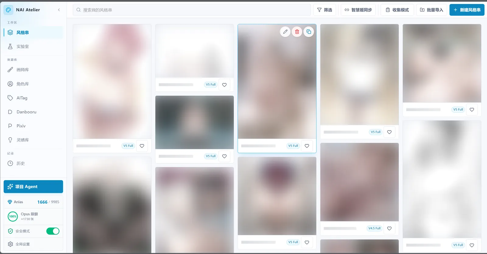
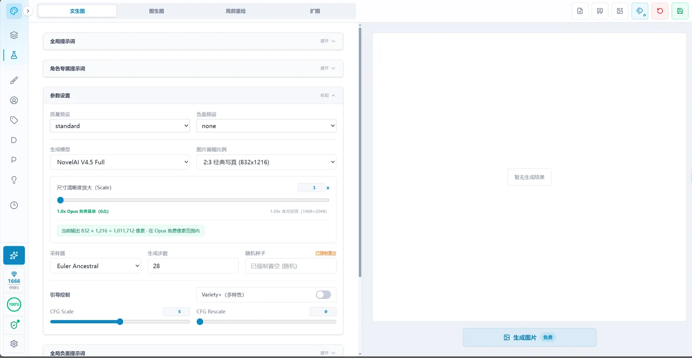
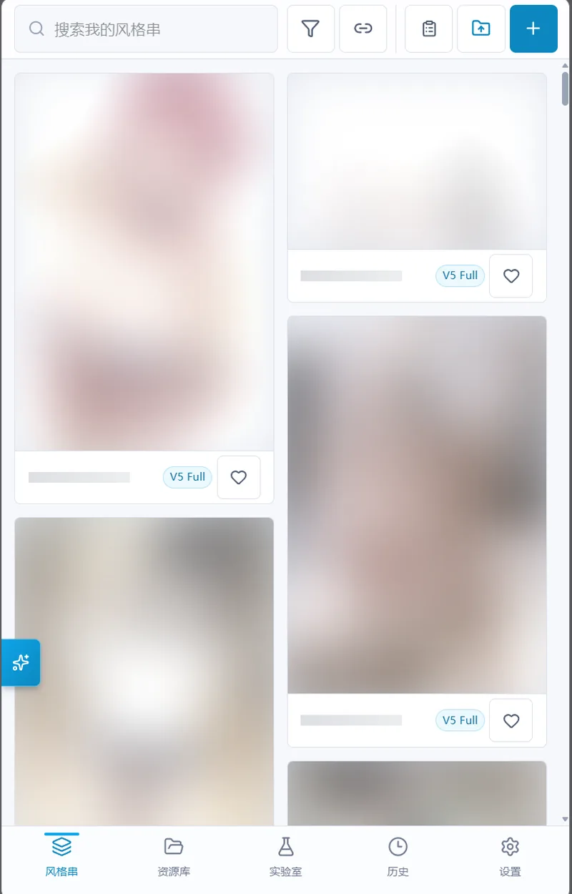

<div align="center">
  

  # NAI Atelier

  **面向 NovelAI 的個人本地創作工坊**

  **[简体中文](./README.md) · [繁體中文](./README.zh-TW.md) · [English](./README.en.md) · [日本語](./README.ja.md) · [한국어](./README.ko.md)**

  [原始碼版本](./package.json) · [下載安裝包](https://github.com/HelloQun54321/nai-atelier/releases) · [更新紀錄](./CHANGELOG.md) · [MIT 授權](./LICENSE)
</div>

---

## 專案介紹

NAI Atelier 是執行於個人電腦或 Android 手機上的 NovelAI 本地創作工坊，將「尋找參考靈感 → 組合提示詞 → 生成與即時預覽 → 局部精修擴圖 → 沉澱為個人資產」串成順手的一體化流程。

所有風格串、角色、提示詞片段、永久 Vibe 編碼與歷史無損原圖均保存在你自己的裝置上。常規探索預設貼合 **Opus** 訂閱的免費面積與步數範圍；遇到需消耗 **Anlas** 點數的操作時，提前顯示估算並二次確認。本專案基於 [kirafishy/NaiPromptManager](https://github.com/kirafishy/NaiPromptManager) 二次開發並獨立維護。

## 界面預覽

<div align="center">
  
  <p><em>風格串與預設庫（展示截圖已開啟安全防窺模糊）</em></p>
  
  <p><em>四大模式生圖實驗室</em></p>
  
  <p><em>手機區域網路雙欄瀑布流</em></p>
</div>

## 快速上手

| 使用方式 | 環境需求 | 開始方式 |
| --- | --- | --- |
| **Windows 安裝版**（推薦） | Windows 10/11 x64，免裝 Node.js / Git | 前往 [Releases](https://github.com/HelloQun54321/nai-atelier/releases) 下載 `NAI-Atelier-Setup-*.exe` 安裝 |
| **原始碼部署** | Node.js 22+（建議 24.x）、Git | 複製儲存庫並執行下方啟動命令 |
| **獨立 Android APK** | Android 8.0+（ARM64） | 安裝建構好的 APK，詳見 [Android 說明](./docs/ANDROID_STANDALONE.md) |

### Windows 安裝版與更新
1. 執行安裝程式並選擇安裝目錄（若缺少 Microsoft VC++ x64 執行階段，精靈會引導前往官網安裝）。
2. 從桌面捷徑開啟 **NAI Atelier**，於「**全局設定 → NovelAI 與 Anlas**」新增官方 `pst-` Key（或拼車成員閘道／按次渠道 Key），並於「**資料與維護 → Tag 補全詞庫**」點擊「更新詞庫」。
3. 關閉主視窗會收進系統匣以維持區域網路服務；欲完全停止背景服務請在系統匣選單點擊「**退出工坊**」。後續可在「資料與維護 → 應用更新」直接檢查並下載新版覆蓋升級。

### 原始碼部署
```bash
git clone https://github.com/HelloQun54321/nai-atelier.git
cd nai-atelier
npm ci
npm run dev:local
```
終端機顯示就緒後開啟 [http://localhost:3000](http://localhost:3000)。更新時關閉服務視窗並執行根目錄的 `更新 NAI Atelier.bat`（macOS / Linux 執行 `sh scripts/update-local.sh`）。

### 多語言與手機連線
- **五語切換**：「全局設定 → 外觀與畫廊 → 語言」支援簡中、繁中、English、日本語、한국어 即時切換；內建「創作助手」下一輪對話自動跟隨所選語言，並保留英文生圖 Tag 與資產原名。
- **家庭區域網路手機操控**：手機連上與電腦相同的 Wi-Fi，於「資料與維護 → 局域網訪問」複製位址並輸入 4 位 PIN 碼即可全功能操控（生圖直接走電腦網路代理，免配手機代理；長按圖片喚出底部操作面板）。

## 核心功能亮點

- **風格串、分享包與剪貼簿收集**：完整保存畫風正負面詞、風格模組、多角色與採樣參數；支援無限層級資料夾、`.naia` 批次分享包（含看圖挑款預覽與 Vibe／精準參考隨包遷移）、本地畫師與權重「查找相似」，以及 Windows 置頂三模式收集懸浮窗（自動收錄複製的圖片、檔案、連結或提示詞文本）。
- **Roll 串隨機探索**：從完整畫師詞庫或自選本地風格串來源隨機抽卡出圖，支援鎖定必出畫師、全域屏蔽、收藏倍率／保底加權及 12 色權重佔比色帶，與畫師庫共用生成預設。
- **四大生圖實驗室**：整合 **文生圖、圖生圖、局部重繪（預設聚焦重繪）、擴圖（32px 接縫過渡）**，支援整段或分類編輯、一鍵整理提示詞、本地詞庫校對 Tag、多角色構圖定位、永久 Vibe 與精準參考管理，以及支援批次排隊與即時秒表的居中生成列。
- **提示詞庫與雙語 Tag 膠囊**：5 大根類自由目錄樹搭配系統固定 16 類用途 Tag，支援 `@名稱` 快速補全、角色庫自訂角色雙向投影、AI 提取分類與生成搭配；翻譯區支援括號／數值雙模精確調權、點擊間隙插入、雙擊改詞及不拆權重組的刪除／屏蔽模式。
- **畫師庫、角色庫與外部素材**：支援 V4.5 與 V5 七分片畫師樣張圖包（覆蓋 54,880 位畫師，單卡切版本與原地串流補圖）、角色同族服裝變體折疊與連動收藏；聚合 **AITag、所長法典、Pixiv、Danbooru** 與全局 **收藏庫**，並內建本地 CPU **WD Tagger** 圖片反推（零點數消耗；自用 HTTPS 反代可透過頁面或 `/api/lan/tagger-remote-access` 配置允許來源）。
- **內建創作助手**：支援接入 DeepSeek、OpenAI、Anthropic、Gemini 等 30+ 模型服務，直接讀寫工坊六大目錄樹、修改提示詞（附多版本舊稿保護、紅綠差異撤回與自動靜默補齊中文譯文）、控制隊列與自動執行連續 Roll，提供三檔權限與可編輯破限模式。
- **多密鑰保管箱與 Key 池輪詢**：支援官方直連、拼車成員閘道（支援串流預覽、個人配額圓環與回滿時間）與按次渠道；多把密鑰可開啟 **Key 池自動輪詢**（滿圈率優先、發車零阻塞、出圖後背景靜默刷新，耗盡或需扣點數時立即停下提示）。

## 本地資料與備份

| 執行方式 | 資料目錄 | 備份方式 |
| --- | --- | --- |
| **Windows 安裝版** | `%LOCALAPPDATA%\NAI Atelier\workspace\local-data` | 設定頁「重要資料備份」一鍵備份，或完全退出工坊後複製 `local-data` |
| **原始碼部署** | `<專案根目錄>/local-data/` | 設定頁一鍵備份，或停止服務後複製 `local-data/` |
| **獨立 Android** | 手機應用私有目錄（與電腦獨立） | **解除安裝會清除私有資料**，請先於「資料與維護」設密碼匯出 `.naiatelier` 加密備份 |

> ⚠️ 請勿修改 `wrangler.toml` 中的 `database_id`、`database_name` 與 `bucket_name` 定位鍵，否則程式會載入全新空資料庫。

## 生態互通與致謝

- 內建 SillyTavern 連接器與 [st-chatu8](https://github.com/damoshen123/st-chatu8) 雙向同步風格串、Vibe 與生圖歷史，並支援 `st-chatu` 拼車公共佇列（詳見 [橋接指南](./docs/SILLYTAVERN_BRIDGE.md)）。
- 感謝 [kirafishy/NaiPromptManager](https://github.com/kirafishy/NaiPromptManager)、[@ffdkj](https://github.com/ffdkj) 中英詞庫、[@damoshen123/st-chatu8](https://github.com/damoshen123/st-chatu8)、[@baibai-git/ST-BaiBai-Image](https://github.com/baibai-git/ST-BaiBai-Image)、[@sdnwls/nai-style-lab](https://github.com/sdnwls/nai-style-lab)、[@yexi-by/dsh-unrestricted](https://github.com/yexi-by/dsh-unrestricted)、[@clanso](https://github.com/clanso) 與 [SmilingWolf WD Tagger](https://huggingface.co/SmilingWolf/wd-vit-tagger-v3)。完整說明與技術文檔見 [簡體中文 README](./README.md)。
